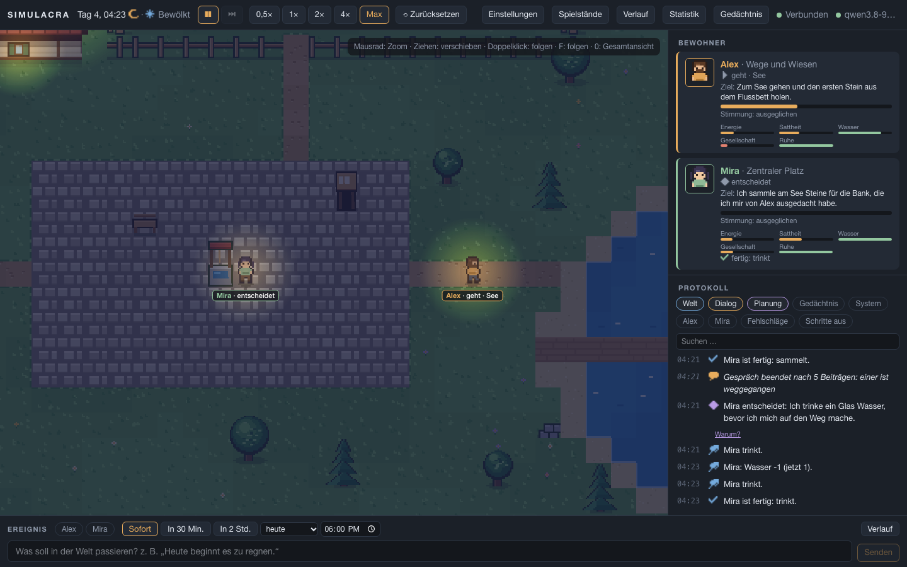

# SIMULACRA

Zwei autonome KI-Agenten, Alex und Mira, leben in einer kleinen, begehbaren Pixelwelt: Haus mit Zimmern, Garten, Wald, See und Dorfplatz, mit Tag und Nacht, Wetter, Ressourcen und Gegenständen. Jeder hat eine eigene Persönlichkeit, ein eigenes Gedächtnis, Bedürfnisse und Ziele. Sie entscheiden selbst, was sie tun, reden miteinander, schließen Abmachungen und bauen Beziehungen auf. Gedacht wird mit einem lokalen Sprachmodell (Qwen 9B über einen llama.cpp-Router), ohne Cloud.

Im Browser siehst du live zu, verstehst jede Entscheidung („Warum?“), blätterst im Gedächtnis jedes Agenten, drehst an Reglern für Persönlichkeit, Autonomie und Welt, und lässt mit freien Sätzen Dinge geschehen („Heute beginnt es zu regnen.“, „Mira erfährt, dass Alex gestern allein am See war.“). Alles ist persistent: Neustart, Spielstände, Export.

Inspiriert von „Generative Agents: Interactive Simulacra of Human Behavior“ (Stanford).



## Schnellstart (Mac oder Linux)

Voraussetzungen: Python 3.14 (ab 3.12), [uv](https://docs.astral.sh/uv/), Node.js 24, ein erreichbarer OpenAI-kompatibler Endpunkt mit Qwen 9B. Ausführlich: [docs/installation.md](docs/installation.md).

```bash
cd backend && uv venv .venv --python 3.14 && uv pip install --python .venv/bin/python -r requirements.lock && uv pip install --python .venv/bin/python -e . --group dev && cd ..
cd frontend && npm ci && cd ..
cp .env.example backend/.env      # Endpunkt, Schlüsseldatei und Modell eintragen
scripts/dev.sh                    # http://127.0.0.1:5173 öffnen; beenden mit scripts/stop.sh
```

## Schnellstart auf dem Server (maintux, SecondTux)

Ein Container liefert API, WebSocket und Oberfläche auf Port 8090; der Router bleibt auf dem Host. Ausrollen vom Mac (nur nach Freigabe):

```bash
scripts/deploy_maintux.sh --dry-run    # zeigt die Schritte
scripts/deploy_maintux.sh              # Tests, Rückfrage, Backup, Bauen, Starten, Prüfen, bei Fehler zurück
```

Danach `http://maintux:8090`. Anderer Rechner, Backup, Wiederherstellung, Fehlersuche: [docs/betrieb.md](docs/betrieb.md).

## Tests

```bash
cd backend && .venv/bin/python -m pytest -q              # ca. 950 Tests, ohne Modell und ohne Netz
cd frontend && npm run typecheck && npm test && npx playwright test
```

Die Abnahme nach Auftrag §17 steht in `backend/tests/acceptance/` und `frontend/e2e/acceptance/` (je Kriterium ein Test), das Ergebnis in [docs/status/ABSCHLUSS.md](docs/status/ABSCHLUSS.md).

## Dokumentation

| Thema | Datei |
|---|---|
| Installation | [docs/installation.md](docs/installation.md) |
| Betrieb im Container, Backup | [docs/betrieb.md](docs/betrieb.md) |
| Sprachmodell anbinden, Messwerte | [docs/llm-anbindung.md](docs/llm-anbindung.md) |
| Konfiguration (`SIM_*`) und Parameter | [docs/konfiguration.md](docs/konfiguration.md), [docs/parameter.md](docs/parameter.md) |
| Architektur | [docs/architektur.md](docs/architektur.md) |
| REST, WebSocket, Ereignisse | [docs/schnittstellen.md](docs/schnittstellen.md) |
| Erweitern (Aktion, Objekt, Parameter, Ereignis, Agent) | [docs/erweitern.md](docs/erweitern.md), [docs/welt-erweitern.md](docs/welt-erweitern.md) |
| Agenten, Gedächtnis, Autonomie, freie Ereignisse | [docs/agenten.md](docs/agenten.md), [docs/gedaechtnis.md](docs/gedaechtnis.md), [docs/autonomie.md](docs/autonomie.md), [docs/ereignisse.md](docs/ereignisse.md) |
| Oberfläche | [docs/frontend.md](docs/frontend.md) |
| Spielstände | [docs/spielstaende.md](docs/spielstaende.md) |
| Bekannte Grenzen und Ideen | [docs/grenzen.md](docs/grenzen.md) |
| Auftrag, Arbeitspakete, offene Fragen, Statusberichte | [docs/AUFTRAG.md](docs/AUFTRAG.md), [docs/ARBEITSPAKETE.md](docs/ARBEITSPAKETE.md), [docs/offene-fragen.md](docs/offene-fragen.md), [docs/status/](docs/status/) |
