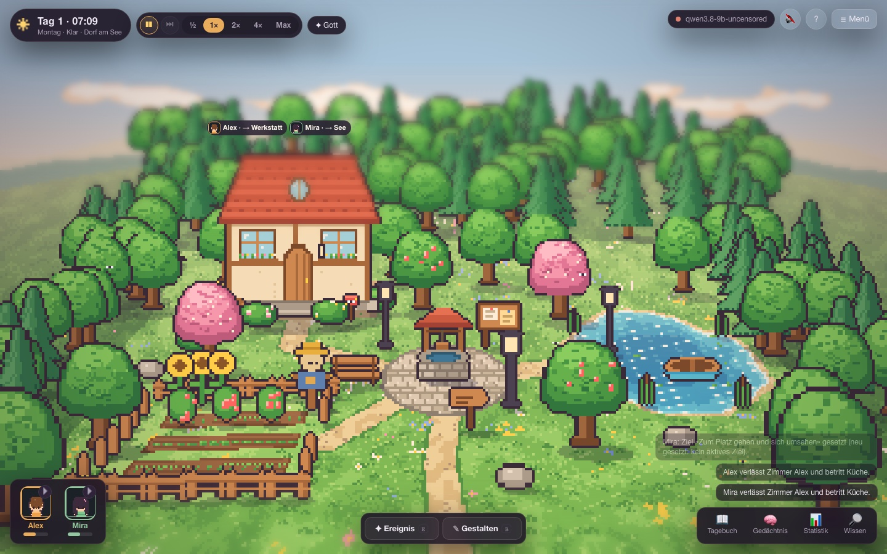
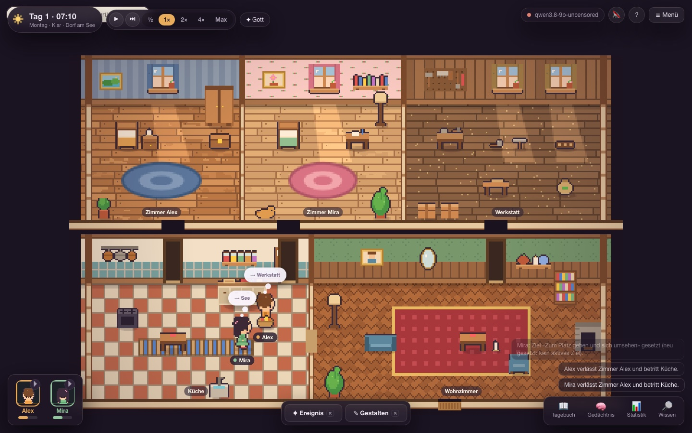
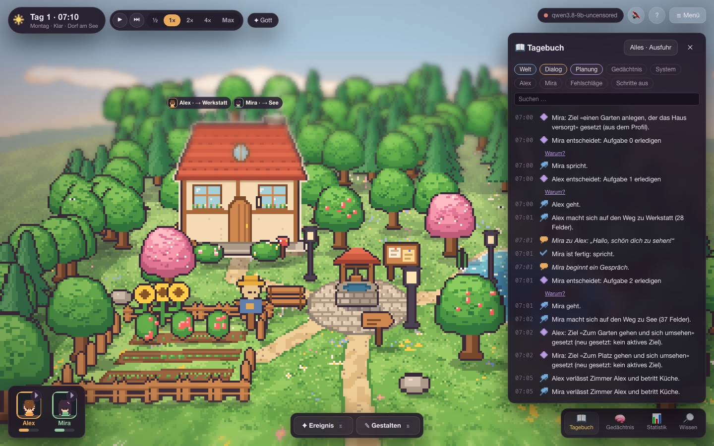

# On Their Own

A small pixel village where AI characters live their own lives. They have personalities, memories, needs and goals; they decide for themselves what to do, talk to each other, make plans and build relationships. You watch, ask them "why?" and shape their world. Everything runs locally on your own machine, with no cloud.

*Deutsch [weiter unten](#deutsch).*



| | |
|---|---|
|  |  |

## Install

```bash
curl -fsSL https://raw.githubusercontent.com/SloppyHenry/on-their-own/main/get.sh | bash
```

That's it. The script fetches the project to `~/on-their-own`, detects your machine (macOS or Linux, Apple Silicon, NVIDIA/CUDA, Vulkan or CPU only, memory and disk) and installs what fits: uv and Node.js if missing, llama.cpp, a language model sized to your hardware, and a background service. No `sudo`, every download is checksummed. Then open **http://127.0.0.1:8090**.

Options are passed through, e.g. `… | bash -s -- --headless` for a server without a screen, `--no-llm` to use an existing OpenAI-compatible endpoint, `--dry-run` to only see the plan. From a checkout: `./install.sh --help`.

## What's inside

- **Autonomous residents** (Alex, Mira and more): memory with reflection, daily plans, conversations, agreements, relationships
- **A living world**: day and night, weather, house with rooms, garden, lake, things to use, events that just happen
- **Ways to play**: watch, play god (events in plain words: *"It starts to rain."*), or build and furnish the village; living in it with your own character is on the way
- **Your own simulations**: pick or write residents, generate villages, set the rules, save and load
- **Local model** via llama.cpp, picked from a curated list to fit your hardware, swappable in the settings

Inspired by *Generative Agents: Interactive Simulacra of Human Behavior* (Stanford).

---

## Deutsch

Ein kleines Pixeldorf, in dem KI-Figuren ihr eigenes Leben führen: mit Persönlichkeit, Gedächtnis, Bedürfnissen und Zielen. Sie entscheiden selbst, reden miteinander, schmieden Pläne und knüpfen Beziehungen. Du schaust zu, fragst „Warum?“ und gestaltest ihre Welt. Alles läuft lokal, ohne Cloud.

**Installation** (macOS und Linux, erkennt den Rechner und installiert alles Passende):

```bash
curl -fsSL https://raw.githubusercontent.com/SloppyHenry/on-their-own/main/get.sh | bash
```

Danach **http://127.0.0.1:8090** öffnen. Ohne Dienst startet `scripts/start.sh` alles im Vordergrund; `./install.sh --help` zeigt alle Schalter.

**Entwickeln:** `scripts/dev.sh` startet Backend und Oberfläche mit Neuladen. Tests: `cd backend && .venv/bin/python -m pytest -q` sowie `cd frontend && npm run typecheck && npm test && npx playwright test`.
