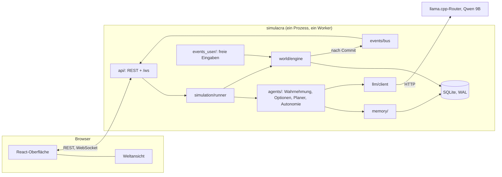

# Architektur

SIMULACRA ist ein Prozess (FastAPI + asyncio) mit einer SQLite-Datenbank und einer Browser-Oberfläche (React, Weltansicht als eigener Canvas2D-Renderer). Das Sprachmodell läuft getrennt davon hinter einer OpenAI-kompatiblen Schnittstelle (llama.cpp-Router). Diese Seite zeigt das Zusammenspiel; Einzelheiten stehen in den verlinkten Dokumenten.



## Grundsätze

1. **Eine Instanz ändert die Welt:** `world/engine.py`. Alles, was die Welt verändert (Agenten, freie Eingaben, Weltregeln), geht über `WorldEngine.propose` bzw. die Engine-Methoden. Jede Änderung und ihr Ereignis werden in **derselben Transaktion** gespeichert.
2. **Das Modell schlägt vor, die Engine entscheidet.** Das Sprachmodell liefert nur Text (JSON nach Schema). Die Engine prüft jede Handlung gegen den Weltzustand; ungültiges wird abgelehnt und protokolliert, nie ausgeführt. Modelltext wird nie als Code ausgeführt (`llm/providers.py`).
3. **Ereignisse sind die Wahrheit für die Oberfläche.** Der Browser zeigt, was gemeldet wurde, nicht das Ergebnis eines Knopfdrucks. Ereignisnummern (`seq`) sind lückenlos; nach einer Unterbrechung holt der Client genau die verpassten Ereignisse nach oder bekommt einen Snapshot.
4. **Getrennte Gedächtnisse und begrenzte Wahrnehmung.** Jede Methode im Gedächtnis verlangt `agent_id` und filtert danach. Ein Agent erfährt nur, was er an seinem Ort sieht, selbst erlebt oder mitgeteilt bekommt (`agents/perception.py`, `agents/observations.py`, Sichtbarkeit je Ereignis).
5. **Eine Registry je Erweiterungspunkt:** Aktionen (`world/actions/__init__.py`), Objektarten (`world/object_kinds.py`), Ereignistypen (`events/types.py`), Parameter (`params/registry.py`). Oberfläche, Prüfung, Typen und Dokumentation bauen darauf auf ([erweitern.md](erweitern.md)).
6. **Die Welt-Engine ist ohne Modell testbar.** Agenten lassen sich mit dem `FakeProvider` (deterministische Antworten) betreiben; alle Tests laufen ohne Netz.

## Module (Backend, `backend/simulacra/`)

| Paket | Aufgabe | Mehr |
|---|---|---|
| `world/` | Weltzustand (Raster, Orte, Objekte, Ressourcen, Uhr, Wetter), Aktionen, Wegsuche, Weltregeln, Erweiterungen und Patches | [welt-erweitern.md](welt-erweitern.md) |
| `agents/` | Wahrnehmung, Optionsgenerator und Bewertung, Prompt, Planer, Gespräche, Bedürfnisse, Stimmung, Beziehungen, Ziele, Schutzmechanismen, Erklärung | [agenten.md](agenten.md), [autonomie.md](autonomie.md) |
| `memory/` | Schreiben, Abrufen (Stichwörter, Aktualität, Wichtigkeit), Reflexion, Tageszusammenfassung, Archivierung | [gedaechtnis.md](gedaechtnis.md) |
| `events/` | Ereignisschema, Registry der Typen, Event-Bus (verteilt erst nach dem Commit), Lesezugriff mit Ursachenkette | [schnittstellen.md](schnittstellen.md) |
| `events_user/` | freie Eingaben: Regelparser → (Modell) → Prüfung → Vorschau → Ausführung in einer Transaktion; Nebenfiguren; geplante Ereignisse | [ereignisse.md](ereignisse.md) |
| `llm/` | OpenAI-kompatibler Anbieter, Fake-Anbieter, Client mit Begrenzung gleichzeitiger Anfragen, gezielten Wiederholungen und Messwerten | [llm-anbindung.md](llm-anbindung.md) |
| `params/` | Registry aller Parameter, Übernahme im Betrieb, Presets | [parameter.md](parameter.md), [konfiguration.md](konfiguration.md) |
| `saves/` | Spielstände, Autosave, Export/Import, Backup/Restore des Datenverzeichnisses | [spielstaende.md](spielstaende.md), [betrieb.md](betrieb.md) |
| `simulation/` | Verdrahtung (`builder.py`), Schleife (`runner.py`), Entscheidungsgrenzen (`limits.py`) | unten |
| `stats/` | Statistik als reine SQL-Abfragen, stündliche Verlaufswerte | [spielstaende.md](spielstaende.md) |
| `api/` | REST, WebSocket, Antwortmodelle (Quelle der TypeScript-Typen), Zugangsschutz, Idempotenz, Auslieferung des gebauten Frontends | [schnittstellen.md](schnittstellen.md) |
| `db/` | SQLite mit WAL, nummerierte Migrationen, ein Schreibzugriff zur Zeit (eigener DB-Thread) | |

Die Aufteilung weicht von den Dateinamen in Auftrag §16 ab (`simulation_engine.py`, `agent_planner.py` …): Pakete statt Einzeldateien, damit keine Datei über 400 Zeilen wächst. Die Zuordnung: `simulation_engine` → `simulation/runner.py`, `world_state` → `world/state.py`, `world_actions` → `world/actions/`, `agent` → `agents/model.py`, `agent_memory` → `memory/`, `agent_planner` → `agents/planner.py` + `agents/options.py`, `event_controller` → `events_user/service.py`, `event_bus` → `events/bus.py`, `llm_client` → `llm/client.py`, `database` → `db/connection.py`, `api` → `api/`, `config` → `config.py`.

## Entscheidungszyklus

Ein **Tick** ist eine Simulationsminute. Die Schleife (`simulation/runner.py`) macht je Schritt:

```mermaid
sequenceDiagram
  participant R as Runner
  participant P as Planer
  participant M as Modell
  participant E as Engine
  R->>R: fällige Agenten (frei, nicht im Ruhemodus, Mindestabstand erreicht), Reihenfolge wechselt
  loop je fälligem Agenten
    R->>R: Grenze Entscheidungen/min abwarten
    R->>P: prepare: Wahrnehmung, Erinnerungen abrufen, Optionen erzeugen und bewerten (beste 6)
    P->>M: Prompt (stabiler Teil vorn) + JSON-Schema (option_id als enum)
    M-->>P: {option_id, intent, utterance, importance, …}
    P->>P: prüfen; bei Fehlern bis zu 2 Korrekturen, sonst Rückfall „warten“
    P->>E: propose(Aktion) → angenommen oder abgelehnt (mit Grund)
  end
  R->>E: tick: laufende Aktionen fortsetzen, Bedürfnisse, Wetter, Uhr
  R->>R: Beobachtungen → Gedächtnis; Tageswechsel: Pflege; Reflexion, wenn fällig; Ziele und Schutz
```

- **Die Zeit wartet auf Entscheidungen** (Standard): Ein Schritt endet erst, wenn alle fälligen Entscheidungen getroffen sind. Abschaltbar (`sim.time_waits_for_decisions`), dann läuft die Uhr weiter und Entscheidungen kommen, sobald das Modell fertig ist.
- **Pause** lässt eine laufende Modellanfrage zu Ende laufen und hält danach an; nie mitten in einer Entscheidung.
- **Handlungen dauern**: `move_to` legt einen Weg mit Fahrplan an (`agent.walking`), Bauen hat Fortschritt, Gespräche haben Züge. Solange eine Handlung läuft, ist der Agent nicht fällig.
- **Optionen statt freier Text**: Das Modell wählt meist aus vorbewerteten Optionen (Bewertung aus Persönlichkeit, Bedürfnissen, Zielen, Tageszeit, Wiederholung; Faktoren im Entscheidungsprotokoll). Eine freie Handlung (`option_id: "other"`) ist möglich und wird genauso geprüft. Folge für die Beobachtung: siehe [grenzen.md](grenzen.md).

## Ereignismodell

- Jede Zustandsänderung erzeugt ein Ereignis mit `seq` (lückenlos), `type`, beteiligten Agenten, Ort, Daten, Sichtbarkeit und Ursache (`caused_by`). Kette: `agent.decision` → `agent.action_started` → Folgeereignisse → `agent.action_completed`.
- Gespeichert wird in derselben Transaktion wie die Änderung; der Bus verteilt **nach dem Commit** an WebSocket-Verbindungen und interne Abonnenten (Beobachtungen, Statistik).
- Je Verbindung ist der Rückstand begrenzt (`SIM_WS_MAX_BACKLOG`); läuft er über, verlangt der Server einen Resync statt unbegrenzt zu puffern.
- Bewegungen werden als ein Fahrplan je Weg gemeldet (Pfad und Ankunftsminute je Kachel), nicht als ein Ereignis je Schritt; der Browser leitet die Position aus Fahrplan und Uhr ab. So wächst die Ereignismenge mit der Zahl der Wege, nicht der Schritte.
- Alle Typen mit Datenmodell: `events/types.py`, als Tabelle in [schnittstellen.md](schnittstellen.md).

## Frontend (`frontend/src/`)

```
Backend ──/ws──▶ net/wsClient ──▶ store/simStore (Snapshot + Reducer) ──▶ React-Komponenten
                                         └──▶ world/worldBridge ──▶ WorldView (liest nur)
```

`net/` Verbindung und REST (jeder verändernde Aufruf mit Idempotency-Key) · `store/` Zustand aus Snapshot und Ereignissen (reine Reducer) · `world/` Weltansicht (Projektion, Renderer, Mitspieler-Vorschau), Zeichnung aus Code im Stil von Mockup A, DOM-Overlays für Namen und Sprechblasen · `timeline/` Protokoll und Ereignisdetail · `panels/` Agenten- und Ortsdetail · `memory/` Gedächtnis-Inspektor · `settings/` Parameter und Presets · `composer/` freie Eingabe · `saves/`, `history/`, `stats/`. Die TypeScript-Typen (`types/generated.ts`) werden aus den Pydantic-Modellen erzeugt (`scripts/gen_types.sh`). Einzelheiten: [frontend.md](frontend.md).

## Daten

Eine SQLite-Datei je Simulation (`data/live.db`, im Container `/data/live.db`) mit Welt, Agenten, Erinnerungen, Ereignissen, Entscheidungen, Parametern. Spielstände sind konsistente Kopien dieser Datei (`saves/`). Migrationen sind nummeriert (`db/migrations/`) und laufen beim Start. Ein Prozess schreibt allein; deshalb läuft uvicorn mit genau einem Worker.

## Betrieb

Ein Container liefert API, WebSocket und Oberfläche auf Port 8090; der Router bleibt auf dem Host. Siehe [betrieb.md](betrieb.md).
