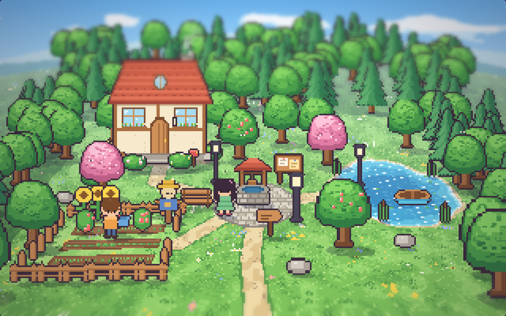
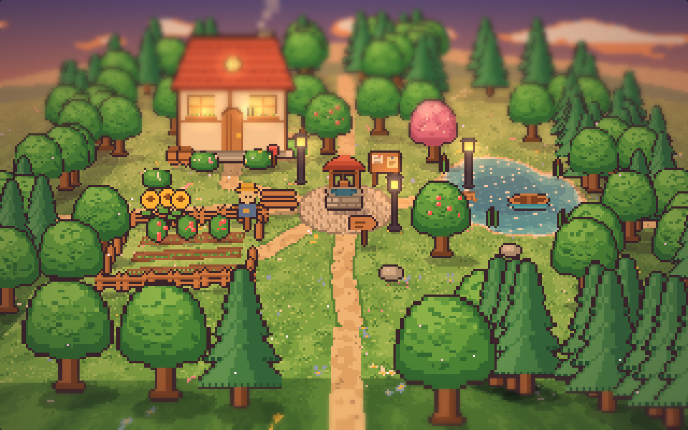
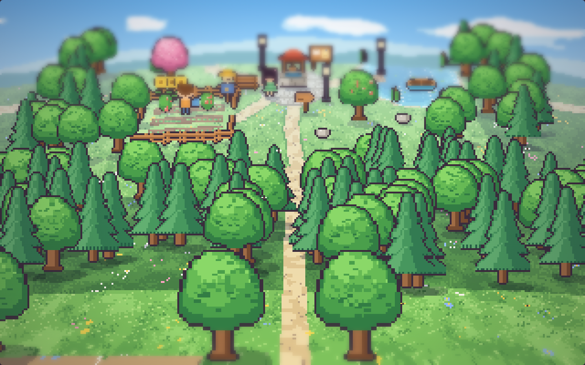
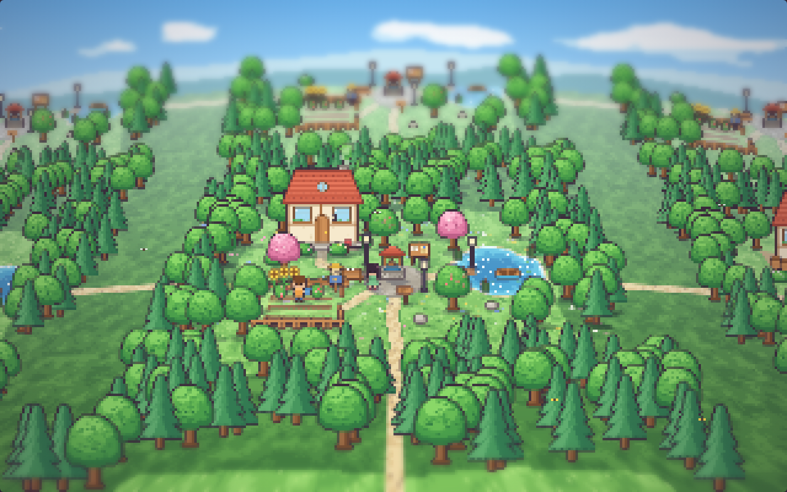
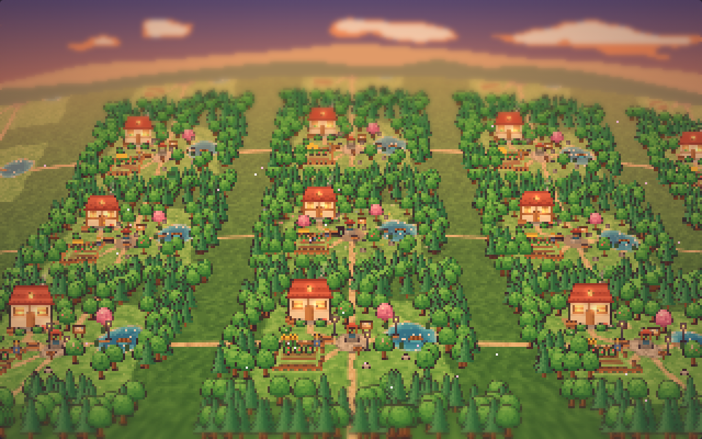
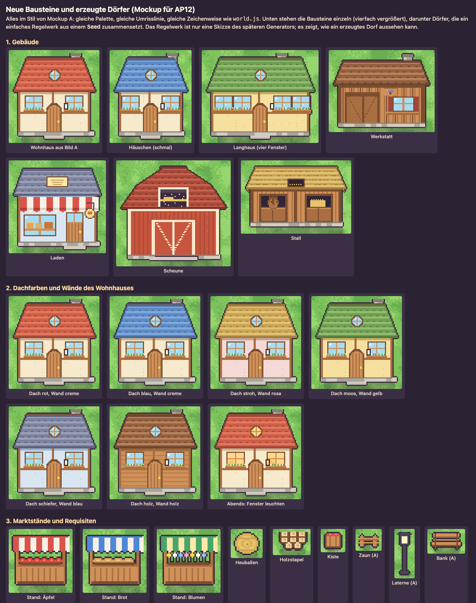
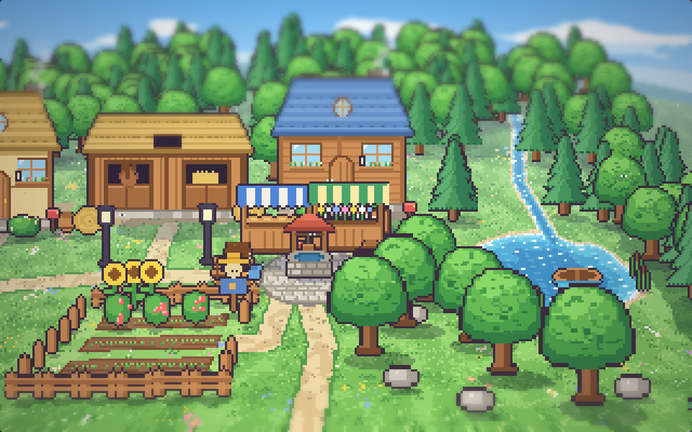
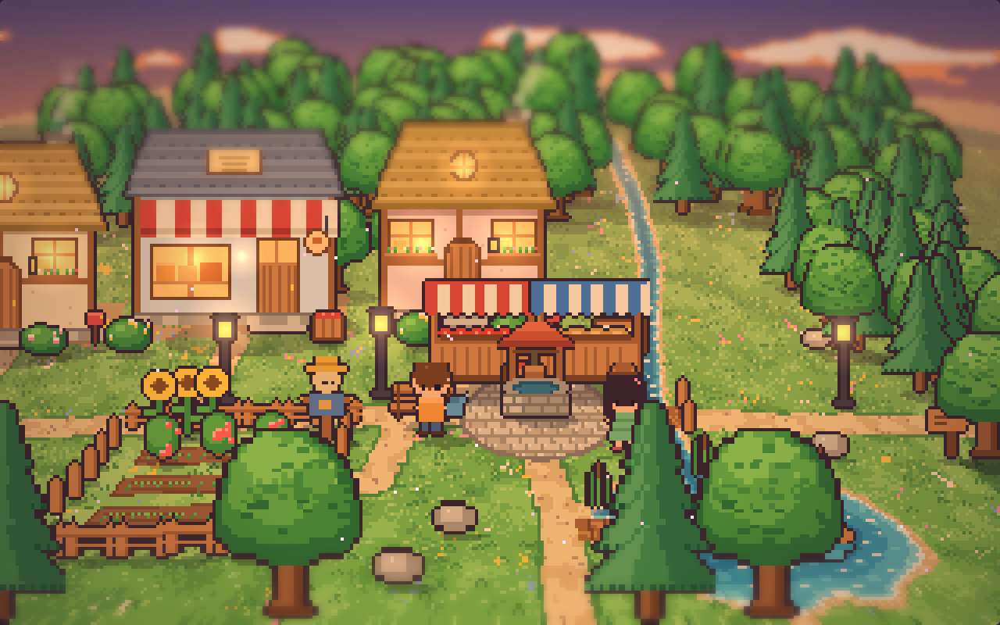
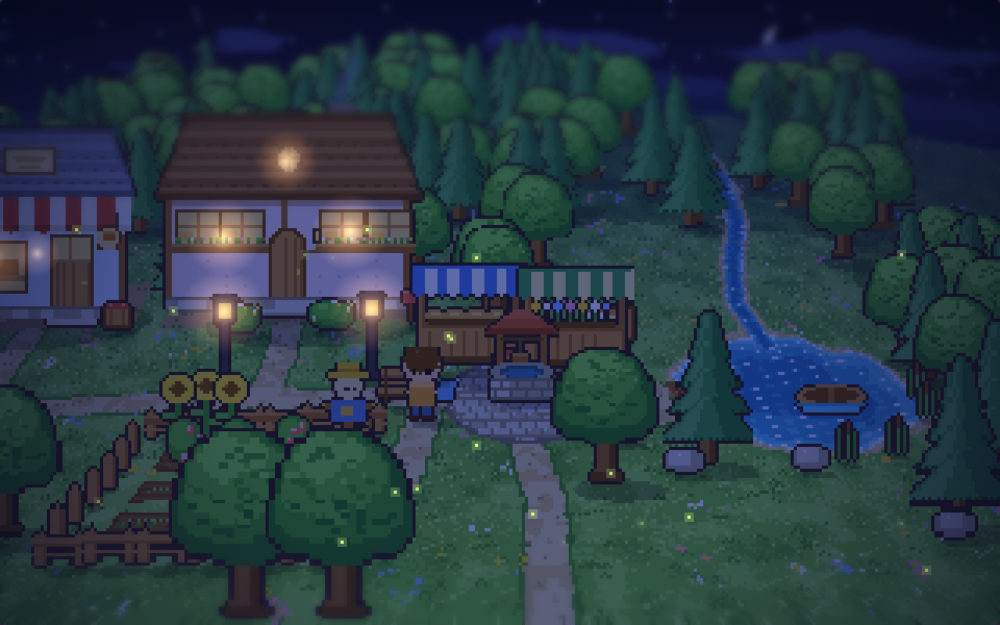
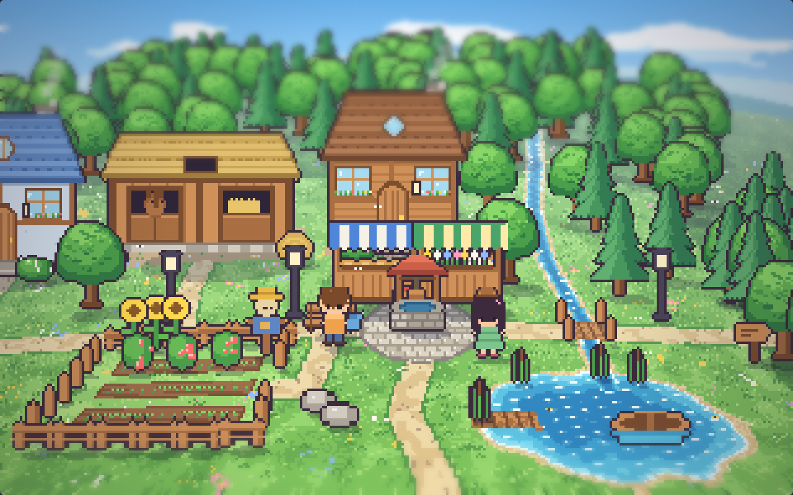

# AP12 Schritt 0 – Prototypen: Kamerafahrt und neue Bausteine

Plan: [AP12-plan.md](../arbeitspakete/AP12-plan.md). Zwei Mockups, noch kein Code im Spiel. Öffnen mit dem Mockup-Server (`mockup-ruhig` in der Vorschau, Port 8766, oder `python3 -m http.server -d docs/mockups/welt-optik`): `scrollen.html` und `bausteine.html`.

## 1. Kamera fährt durch die Welt (`scrollen.html`)
Neun Dörfer aus Bild A (3 × 3), durch Landstraßen verbunden. Die Startlage der Kamera ist Bild A: Das Dorf in der Mitte ist dort Pixel für Pixel A (gleiche Textur, gleiche Schatten, gleiche Effekte); Zufall im Boden (Gräser, Blumen) ist außerhalb von A je Block gewürfelt.

| Start = Bild A | Nachbardorf am Abend | Landstraße nach Süden |
|---|---|---|
|  |  |  |

**Bewegungsarten (Frage 24):** (a) frei und scharf, (b) Kachelschritte mit Gleiten, (c) weich beim Fahren und scharf im Stillstand. Ich habe die Bewegung nicht im Laufen beurteilen können, nur Standbilder im Stillstand und mitten in der Fahrt (c): Dort ist der Boden sichtbar weich, kein Krisseln im Standbild. Ob (a) beim Fahren krisselt und (c) angenehm fließt, musst du beim Fahren selbst sehen.

**Gemessen** (Browser im Mockup-Server, Anzeige im Mockup): Bildzeit etwa 4–6 ms im Mittel, auch während der Auto-Fahrt. Der Boden entsteht in Blöcken zu 64 × 64 Texel bei Bedarf (rund 85 Blöcke nach einer kurzen Fahrt). Ob einzelne Blöcke beim Fahren einen Ruckler verursachen, habe ich nicht gemessen.

**Was bleibt in jeder Art:** Sprites ändern ihre Größe mit der Tiefe (wie in A). Beim Fahren nach vorn oder hinten springen sie dadurch in Pixelstufen. Straßen enden am Rand des Originalblocks von A (dort setzt später der Generator die Anschlüsse).

**Nach dem ersten Test (14.10.2026):** „Alles wobbelt, und beim Fahren nach vorn und hinten ist der Globus-Effekt wieder da.“ Zwei Ursachen:
- **Mein Mockup:** Es zeichnete nur 25 Bilder je Sekunde (Takt von A für Wasser und Wolken) und rundete jedes Sprite einzeln auf ganze Pixel, Boden und Figuren verschoben sich dadurch gegeneinander. Jetzt: jedes Bild neu (60 fps gemessen, Bildzeit etwa 13 ms) und beim Fahren Bruchteile von Pixeln für Sprites und Boden, im Stillstand wieder ganze Pixel.
- **Das Bild A selbst:** Der Globus-Eindruck ist kein Stilmittel, sondern folgt aus der Projektion von A: Der Horizont ist gewölbt, Boden und Bäume an den Seiten laufen beim Fahren auf Bögen, und alles wächst auf dem Weg nach vorn. Das lässt sich im Stillstand nicht sehen, in der Fahrt schon. Neu Variante **(d)**: Die Wölbung verschwindet beim Fahren und kommt im Stillstand sanft zurück. Die Vergrößerung mit der Tiefe bleibt in jeder Variante.

**Entscheidung (14.10.2026):** Variante (d) („d ist super“). **Zoom:** 1× bleibt Standard, dazu soll man weiter herauszoomen können. Im Mockup: ¼×, ½×, 1×, 2×, 4× mit Mausrad, + / − und 0 (zurück auf 1×); die Bildmitte bleibt am Ort. Herausgezoomt zeigt das Bild mehr Welt, der Boden wird in gröberen Stufen gelesen (ein Block deckt 64 × 2 oder 64 × 4 Texel ab, jeder 2. oder 4. Texel, gemischt), Sprites werden kleiner. Bildzeit dabei etwa 16–17 ms (Browser im Mockup). Gröbere Stufen haben keine Gräser und Schatten; für die echte Umsetzung ist eine eigene Übersichtsebene der Welt geplant.

| ½× | ¼× (Abend) |
|---|---|
|  |  |

## 2. Neue Bausteine und erzeugte Dörfer (`bausteine.html`)
Wohnhaus in Breiten 58, 66, 90 (zwei bis vier Fenster), sechs Dachfarben (rot, blau, stroh, moos, schiefer, holz), fünf Wandfarben, Werkstatt, Laden, Scheune, Stall mit Pferd, drei Marktstände, Heuballen, Holzstapel, Kiste, Bach mit Brücke.

Vier Dörfer aus Seeds. Das Regelwerk (`dorf.js`) ist nur eine Skizze des Generators: Platz mit Brunnen, Ständen und Laternen, Hauptstraße, Häuserzeile mit zwei Sondergebäuden, Garten wie in A, See im Osten oder im Süden mit Steg, Boot und Schilf, Bach (im Süden mit Brücke).

| Seed 7, Mittag (See im Osten) | Seed 12, Abend (See im Süden, Brücke) |
|---|---|
|  |  |
| **Seed 31, Nacht** | **Seed 58, Mittag** |
|  |  |

## Was daraus für den Bau folgt
- `scrollen.js` zeigt, dass die verallgemeinerte Bodenregel (Listen von Wegen, Seen, Plätzen, Gärten, Bächen) und der Boden in Blöcken tragen; `dorf.js` ist die Vorlage für `look` Version 2.
- Die Häuser sind parametrisch (Breite, Dach- und Wandfarbe) und passen zur Vorgabe „Zeichenbausteine mit Parametern“; neue Arten sind neue Funktionen in `art/`.
- Nicht geprüft: Verhalten auf einem Gerät mit anderer Pixeldichte, Leistung im echten Spiel (kommt in AP12a), die Bewegung selbst (siehe oben).

## Abnahme (erledigt 14.10.2026)
**Frage 24:** Bewegung (d), 1× Standard, herauszoomen möglich. **Frage 25:** Bausteine freigegeben („neue Bausteine sind super“).

## Ursprünglicher Abnahmetext
1. `scrollen.html` öffnen, die drei Bewegungsarten mit WASD und „Auto-Fahrt“ vergleichen, Frage 24 beantworten.
2. `bausteine.html` ansehen, Frage 25 beantworten (Formen, Farben, fehlende Arten).
