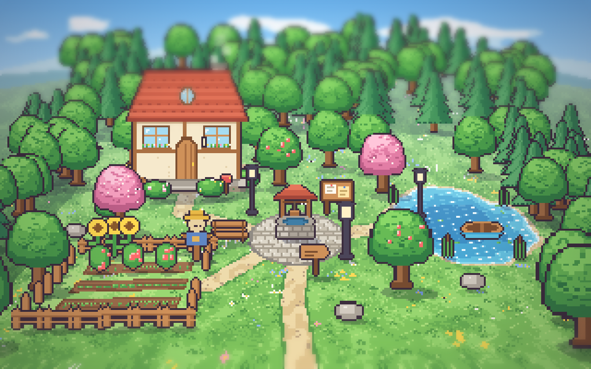
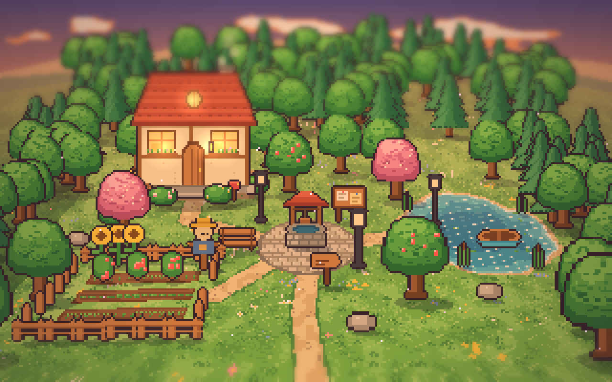
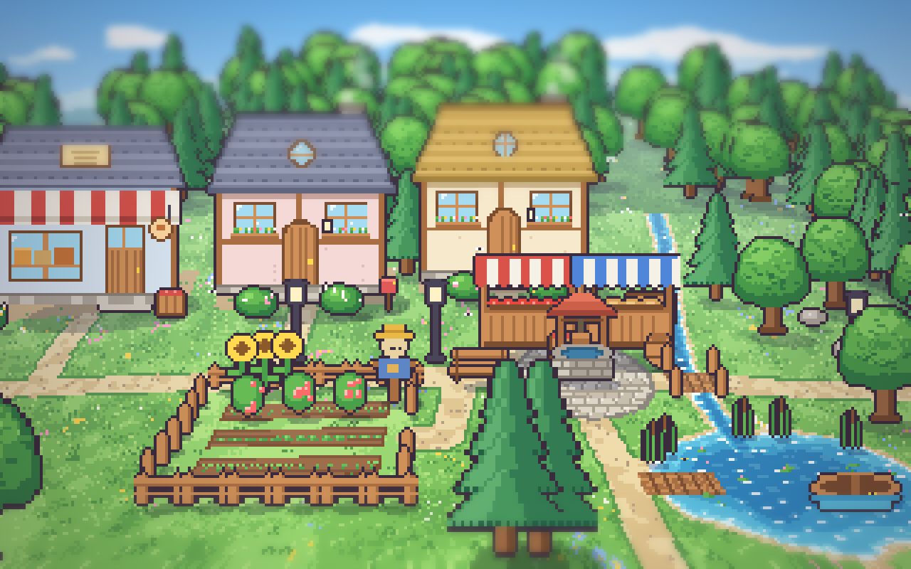
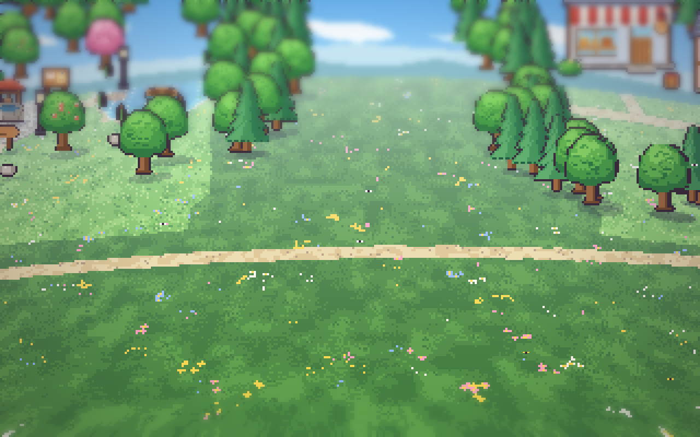
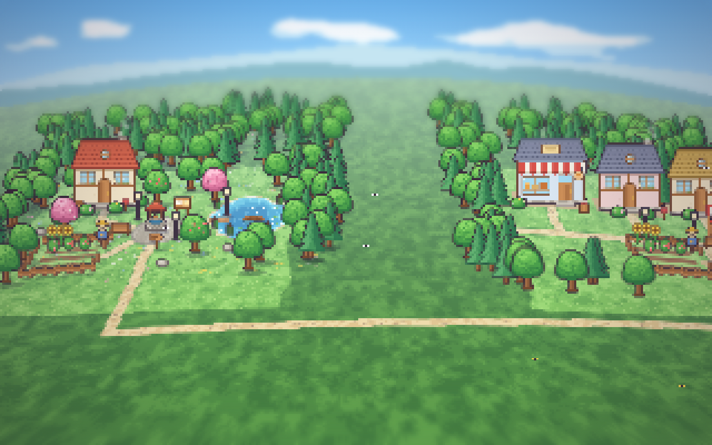
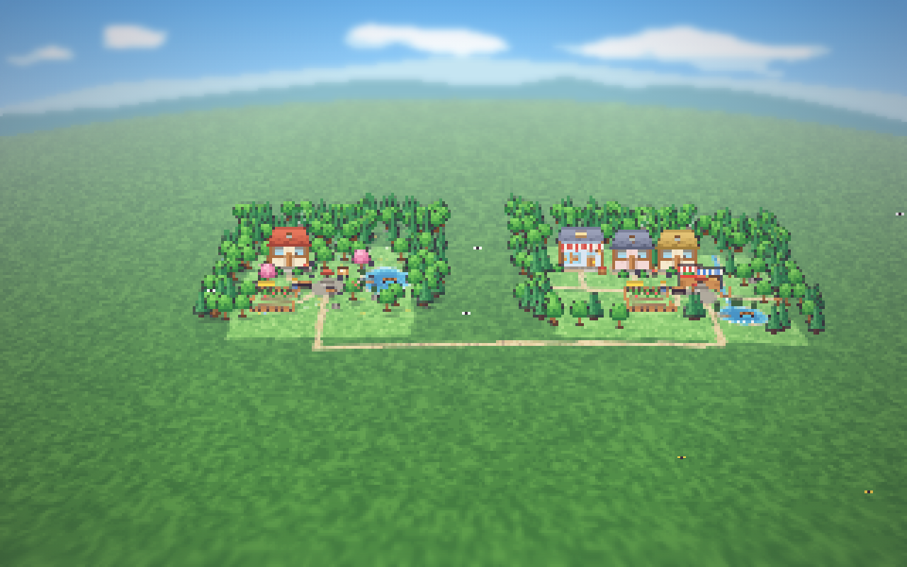

# AP12a – Darstellung: Kamera durch die Welt, `look` Version 2

Plan: [AP12-plan.md](../arbeitspakete/AP12-plan.md) (Teilpaket a). Branch `ap/12-weltgenerator`, nicht ausgerollt. Entscheidungen aus Schritt 0: Bewegung **(d)**, 1× immer Standard und weiter herauszoomen, neue Bausteine freigegeben ([AP12-schritt0.md](AP12-schritt0.md)).

## Bilder
Die Startwelt zeigt in der Startlage **Pixel für Pixel dasselbe Bild** wie das abgenommene Dorf (Goldbild-Test). Daneben ein zweites, aus einem Seed erzeugtes Dorf mit den neuen Bausteinen, durch eine Landstraße verbunden.

| Startwelt, Mittag (1×) | Startwelt, Abend |
|---|---|
|  |  |
| **Zweites Dorf (Seed 12, Look Version 2)** | **Landstraße zwischen den Dörfern** |
|  |  |
| **½×** | **¼× (Übersicht)** |
|  |  |

## Geliefert
- **Goldbild-Test** (`frontend/e2e/golden.spec.ts`, fünf Bilder in `golden.spec.ts-snapshots/`): Startwelt Mittag, Abend, Nacht, 2× und Haus von innen, nur die Pixel der Zeichenfläche, Zeit eingefroren (`window.__freezeT`). Vor und nach dem Umbau des Renderers **0 Pixel Unterschied**. Gegenprobe: mit anderer Zeit schlägt er fehl.
- **`look` Version 2:** Die Welt besteht aus Gebieten (Dörfern) in eigenen Dorfkoordinaten mit Listen von Wegen, Plätzen, Seen, Gärten, Stegen, Bächen, Brücken, Vorplätzen, dazu Deko, Lichter, Bildstellen der Dinge und **beliebig vielen Häusern** mit Tür und Innenbereich; Landstraßen verbinden die Gebiete. Die alte Form lädt über `normalizeLook` weiter (alte Spielstände); ein Test prüft, dass sie genau die heutige Weltdatei ergibt. `scripts/startwelt_a.mjs` schreibt jetzt Version 2, die Weltdatei hat sich sonst nicht verändert.
- **Boden in Blöcken** (`dorf/boden.ts`, `grund.ts`): Regeln wie `wTexel` über Listen und mehrere Gebiete, Blöcke zu 64 × 64 Texel bei Bedarf; der Block von Bild A bleibt der Originalblock, alle anderen würfeln ihren Zufall aus ihren Koordinaten; eine gröbere Stufe fürs Herauszoomen.
- **Kamera** (`dorf/kamera.ts`, `abbild.ts`, `DorfView.ts`): fährt durch die Welt (WASD, Pfeile, Ziehen, Folgen, „hingehen“), **Variante (d)**: beim Fahren Boden weich, Sprites und Boden in Bruchteilen von Pixeln, Horizont gerade; im Stillstand scharf wie A. **Zoom** ¼×, ½×, **1× (Standard)**, 2×, 3× mit Rad (eine Stufe je Raste oder Wisch), `+` `−` (auch deutsche Tastatur) und `0`; die Bildmitte und der Boden unter dem Zeiger bleiben.
- **Mehrere Häuser:** Klick auf jedes Haus, Innenansicht je Haus, Schilder und Rauch je Haus; Dinge und Schatten in Weltpixeln.
- **Neue Bausteine** (`art/bausteine.ts`, 1:1 aus dem abgenommenen Mockup): Wohnhaus in drei Breiten mit sechs Dach- und fünf Wandfarben, Werkstatt, Laden, Scheune, Stall, drei Marktstände, Heu, Holz, Kiste.

## Tests
- Backend (pytest): **993 bestanden**, 3 abgewählt (wie bisher). `test_startwelt.py` liest jetzt Version 2.
- Frontend (Vitest): **119 bestanden**. Neu: `look` (Umwandlung, Gebiete, Häuser, Adapter = Weltdatei), Abbildung mit Kamera und Zoom (hin und zurück, Kamera auf Bildstelle), Boden (Listen, Bach, zweiter See, Landstraße), `Kamera` (Stufen, Grenzen, Fahrt).
- Browser (Playwright): **67 bestanden**, 3 übersprungen (Messung, zwei Bilderläufe). Neu: `golden.spec.ts` (4 Tests), `zwei-doerfer.spec.ts` (zwei Dörfer, Landstraße, ½×, ¼× als Goldbilder), `kamera.spec.ts` (Zoomstufen mit Rad, Wisch, + −, 0; Fahren mit WASD und Ziehen; Haus).
- Typprüfung grün; keine Datei über 400 Zeilen (größte: `DorfView.ts`, 374).

## Leistung (Fenster 1440 × 900, Messläufe in `status/messung/ap12a-leistung-*.json`)
| | mit Grafikkarte (Metal) | Software-Rendering |
|---|---|---|
| Startwelt ruhig, 1× | 60 fps, Rechenzeit 0,1 ms | 60 fps, 0,1 ms |
| 1× Kamera fährt (Boden weich, Horizont gerade) | 60 fps, 9,1 ms | 53 fps, 17,8 ms |
| ½× / ¼× ruhig | 60 fps, 0,2 ms | 60 fps, 0,1 ms |
| ½× / ¼× Kamera fährt | 60 fps, 9 ms | 54 fps, 17 ms |
| Haus innen | 60 fps, 0,6 ms | 60 fps, 0,6 ms |

Im Software-Rendering kostet das weiche Lesen des Bodens beim Fahren etwa 17 ms je Bild; im Stillstand nichts.

## Grenzen und Abweichungen
Siehe [grenzen.md](../grenzen.md) („Kamera durch die Welt“):
- Die Startwelt hat außerhalb ihres Originalblocks keine Gräser und Schatten im Boden (`legacy.plainOutside`), damit Bild A pixelgleich bleibt. Fährt man weit aus dem Dorf, sieht der Waldboden dort etwas glatter aus. In Welten aus dem Generator ist das aus.
- Herausgezoomt fehlen Gräser und Schatten; die Wölbung bleibt im Stillstand wie in A (bei ¼× sieht die Welt wie eine Kugel aus).
- Sprites ändern ihre Größe mit der Tiefe; beim Fahren nach vorn und hinten springen sie dadurch in Stufen.
- Das zweite Dorf in den Bildern kommt aus einer Fixture (aus dem Mockup-Generator); den echten Generator liefert AP12b. Die Häuser dort haben noch keinen Innenbereich (leer).
- Die Karte (Kacheln) kennt das zweite Dorf noch nicht: Es ist nur zu sehen, nicht begehbar. Das setzt AP12b um (Patch-Format mit `links` und `look`, Kacheln aus denselben Formen).

## Abnahme
1. **Im Browser ansehen:** `scripts/dev.sh`, dann http://localhost:5173. Mit WASD und Maus fahren, Rad, `+` `−` und `0` zum Zoomen. Das Startdorf muss aussehen wie vorher.
2. Das zweite Dorf (nur zum Ansehen) liegt nicht in der Startwelt; die Bilder oben zeigen es.
3. Freigabe für AP12b (Generator im Backend).
