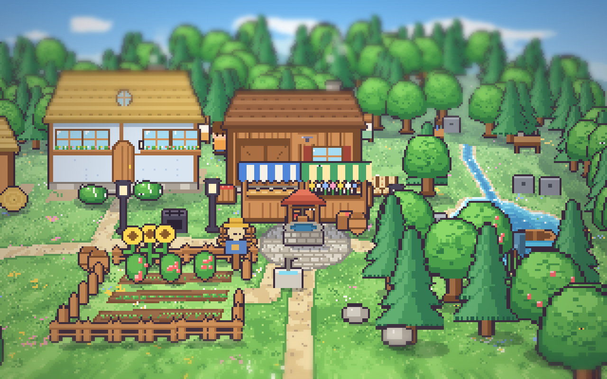
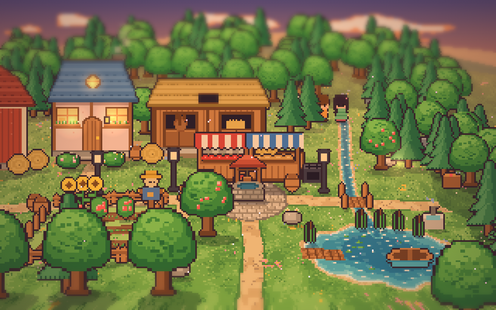
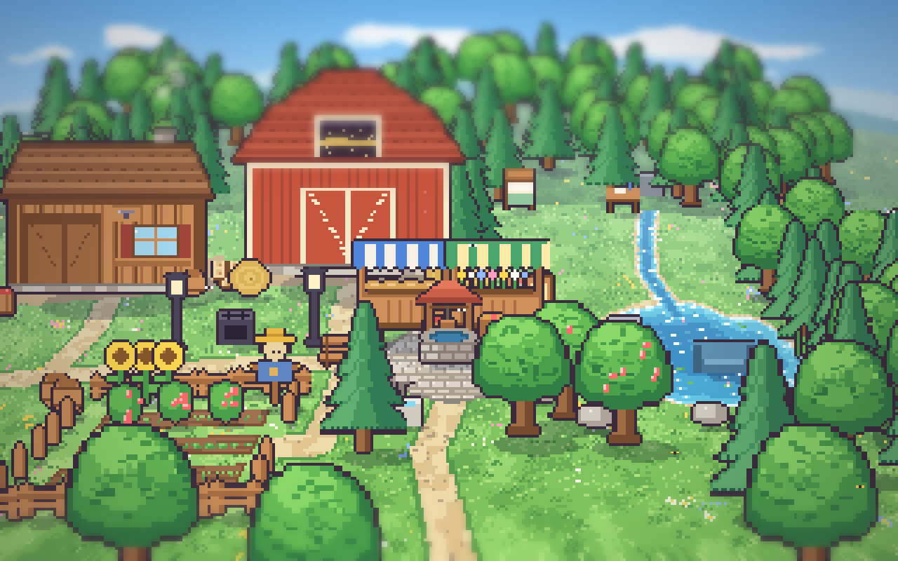
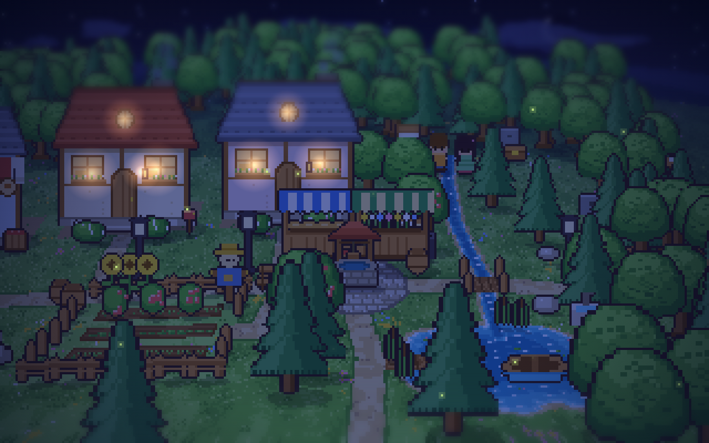
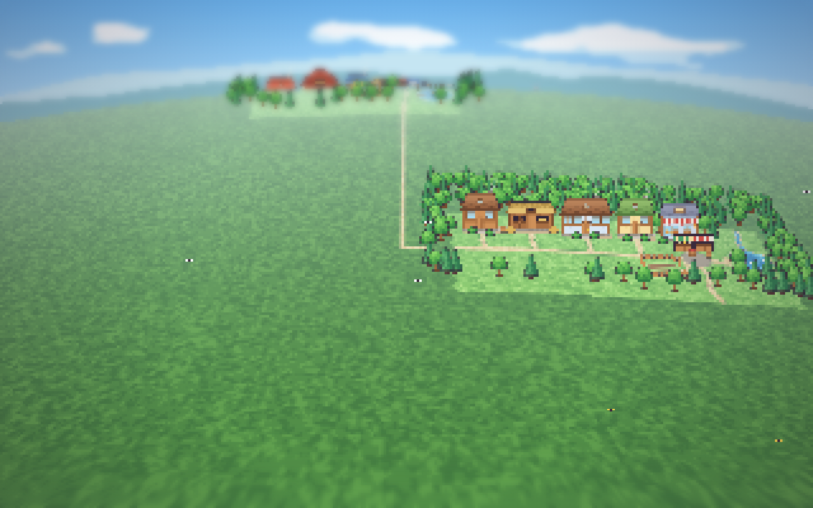
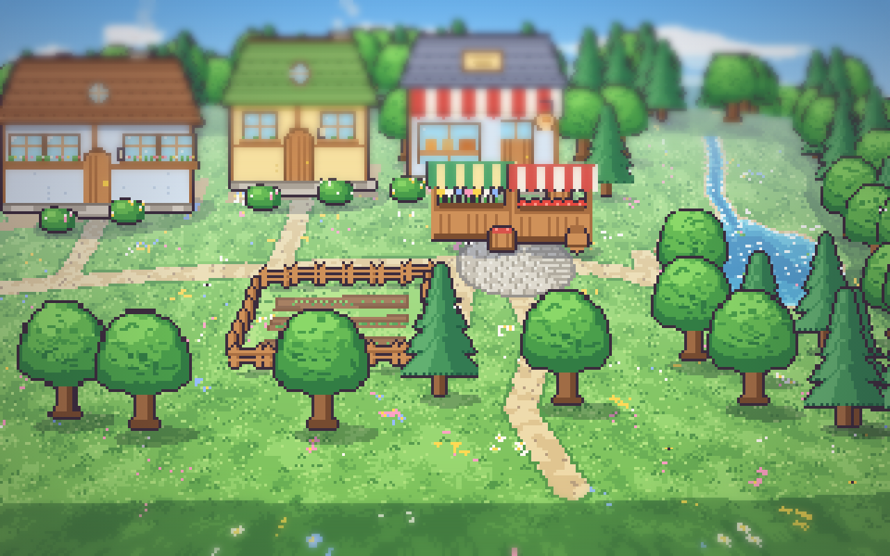

# AP12b – Generator im Backend

Plan: [AP12-plan.md](../arbeitspakete/AP12-plan.md) (Teilpaket b), Beschreibung: [generator.md](../generator.md). Branch `ap/12-weltgenerator`, nicht ausgerollt.

## Bilder
Vier neue Startwelten aus Seeds (ein Dorf mit Heimhaus, Garten, See, Platz, Wald) und eine erweiterte Welt: die Startwelt mit einem zweiten, erzeugten Dorf und Landstraße.

| Seed 7, Mittag | Seed 12, Abend |
|---|---|
|  |  |
| **Seed 31, Mittag** | **Seed 58, Nacht** |
|  |  |
| **Erweiterte Welt, Übersicht (¼×)** | **Zweites Dorf (1×)** |
|  |  |

(Die grauen Kisten in den Bildern sind Objekte der Testwelt, die dort liegen, wo die Testwelt sie hat; die Bilder zeigen nur die Gestaltung vom Generator. In einer echten erzeugten Welt stimmen Objekte und Bild überein, siehe die Browser-Ansicht unten.)

## Geliefert
- **Patch-Format** (Engine): neue Abschnitte `links` (Haustüren als Übergänge), `look` (Gebiete und Landstraßen anhängen, alte Form `look` Version 1 wird dabei umgewandelt) und `max_objects`; Objekte mit `"anywhere": true` dürfen auf Wasser und Möbelkacheln stehen; Quellen mit `label` und `regen_weather`. Ereignisse `world.links_added` und `world.look_changed` mit Reducern im Browser und Texten im Protokoll. Der Bau „Steg-Verlängerung“ erkennt jeden See (`props.fishing`), nicht nur den Ort `lake`.
- **Generator** (`backend/simulacra/generator/`, 1377 Zeilen in 12 Dateien): Layout als Port des abgenommenen Mockup-Generators mit Zufallsfolge wie `wRng`, **Kacheln aus denselben Formen wie das Bild**, **Innenbereiche aus Bauplänen** (`data/gebaeude/`: Häuschen, Wohnhaus, Langhaus, Werkstatt, Laden, Scheune, Stall; dazu das Heimhaus der Startwelt wörtlich), **Dorfbausteine** (Brunnen, Laternen, Briefkästen, Wegweiser, Beete, Tomaten, Sonnenblumen, Regentonnen, Schilf, Steine, Apfelbäume, Boot, Angelplatz, Wald), **Prüfung** und deutsche Namen.
- **Neue Startwelt** und **Erweiterung** aus demselben Code; Erweiterung als Patch nach Süden, Landstraße zur Südausfahrt des letzten Dorfs, auch auf erzeugte Welten und auf alte Spielstände mit `look` Version 1.
- **CLI:** `world new --seed N --out datei.json`, `world init --world-file datei.json`, `world generate --seed N --preview patch.json`, `--apply --yes`. `scripts/e2e_server.py --world datei.json` startet den Testserver mit einer erzeugten Welt.
- **Prüfung** (muss bestehen, sonst Neuwurf mit abgeleitetem Seed, höchstens 8 Versuche): Raster rechteckig, Haustüren, Quellen, Dinge und Startplätze vom Dorfplatz aus erreichbar (wie die Wegsuche), Übergänge auf begehbaren Kacheln, Mengen gültig, IDs und Ortsnamen eindeutig (auch gegen den Bestand), keine Überlappung der Orte, jedes Schlafzimmer ein Bett. Im ersten Versuch bestehen 300 von 300 Seeds (neue Startwelt) und 80 von 80 (Erweiterung auf die Startwelt und auf eine erzeugte Welt).
- **Beide Skins** (Wunsch Henry): „Tiefe“ (3D) und „Flach“ sind immer wählbar und funktionieren mit allem Neuen; Goldbilder für Flach in `e2e/flach.spec.ts`.
- **Infoleiste** rechts einklappbar (Wunsch Henry); im Editor-Modus und im Startmenü aus (`uiStore.appMode`).

## Tests
- Backend (pytest): **1068 bestanden**, 3 abgewählt (wie bisher). Neu: `tests/world/test_look_patch.py` (7), `tests/generator/` (68: byte-gleiche Ergebnisse, 24 Seeds je Weg mit echter Engine geladen und 120 Ticks, Erweiterung 24 Seeds mit Erreichbarkeit aller neuen Orte über die echte Wegsuche, Bestand unverändert, zweites und drittes Dorf, alter Spielstand, Kartengrenze, Gebäudemix × See, Fixture aktuell) und `test_simulation.py` (4: 100 Schritte mit Fake-Modell auf der erweiterten Welt, Laterne und Tomaten im neuen Dorf benutzen, der Wegweiser macht die neuen Orte bekannt, neue Startwelt läuft).
- Frontend (Vitest): **122 bestanden**, neu `erzeugt.test.ts` (Bild und Kacheln des erzeugten Dorfs stimmen überein: unter 4 % Abweichung, keine Wege über Wasser).
- Browser (Playwright): **70 bestanden**, 8 übersprungen (Messläufe und Bilderläufe). Neu: `layout.spec.ts` (Infoleiste), `flach.spec.ts` (flache Ansicht mit zwei Dörfern, ½×, ¼×, zurück auf 3D).
- Typen aktuell (`scripts/gen_types.sh --check`), keine Datei über 400 Zeilen (`models_edit.py` ausgelagert).

## Grenzen
Siehe [generator.md](../generator.md): nur nach Süden (nach Osten offen), ein See, ein Garten, ein Platz und ein Wald je Dorf, feste Namenslisten, neue Gebäudearten brauchen einen Zeichenbaustein im Frontend. Die Erweiterung rückt nach Süden und etwas nach Osten; bei vielen Dörfern stößt die Karte an 256 × 256.

## Was noch fehlt (AP12c)
API (Trockenlauf, Anwenden mit Sicherung und Bestätigung), die Oberfläche „Welt erweitern“ mit Reglern, Vorschau und „Übernehmen“, „Neue Simulation mit Dorf …“, Probelauf mit dem echten Modell, Bilder im Browser.

## Abnahme durch dich
1. **Ansehen:** `backend/.venv/bin/python -m simulacra.cli world new --seed 7 --out /tmp/dorf.json`, dann `backend/.venv/bin/python scripts/e2e_server.py --port 8195 --data-dir /tmp/simdorf --world /tmp/dorf.json` und das Frontend darauf (`SIM_BACKEND=http://127.0.0.1:8195 npm run dev` in `frontend/`). Mit WASD fahren, ¼× bis 3× zoomen, Haus anklicken.
2. **Erweiterung:** `cli world generate --db … --seed 5 --apply --yes` auf einer Welt und im Browser die Landstraße entlangfahren.
3. Freigabe für AP12c.
