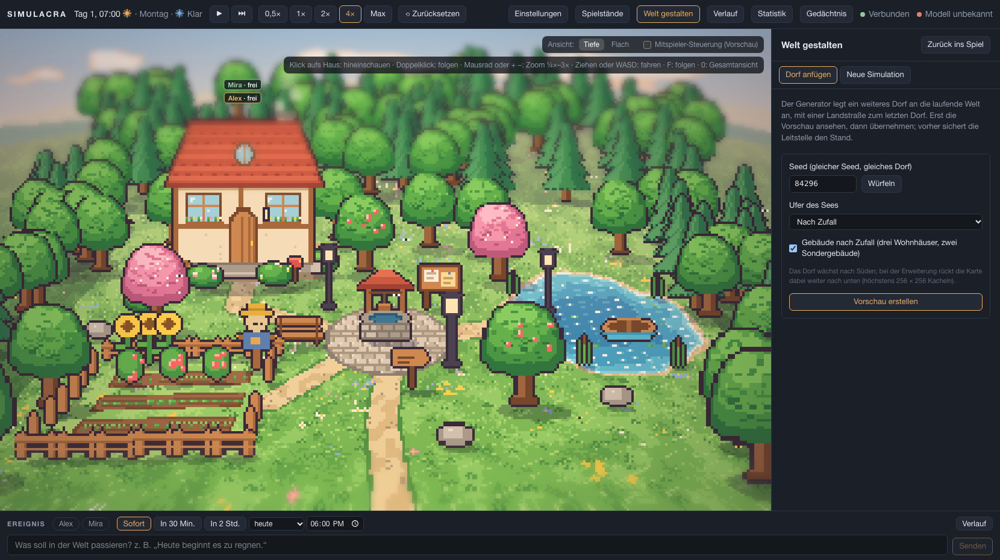
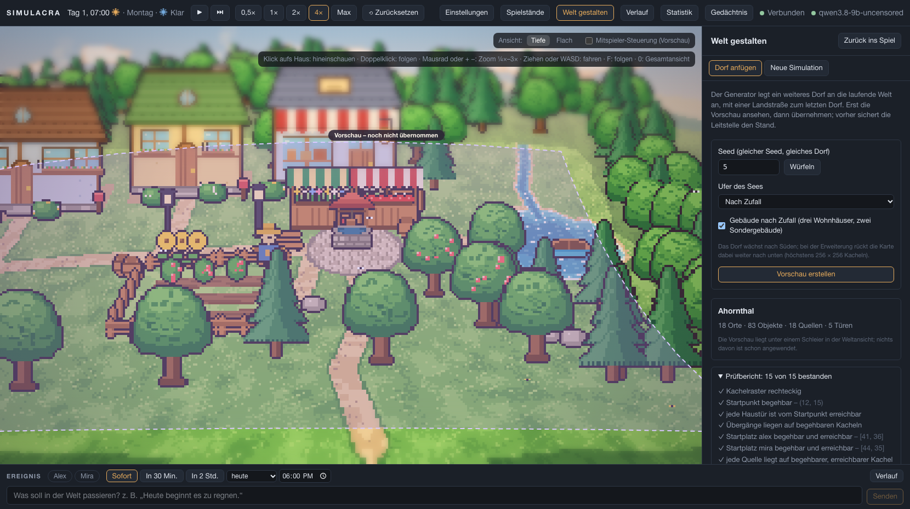
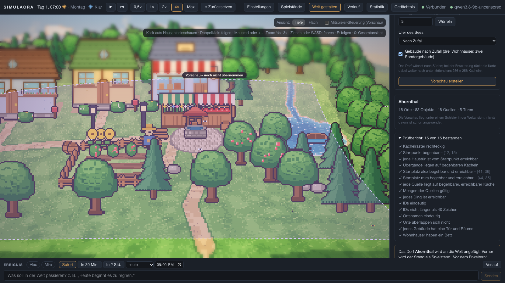
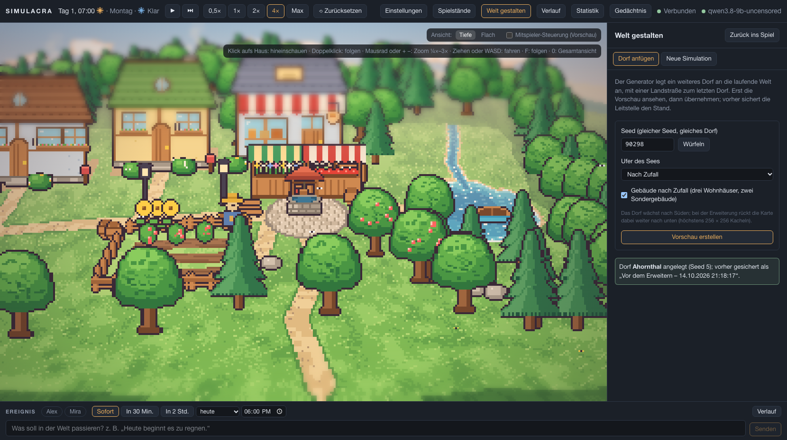
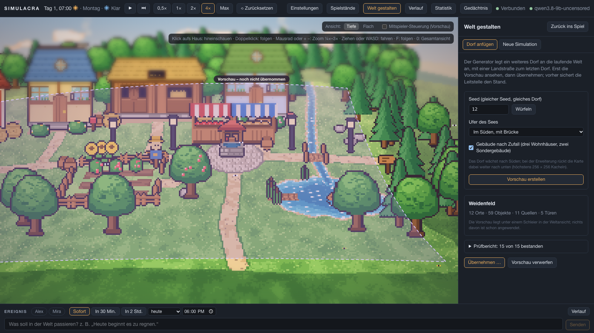
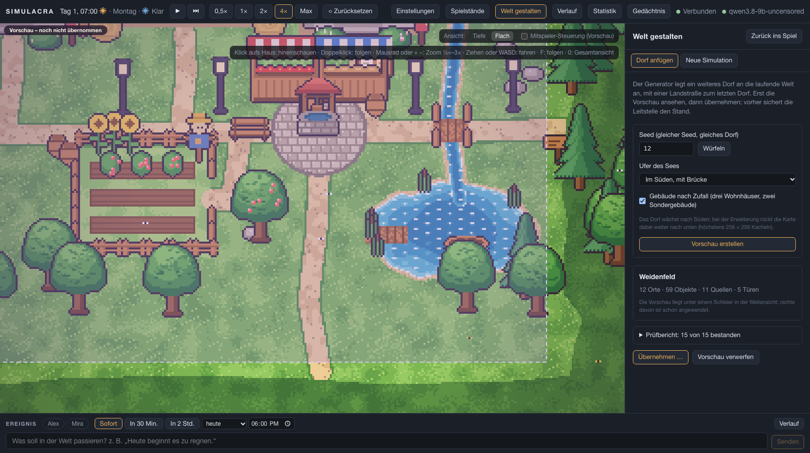
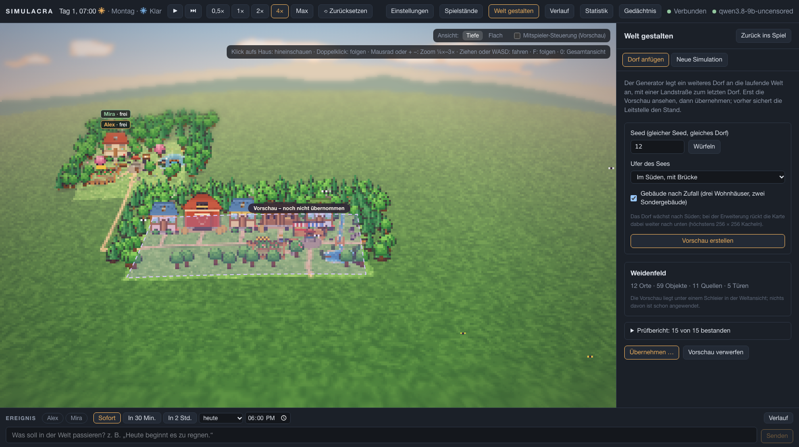
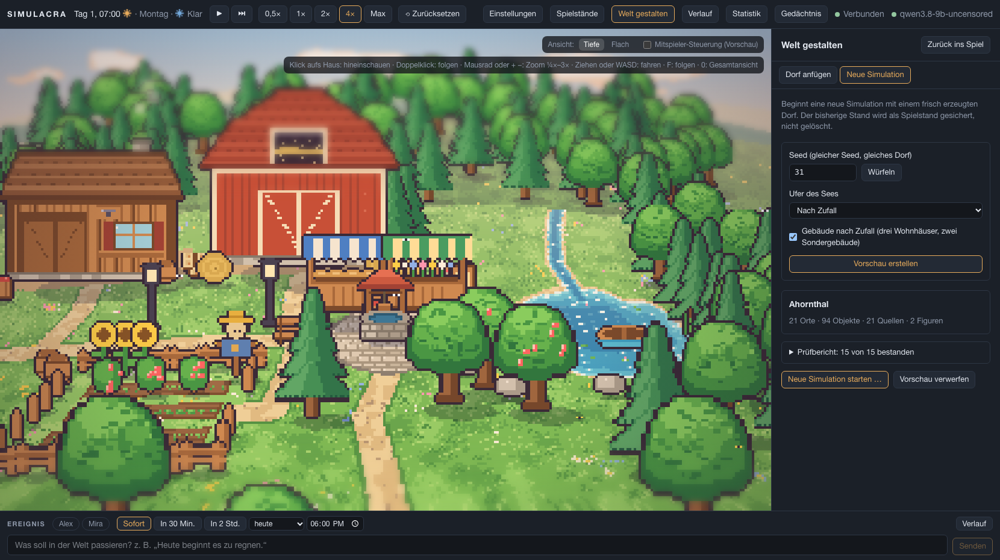
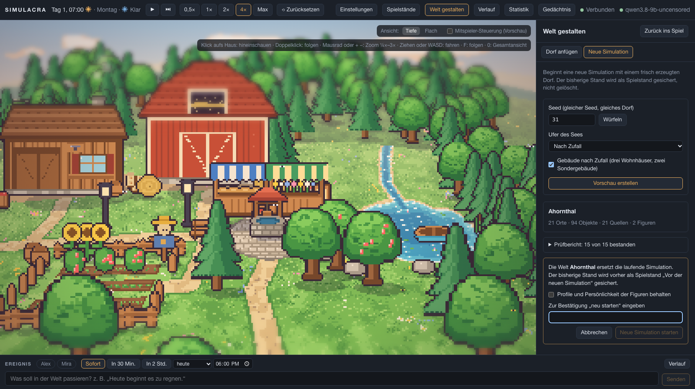

# AP12c – Bedienung in der Leitstelle

Plan: [AP12-plan.md](../arbeitspakete/AP12-plan.md) (Teilpaket c), Beschreibung: [generator.md](../generator.md), [frontend.md](../frontend.md) (Welteditor), [schnittstellen.md](../schnittstellen.md). Branch `ap/12c-leitstelle` (von `main`, nicht ausgerollt).

## Bilder
Alle Bilder sind echte Bildschirmfotos der Oberfläche gegen das Backend mit der Startwelt.

| Werkzeugleiste „Welt gestalten“ | Vorschau Seed 5: das neue Dorf unter dem Schleier |
|---|---|
|  |  |
| **Prüfbericht** | **Bestätigung vor dem Übernehmen** |
|  |  |
| **Nach dem Übernehmen (ohne Schleier, mit Meldung)** | **Seed 12, See im Süden** |
|  |  |
| **Dieselbe Vorschau in „Flach“** | **Übersicht (¼×) mit Landstraße und Schleier** |
|  |  |
| **Neue Simulation, Vorschau (Seed 31)** | **Neue Simulation, Bestätigung mit Wort** |
|  |  |

## Geliefert
- **API** (`api/routes_world.py`, `api/models_world.py`, `generator/service.py`):
  - `POST /api/world/generate`: **Trockenlauf.** Das Dorf wird erzeugt, geprüft und in der echten Datenbank angewendet, der Zustandsabzug gebaut und alles zurückgerollt (`WorldEditor.dry_run`). Die Welt bleibt unverändert, auch Ereignisnummer und Patch-Liste. Antwort: Prüfbericht mit allen Einzelprüfungen, Prüfsumme, Zähler, Dorfplatz und die Welt, wie sie danach aussähe.
  - `POST /api/world/generate/apply`: Bestätigung (`confirm`), Idempotency-Key, **Prüfsumme der Vorschau** (hat sich die Welt seit der Vorschau geändert, 409), automatische Sicherung („Vor dem Erweitern“), Patch und Ereignis **`world.generated`** in einer Transaktion. Eine laufende Simulation wird kurz angehalten.
  - `POST /api/world/patch/preview`: derselbe Trockenlauf für **jeden** Patch, damit Einzeländerungen des späteren Gestaltungs-Editors ihre Vorschau bekommen.
  - **Neue Simulation:** gleiche Vorschau (Wegwerf-Simulation im Speicher), Anlegen über `Simulation.reset(world=…)` mit Sicherung „Vor der neuen Simulation“.
- **Oberfläche** (`editor/`): Knopf „Welt gestalten“ in der Kopfzeile, Werkzeugleiste mit zwei Reitern („Dorf anfügen“ = `appMode editor`, „Neue Simulation“ = `appMode menu`; die Infoleiste ist in beiden aus, beide Ansichten Tiefe und Flach bleiben wählbar). Wunsch: Seed mit „Würfeln“, Ufer des Sees, Gebäudemix. Die Vorschau zeigt die Welt unter einem **Schleier mit gestricheltem Rahmen**, die **Kamera fährt hin** (Zoom und Lage bleiben, jede Eingabe bricht die Fahrt ab), der Prüfbericht ist aufklappbar. Ändert sich der Wunsch, ist die Vorschau veraltet und „Übernehmen“ gesperrt. Übernehmen fragt nach und nennt die Sicherung; „Neue Simulation“ verlangt das Wort „neu starten“ und lässt die Profile behalten.
- **Ereignis** `world.generated` (Protokolltext, Typen).

## Nicht umgesetzt / offen
- **Regler** für Siedlungsdichte, Waldanteil, Wasseranteil, Wegedichte und eine **Palette**: Der Generator (AP12b) hat dafür keine Stellgrößen; umgesetzt sind Seed, Ufer des Sees und Gebäudemix. **Frage 26** in [offene-fragen.md](../offene-fragen.md).
- **Probelauf mit dem echten Modell** (besuchen die Agenten neue Orte?): maintux ist von hier nicht erreichbar. Mit dem Fake-Modell laufen 100 Schritte auf der erweiterten Welt und neue Orte und Dinge werden benutzt (`tests/generator/test_simulation.py`, AP12b). Zum Ausprobieren im echten Spiel siehe unten.
- **Ausrollen auf maintux** bleibt offen und nur nach Freigabe.

## Tests
- Backend (pytest): **1075 bestanden**, 3 abgewählt (wie bisher). Neu `tests/api/test_world_generate.py` (6): Vorschau ändert nichts (Karte, Orte, Ereignisnummer, Patch-Liste) und ist bei gleichem Wunsch gleich, Wunsch wird geprüft (422), Übernehmen braucht Bestätigung, Idempotency-Key und passende Prüfsumme (409), Sicherung und `world.generated`, Wiederholung mit demselben Schlüssel tut nichts doppelt, neue Simulation (Vorschau, Anlegen, Sicherung), Trockenlauf beliebiger Patches. Dateigrößenregel eingehalten (`DorfView.ts` 395 Zeilen, Umriss ausgelagert in `dorf/umriss.ts`).
- Frontend (Vitest): **128 bestanden**, neu `editor/editorStore.test.ts` (6: Wunschschlüssel, Vorschau ersetzt nur die Ansicht, abgelehntes Dorf, überholte Antwort, Übernehmen nur mit passender Vorschau und Warten auf die laufende Welt, Fehler beim Übernehmen).
- Browser (Playwright): **76 bestanden**, 8 übersprungen (Messläufe und Bilderläufe, darunter `bilder-editor.spec.ts` mit `SIM_BILDER=1`). Neu `editor.spec.ts` (6). Alle Goldbilder (Startwelt, zwei Dörfer, Flach) unverändert, auch nach dem Umbau von `DorfView`.
- Typen aktuell (`scripts/gen_types.sh --check`).

## Abnahme
1. **Ansehen** (lokal, mit Fake-Modell oder eigenem Modell):
   ```bash
   backend/.venv/bin/python scripts/e2e_server.py --port 8195 --data-dir /tmp/simdorf
   cd frontend && SIM_BACKEND=http://127.0.0.1:8195 npm run dev
   ```
   Im Browser „Welt gestalten“, Seed würfeln, „Vorschau erstellen“, zoomen (¼×), Landstraße entlangfahren, dann „Übernehmen“ und auf „Zurück ins Spiel“ klicken.
2. **Neue Simulation:** Reiter „Neue Simulation“, Vorschau, Bestätigung. Der alte Stand liegt danach unter „Spielstände“ („Vor der neuen Simulation …“).
3. Frage 26 beantworten (genügen Seed, Ufer und Gebäudemix?) und AP12b/AP12c abnehmen.
