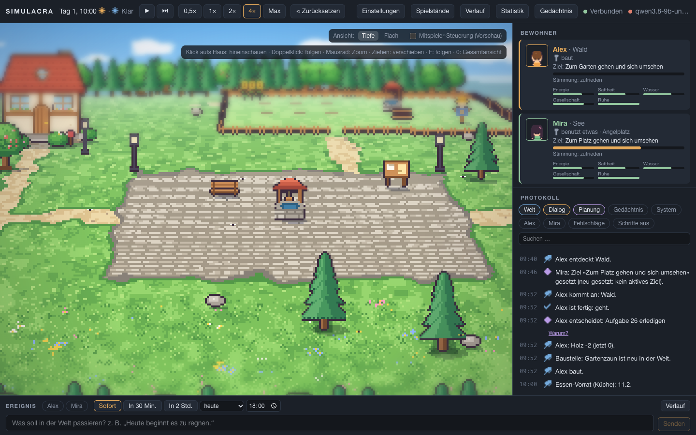
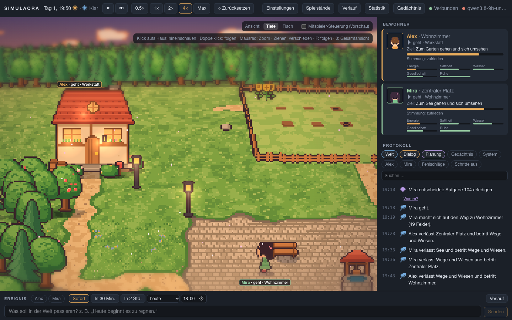
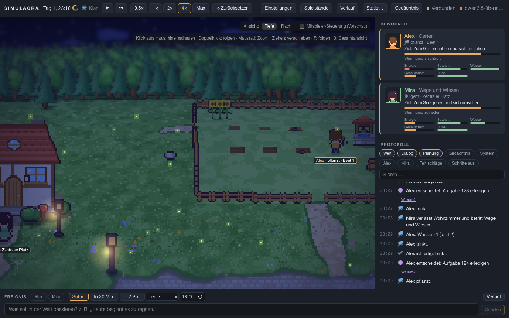
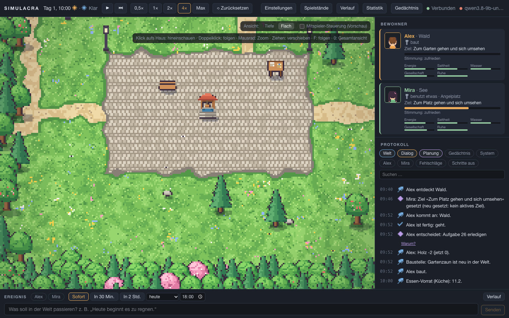
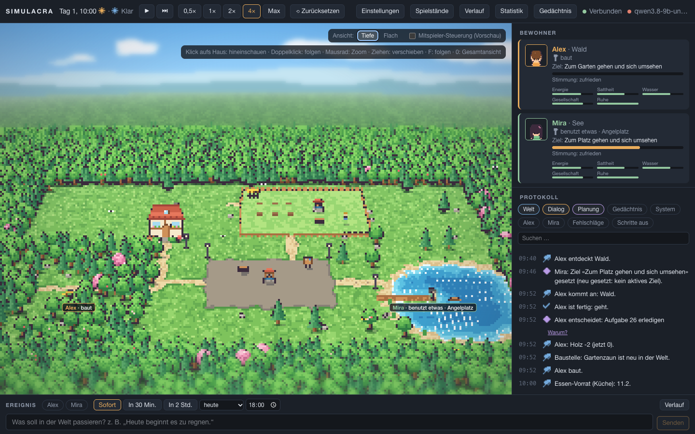
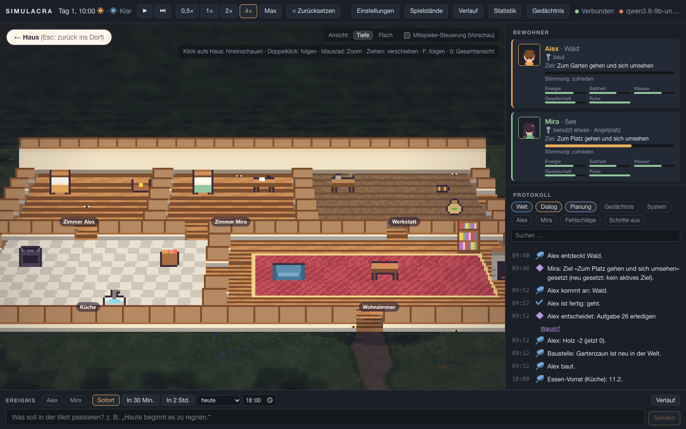
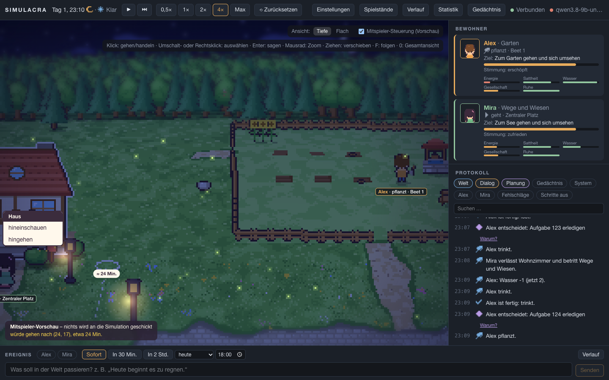
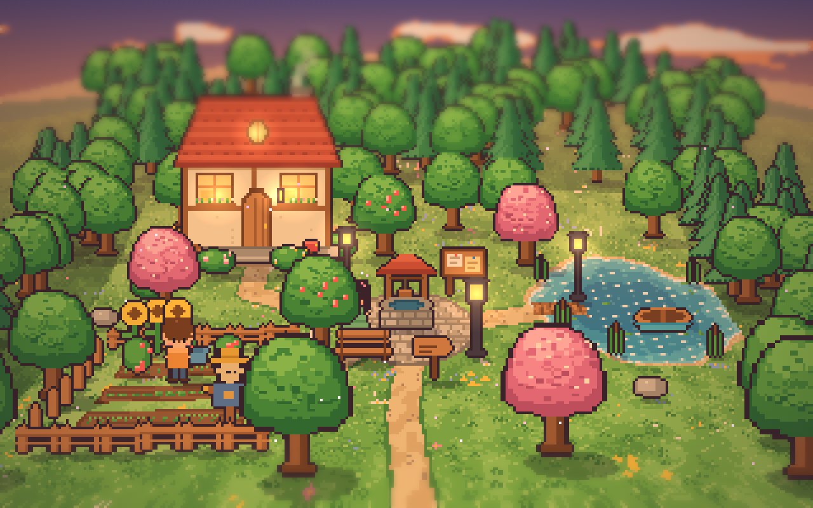

# Statusbericht AP13 – Weltoptik „Mischung“ und Vorbereitung der Mitspieler-Steuerung

Stand: 13.10.2026 · Branch `ap/13-weltoptik` · **Nicht ausgerollt** (wartet auf Freigabe) · Abnahme der Optik: offen (noch nicht im Browser angesehen)

Auftrag: [AP13-weltoptik.md](../arbeitspakete/AP13-weltoptik.md) · Plan: [AP13-plan.md](../arbeitspakete/AP13-plan.md) · Fragen 18–21: [offene-fragen.md](../offene-fragen.md) · Folgepaket: [AP14](../arbeitspakete/AP14-startwelt-innenbereiche.md)

## Bilder
| | |
|---|---|
| Tag, Tiefe:  | Abend, Tiefe:  |
| Nacht, Tiefe:  | Tag, Flach:  |
| Ganze Welt (Taste 0):  | Haus innen (nach Klick aufs Haus):  |
| Mitspieler-Vorschau (Weg, Dauer, Kontextmenü):  | Zum Vergleich Mockup A:  |

Für die Bilder ist das Wetter in der Anzeige auf „klar“ gesetzt (die Startwelt hat abends Nebel), sonst echter Zustand der Startwelt mit dem Fake-Modell. Erzeugt mit `SIM_BILDER=1 npx playwright test e2e/bilder.spec.ts`.

## Geliefert
- **Darstellung 1:1 aus Mockup A** (Vorgabe „es soll 1:1 aussehen wie im Mockup“): Sprites (Haus, Bäume, Brunnen, Bank, Laterne, Brett, Zaun, Vogelscheuche …), Farben, Tageszeiten, Bodenmuster (Grasbüschel, Blumen, Schatten, Pflaster, Ufer mit Schaum), Himmel, Wolken, Sterne, Hügel, Dunst, Farbstimmung, Lichtschein, Teilchen (Schmetterlinge, Blütenblätter, Glühwürmchen), Tilt-Shift und Vignette sind aus `world.js` nach TypeScript übertragen, nicht nachgezeichnet. Tageszeiten werden fließend nach der Uhr gemischt, Wetter (Wolken, Regen, Sturm, Nebel, Schnee) dämpft Himmel und Licht.
- **Eine Projektion für alles** (`world/view/projection.ts`) mit beweglicher Kamera: Zoom um den Zeiger, Ziehen, Folgen, Gesamtansicht, weiche Fahrten. Hin- und Rückweg exakt; die Wölbung stimmt bei jeder Stellung (Vitest prüft 400 Zufallsstellungen je Ansicht).
- **Wölbung nach Rückmeldung (13.10.2026: „invertiert, wie innen in einem Ball; zu krass; im Haus keine Krümmung“):** Die Mockup-Formel war eine reine Bildverzerrung, die den Boden zum unteren Rand hin immer stärker vergrößert – dadurch kippte der nahe Boden scheinbar zur Kamera hoch wie in einer Schüssel. Ersetzt durch echte Geometrie: Kamera mit 36° Neigung über einer nach außen gewölbten Welt, nach vorn gekrümmt (Horizont und Himmel bleiben oben), zur Seite sanft (Durchhang des Horizonts unter 4,5 % statt 7 %). In der Innenansicht ist der Boden eben; beim Hinein- und Hinausfahren wird die Wölbung weich überblendet. Tests prüfen: Ränder fallen ab (außen), sanfter Durchhang, vorn kaum gestaucht und zum Horizont stärker, innen keine Krümmung.
- **Ansicht „Tiefe | Flach“** als Schalter an der Welt, im Browser gemerkt (Frage 21); „Flach“ ist dieselbe Pixelwelt ohne Wölbung (Mockup B).
- **Häuser (Frage 18):** draußen das Mockup-Haus an der Haustür; wer drin ist, steht als Namensschild über dem Dach, die Fenster leuchten, bei brennendem Kamin raucht der Schornstein. Klick aufs Haus → Kamerafahrt hinein, Wände runter, Raumnamen, Umgebung dunkel; Esc / „← Haus“ / Klick daneben → zurück. Folgen und Raumwahl öffnen das Haus von selbst. Das alte Dach-Ausblenden ist ersetzt.
- **Figuren (Frage 19):** Vorderansicht wie `wPerson`, dazu hinten, Seite (rechts gespiegelt), vier Laufbilder, Sitzen, Schlafen im Bett, Werkzeug bei Arbeit; Portraits der Oberfläche aus denselben Figuren. Was vor der gewählten oder verfolgten Figur steht, wird halb durchsichtig.
- **Zeigen und Treffen:** Pixelmaske in Tiefenreihenfolge, sonst Boden per Rückprojektion; Umriss beim Darüberfahren, passender Mauszeiger.
- **Mitspieler-Vorschau** hinter dem Schalter (standardmäßig aus): Wegvorschau mit Dauer ab der Vorschau-Figur „Du“ (Frage 20), Kontextmenü aus dem Aktionskatalog, „Sagen …“ (Enter, max. 500 Zeichen, Esc, keine Kürzel im Feld), Umschalt-/Rechtsklick wählt aus. `PlayerController` (`moveTo`, `interact`, `say`) zeigt nur „würde …“ und **schickt nichts**; der Browser-Test prüft, dass keine schreibende Anfrage an die API geht. Der Objektkatalog wird mit den Typen erzeugt (`scripts/gen_types.sh`, `OBJECT_KINDS`).
- **Phaser entfernt:** Die Welt zeichnet ein eigener Canvas2D-Renderer (Begründung unten). Keine neue Abhängigkeit; das Frontend-Paket ist 444 kB (141 kB gzip).
- **Doku:** [frontend.md](../frontend.md), [assets.md](../assets.md), [grenzen.md](../grenzen.md), [architektur.md](../architektur.md), [erweitern.md](../erweitern.md); Mockups `docs/mockups/welt-optik/echt.html` (Startwelt in Optik A) und `haus-innen.html`.

## Abweichung vom Vorschlag im Auftrag (Technik)
Der Auftrag schlug einen WebGL-Shader für den gewölbten Boden vor, weil eine Projektion je Pixel auf der CPU nicht reiche. Gemessen reicht sie doch, weil wie im Mockup in einen kleinen Puffer gezeichnet wird (z. B. 265 × 193 Pixel bei 1440 × 900): die Bodenabtastung kostet unter 1 ms (die Strahlen gegen die gewölbte Fläche werden je Zoomstufe einmal vorberechnet). Darum ein eigener Canvas2D-Renderer ohne Shader und ohne Phaser. Vorteile: die Projektion ist wirklich eine einzige TypeScript-Funktion (keine zweite Fassung in GLSL), die Mockup-Zeichenfunktionen ließen sich 1:1 übernehmen, kein WebGL nötig (damit entfällt der in Frage 21 genannte Rückfall „ohne WebGL automatisch Flach“). Der Boden liegt in Blöcken mit gröberen Stufen für weite Ansichten, damit auch 256 × 256-Karten kein riesiges Bild brauchen.

## Leistung (Ziel: ≥ 30 fps mit 20 Figuren und 500 Objekten, 60 fps mit der Startwelt bei 1440 × 900)
Gemessen (vor der Umstellung auf die echte Wölbung; Nachmessung siehe Prüfstand) mit `SIM_MESSEN=gpu npx playwright test e2e/leistung.spec.ts` (Chromium headless mit Grafikkarte, Apple M1), Ergebnis in [messung/ap13-leistung-gpu.json](messung/ap13-leistung-gpu.json). „Rechenzeit“ = eigener Code je Bild (Boden, Sprites, Effekte, Schilder).

| Fall | fps | Rechenzeit Median / 95 % |
|---|---|---|
| Startwelt, Tiefe, ruhig | 60 | 1,9 / 2,5 ms |
| Startwelt, Tiefe, Kamerafahrt | 60 | 2,0 / 3,9 ms |
| Startwelt, Flach, Kamerafahrt | 60 | 1,8 / 2,1 ms |
| Testwelt 256 × 256, 20 Figuren, 500 Objekte, Zoom 1, Kamerafahrt | 60 | 2,4 / 5,7 ms |
| Testwelt, ganze Welt, ruhig | 60 | 2,9 / 3,6 ms |
| Testwelt, ganze Welt, Kamerafahrt | 60 | 3,0 / 4,9 ms |

**Ziele erreicht.** Ohne Grafikkarte (Software-Rendering, `SIM_MESSEN=1`) rechnet der Browser die Tilt-Shift-Unschärfe selbst: dann 25–30 fps in „Tiefe“, 42 fps ohne Tilt-Shift, 58 fps in „Flach“, bei gleicher Rechenzeit unseres Codes. Die Testwelt ist erzeugt (kein Spielstand) und wird nur im Browser eingesetzt; Figuren stehen dabei still, die Kamera fährt.

## Tests
- **Vitest:** Projektion hin und zurück (beide Ansichten, 400 Stellungen), Maßstab wie im Mockup, Zoom und Ziehen halten den Punkt, Gesamtansicht; Gebäude und Haustür; Treffer (Tiefenreihenfolge, durchsichtige Pixel, Spielraum für Figuren); Wegsuche (Umweg durch die Tür, gesperrte Tür, blockierende Objekte, unerreichbar), Kontextmenü aus dem Katalog, PlayerController sendet nichts, Tastaturfokus.
- **Playwright (neu oder angepasst):** Klick aufs Haus, auf Figur und Raum in **beiden Ansichten**; Namensschild sitzt unter der Figur und bleibt beim Zoomen; F folgt auch ins Haus, 0 zeigt die ganze Welt; Haus zeigt, wer drin ist, Esc führt zurück; Ansicht umschalten und Neuladen; Mitspieler-Vorschau (Wegvorschau ohne Schreibzugriff, Kontextmenü, Sagen ohne Kürzel, Esc, Rechtsklick, Schalter aus). Angepasst statt abgeschaltet: K06 misst einen Weg ganz im Haus (dann Innenansicht) oder ganz draußen; „Start: eine Figur bewegt sich“ öffnet vorher das Haus.
- Ergebnisse des letzten Gesamtlaufs: siehe Abschnitt „Prüfstand“ unten.

## Grenzen und offene Punkte
- **Grundriss weicht ab:** Die Startwelt ist drei- bis fünfmal größer und eckiger als das Mockup-Dorf; der übrige Grundriss des Hauses ist draußen Garten, auf dem nie jemand läuft. Behebt **AP14** (Entwurf, vor Beginn mit dir zu klären).
- **Deko ohne Zustand** (Laternen, Briefkasten, Schilf, Steine, Boot, Vogelscheuche, Sonnenblumen) bis AP14.
- Unschärfe ohne Grafikkarte teuer (siehe Leistung); in „Flach“ oder mit reduzierter Bewegung kein Tilt-Shift.
- Die Vorschau-Figur bewegt sich nicht; regelgesperrte Kacheln (`forbidden`) kennt die Wegsuche im Browser nicht.
- **Nicht in AP13** (wie beauftragt): Mitspieler im Backend, Anmeldung mehrerer Menschen, Takt, Abwesenheit, Gedächtnis des Menschen.

## Abnahme
- [ ] Ansicht „Tiefe“ entspricht Mockup A in Stimmung und Lesbarkeit – **bitte im Browser ansehen** (`scripts/dev.sh`, dann http://localhost:5173) und freigeben.
- [x] Kamera (Zoom, Ziehen, Folgen, Gesamtansicht) in beiden Ansichten; Wölbung bei jeder Stellung (Vitest, Playwright).
- [x] Klicks treffen Figur, Haus, Raum, Kachel in beiden Ansichten; Namensschilder und Sprechblasen sitzen über bzw. unter den Figuren.
- [x] Mitspieler-Vorschau hinter dem Schalter, sendet nichts; ausgeschaltet wie vorher (bis auf das neue Haus-Konzept).
- [x] Leistungsziele erreicht (mit Grafikkarte); Abweichung ohne Grafikkarte offen benannt.
- [x] Tests grün, Doku und Statusbericht vollständig.

## Prüfstand
Stand 13.10.2026, nach der Umstellung auf die echte Wölbung:
- **Vitest:** 99 passed; `tsc` sauber.
- **Playwright:** 56 bestanden (2 übersprungen: Messung und Bilder laufen nur auf Wunsch mit `SIM_MESSEN` bzw. `SIM_BILDER`). Ein Gesamtlauf zwischendurch brach nach K06 mit 52 Fehlern in je etwa 50 ms ab (Test-Backend nicht erreichbar); der nächste Lauf war vollständig grün, der Abbruch ließ sich nicht wiederholen.
- **Backend:** 956 bestanden (3 abgewählt), darunter die Typprüfung mit dem neuen Objektkatalog und die Dateigrößenregel.
- **Leistung nachgemessen** (GPU, [messung/ap13-leistung-gpu.json](messung/ap13-leistung-gpu.json)): weiterhin überall 60 fps, Rechenzeit 95 % höchstens 5,3 ms (große Welt, Gesamtansicht mit Kamerafahrt).
- Nicht ausgerollt; Ausrollen auf maintux oder SecondTux erst nach Freigabe.
