# Statusbericht AP14 – Welt genau wie Mockup A

Stand: 13.10.2026 · Branch `ap/14-startwelt-a` (baut auf `ap/13-weltoptik` auf) · **Nicht ausgerollt** (wartet auf Freigabe) · Abnahme der Optik: offen

Auftrag: Vorgabe vom 13.10.2026 (Frage 22 in [offene-fragen.md](../offene-fragen.md)): „Ich will, dass du es so wie in Abbildung A aussehen lässt, genau so, auch in dieser Skalierung, mit dieser Anzahl von Bäumen, genau so wie der See mit dem Boot … keine Kompromisse. Wenn man aufs Haus klickt, sieht man es von innen.“ Rückfragen: Kamera **„wie A, aber beweglich“**, Startwelt **„ja, Welt wie A“**. Plan: [AP14-plan.md](../arbeitspakete/AP14-plan.md).

## Bilder
Weltfläche 1280 × 800 wie Bild A; Wetter in der Anzeige auf „klar“ gesetzt; Alex im Garten, Mira am Platz wie in der Startwelt. Erzeugt mit `SIM_BILDER=1 npx playwright test e2e/bilder.spec.ts`.

| | |
|---|---|
| App, Mittag: 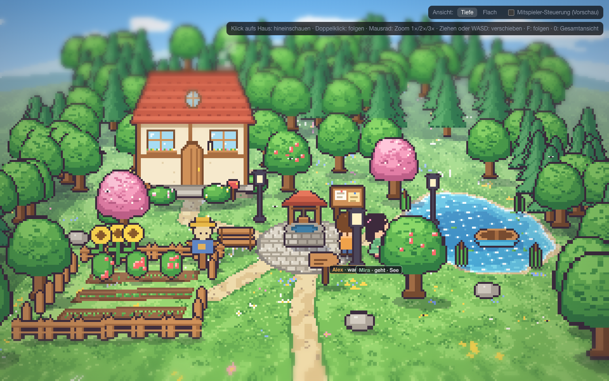 | Bild A (Abend) zum Vergleich:  |
| App, Abend: 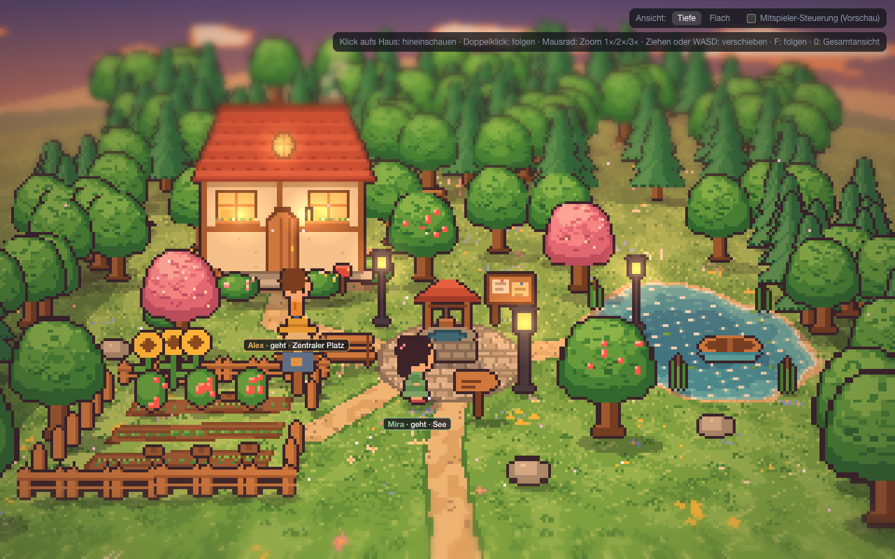 | App, Nacht: 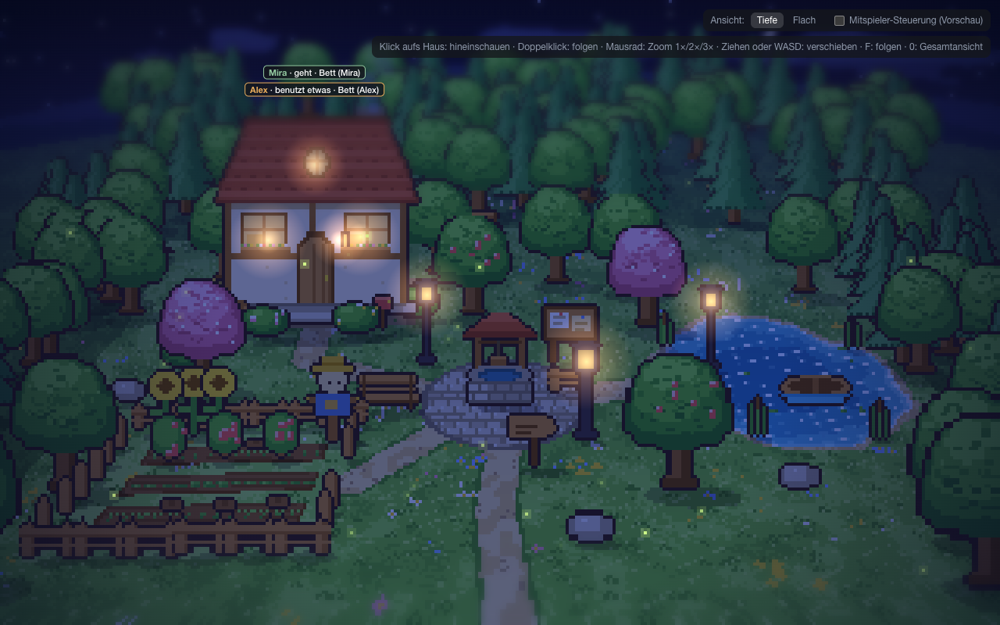 |
| Zoom 2× (vergrößertes Bild A): 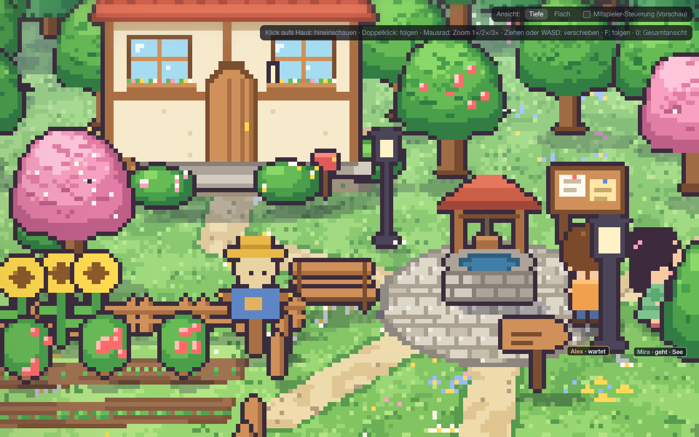 | Flach (Mockup B): 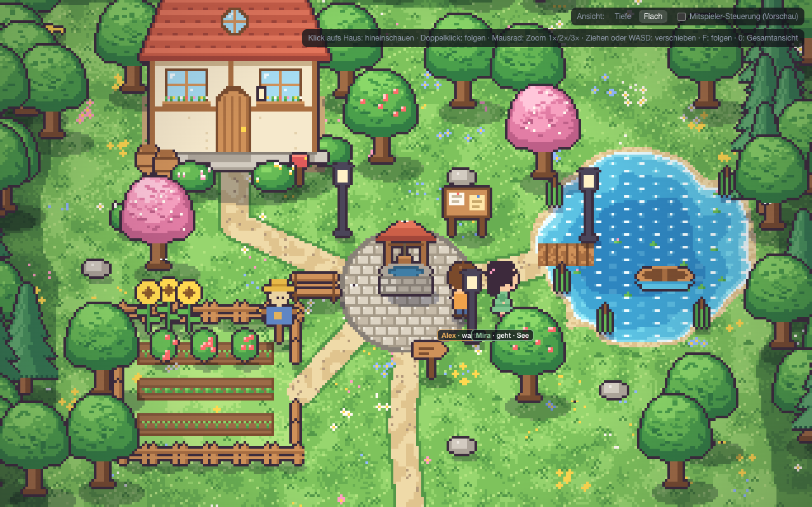 |
| Haus innen, Puppenhaus (Klick aufs Haus): 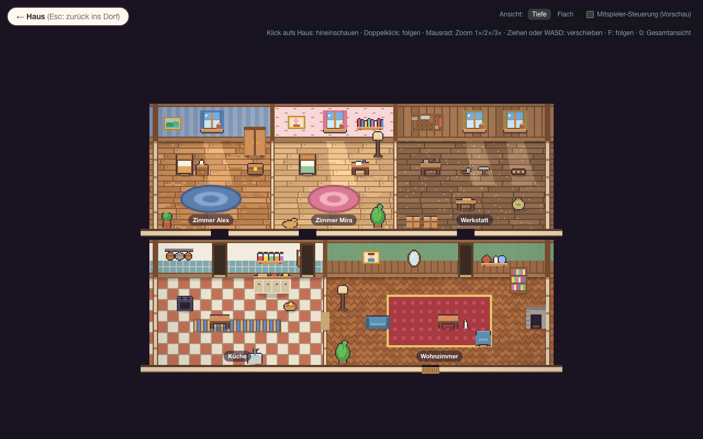 | Ein Raum groß (Klick auf das Wohnzimmer): 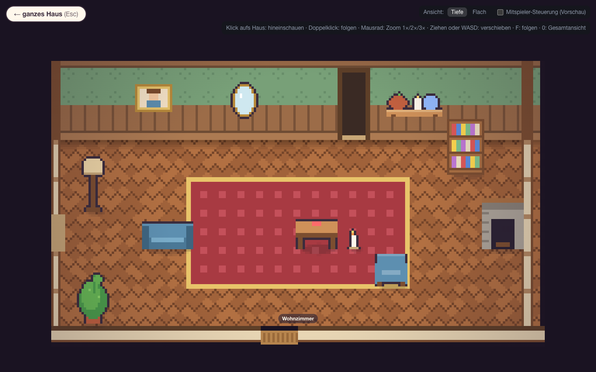 |
| Haus innen am Abend (Lampen, Kerzen): 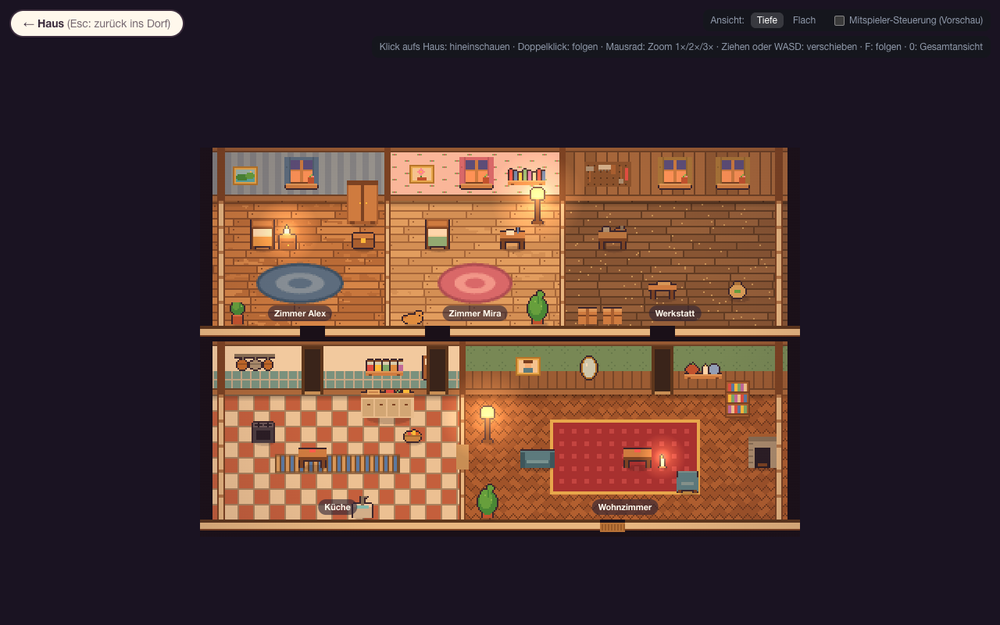 | Mockup innen2 zum Vergleich: 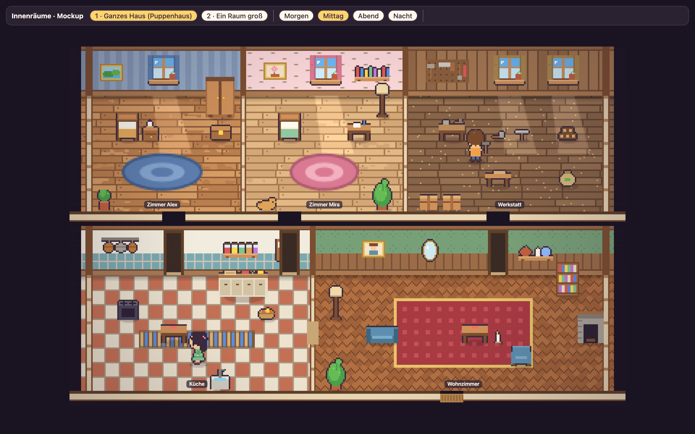 |
| Ganze App mit Seitenleisten: 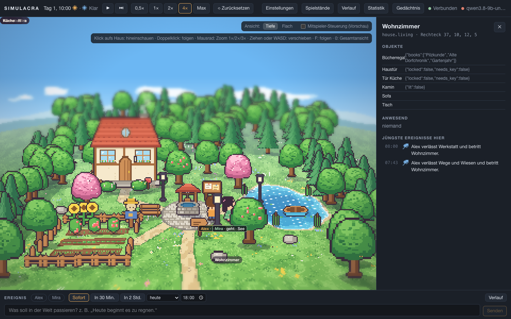 | Mitspieler-Vorschau: 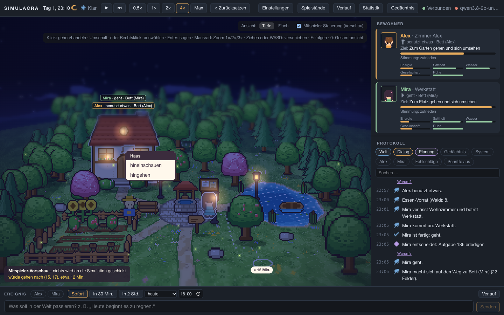 |

## Geliefert
- **Bild A unverändert übernommen:** Bodenregeln (`wTexel`), Abbildung (`wProject`, Puffer 320 × 200), Himmel, Wolken, Hügel, Dunst, Wasserglitzern, Rauch, Farbstimmung, Lichtschein, Tilt-Shift, Teilchen und Vignette aus `world.js`; Sprites wie bisher aus `world/art/` (1:1-Übertragungen). Alle 13 Einzelbäume, 95 Bäume im Wald dahinter, 52 an den Seiten, Haus, Garten mit Zaun, drei Beeten, Sonnenblumen und Tomaten, Vogelscheuche, runder Platz mit Brunnen, Brett, Wegweiser, drei Laternen, See mit Steg, Boot, Schilf und Seerosen, Steine. Pixelvergleich bei 1280 × 800 mit Mockup A (gleiche Tageszeit): in ruhenden Bereichen (Haus, Garten, Ufer) 99–100 % gleiche Pixel; Unterschiede nur durch Bewegtes (Wasserglitzern, Wolken, Teilchen in einem anderen Augenblick), die Figuren, die der Zustand setzt, und die Namensschilder.
- **Startwelt nach dem Bild** (`backend/simulacra/data/world_default.json`, erzeugt mit `node scripts/startwelt_a.mjs` direkt aus `world.js`): Kachelarten nach den Bodenregeln von A, die Bäume aus A als Hindernisse, Gartenzaun mit Eingang rechts, Steg am See. Orte, Objekte und Quellen behalten ihre Kennungen (Zimmer, Werkstatt, Küche, Wohnzimmer, Garten, Platz, See, Wald); entfallen sind der zweite Brunnen, die zweite Bank und die Hintertür, weil A sie nicht hat. Sechs Beete liegen in den Reihen 1 und 3 von A. Alex startet im Garten, Mira am Platz.
- **Haus innen hinter der Tür:** Die fünf Räume liegen als eigener Innenbereich auf der Karte, verbunden über die Haustür als **Übergang** (`links`). Wegsuche, Bewegung, Fahrplan und Wegvorschau gehen hindurch; Figuren springen an der Tür, statt über die Karte zu gleiten. Drinnen und draußen hören sich nicht (Ort und Hörweite wie bisher).
- **Beweglich ohne Flimmern:** Zoom 1× / 2× / 3× vergrößert das fertige Bild A ganzzahlig; Mausrad (eine Raste = eine Stufe, um den Zeiger), Ziehen, WASD und Pfeile verschieben den Ausschnitt um ganze Gerätepixel, `0` zurück, `F` folgt. Weil nichts neu abgetastet wird, gibt es kein Krisseln beim Zoomen und kein Flackern beim Wandern. Fenster in anderen Seitenverhältnissen bekommen am Rand mehr Wald oder Himmel, nie ein gestauchtes Bild.
- **Haus innen wie Mockup innen2** (Frage 23, „PERFEKT so umsetzen“): Klick aufs Haus zeigt das ganze Haus als aufgeschnittenes Puppenhaus: hohe Rückwände mit Tapete je Raum (Streifen, Blumen, Bretter, Kacheln, Ranken mit Vertäfelung), Fenster mit Vorhängen und Himmel nach Tageszeit, Bilder, Uhr, Spiegel, Regale, Werkzeugwand; Böden je Raum (Dielen, helle Dielen, Werkstatt, Fliesen, Fischgrät), Teppiche, dünne Innenwände mit Türöffnungen, Fußmatte an der Haustür. Neue Einrichtung (Schrank, Sessel, Küchenzeile, Pflanzen, Stehlampe, Nachttisch, Kerze, Katze …) aus `look.interior`, die Stellplätze sind in der Welt als Möbelkacheln gesperrt. Tags Sonnenflecken unter den Fenstern, abends warmes Licht von Lampen, Kerzen und brennendem Kamin oder Herd. Klick auf einen Raum zeigt ihn groß; Esc führt zurück ins ganze Haus, noch einmal Esc ins Dorf, `0` gleich ins Dorf. Wer drin ist, steht draußen als Schild über dem Dach.
- **Alles Übrige bleibt:** Auswahl, Agentendetail, Doppelklick/`F` folgen (auch ins Haus), Sprechblasen, Ortswahl per Klick, Ansicht „Tiefe | Flach“, Mitspieler-Vorschau mit Weg, Dauer und Kontextmenü. Alte Spielstände ohne `look` zeigen die Ansicht aus AP13.
- **Doku:** [frontend.md](../frontend.md), [welt-erweitern.md](../welt-erweitern.md) (`links`, `look`), [schnittstellen.md](../schnittstellen.md), [assets.md](../assets.md), [grenzen.md](../grenzen.md), [architektur.md](../architektur.md).

## Leistung
`SIM_MESSEN=gpu npx playwright test e2e/leistung.spec.ts`, 1440 × 900, Apple M1; Ergebnisse in [messung/ap14-leistung-gpu.json](messung/ap14-leistung-gpu.json) und [messung/ap14-leistung-software.json](messung/ap14-leistung-software.json). Rechenzeit = eigener Code je Bild; das Bild A wird wie im Mockup alle 40 ms neu aufgebaut, dazwischen nur angezeigt.

| Fall | fps mit Grafikkarte | Rechenzeit 95 % | fps ohne Grafikkarte |
|---|---|---|---|
| Dorf, Tiefe, 1× | 60 | 1,2 ms | 60 |
| Dorf, Tiefe, 2×, Ausschnitt fährt | 60 | 1,2 ms | 60 |
| Dorf, Flach | 60 | 1,1 ms | 60 |
| Haus innen (Puppenhaus) | 60 | 0,6 ms | 60 |
| Haus innen, ein Raum groß | 60 | 0,6 ms | 60 |
| Testwelt 256 × 256 ohne `look` (Ansicht AP13), 20 Figuren, 500 Objekte | 60 | 4,8 ms | 29–31 |

## Tests
- Backend: **964 bestanden**. Die Mechanik-Tests laufen auf einer festen Testwelt (`tests/fixtures/world_mechanik.json`, die Startwelt bis AP13), damit sie nicht an der Gestaltung hängen; die neue Startwelt prüft `tests/world/test_startwelt.py` (Grundriss wie A, Haustür als Übergang, jeder Ort und jedes Ding von beiden Startplätzen erreichbar, Alex geht durch die Tür hinein und hinaus, drinnen und draußen hören sich nicht). Übergänge in der Wegsuche: `test_pathfinding.py`.
- Frontend (Vitest): **105 bestanden**, neu `world/dorf/dorf.test.ts` (Abbildung genau wie `wProject`, Klick trifft dieselbe Stelle, breitere Fenster zeigen A in der Mitte, Boden wie `wTexel`, Wegvorschau durch die Haustür).
- Browser (Playwright): **58 bestanden**, 2 übersprungen (Messung, Bilder). Neu: Dorf mit Zoomstufen um den Zeiger, WASD, Klick auf die vergrößerte Figur, `0`; Folgen ins Haus und gezoomt im Dorf; Puppenhaus: Klick auf einen Raum zeigt ihn groß, Esc Schritt für Schritt zurück; Namensblase beim Verweilen über einem Ding.

## Grenzen
Siehe [grenzen.md](../grenzen.md): kleines Dorf wie im Bild, Figuren auf Kacheln (bis 10 Pixel neben den Stellen in A), Deko ohne Handlungen (Punkt 3 des AP14-Entwurfs bleibt offen), Erweiterungen außerhalb des Bildausschnitts unsichtbar.

## Abnahme
1. Im Browser ansehen (`scripts/dev.sh`, dann http://localhost:5173): Sieht es aus wie Bild A? Zoomen (Mausrad), Wandern (WASD), Haus anklicken, im Haus einen Raum anklicken (Esc zurück).
2. Freigabe zum Ausrollen auf maintux (erst danach).
