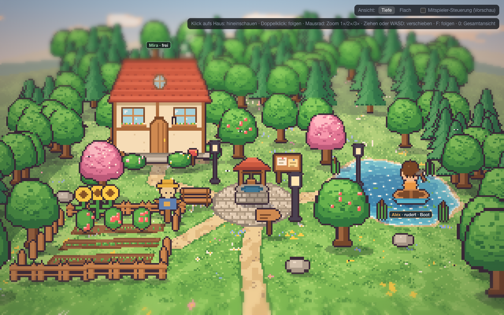
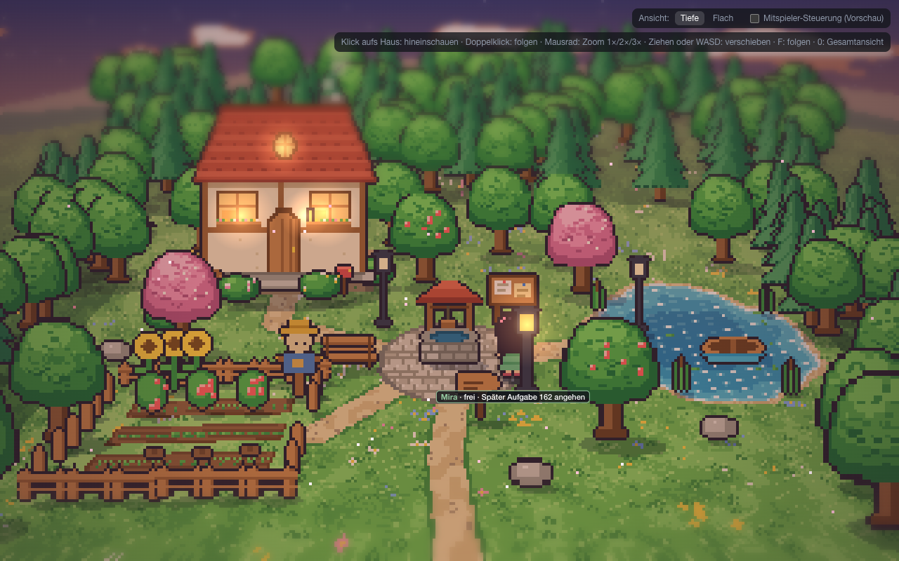
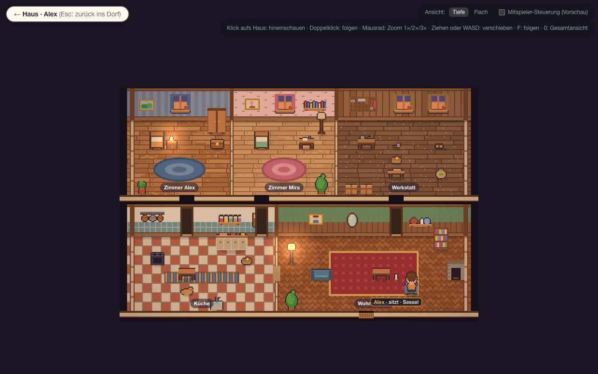

# AP15 – Dinge im Dorf: Statusbericht

Auftrag: deine Auswahl vom 14.10.2026 („erst Deko, dann Weltgenerator“; alle vorgeschlagenen Dinge, Licht schalten nur die Agenten). Plan: [AP15-dinge.md](../arbeitspakete/AP15-dinge.md). Branch `ap/15-dinge` (baut auf `ap/14-startwelt-a` auf), nicht ausgerollt.

## Bilder

| | |
|---|---|
| Alex rudert (sitzt im Boot, Schild „rudert · Boot“):  | Abends: Mira hat die Laterne am Platz angezündet, die beiden anderen sind dunkel:  |
| Haus am Abend: Stehlampe an, Alex im Sessel, Katze auf dem Teppich:  | Zum Vergleich das abgenommene Dorf (AP14):  |

## Geliefert
- **Aussehen unverändert:** Was benutzbar wurde, steht mit demselben Sprite an derselben Stelle wie in Bild A und innen2; es kommt nur jetzt aus dem Weltzustand. Am Mittag sieht das Dorf aus wie das abgenommene Bild (Unterschiede nur durch die Figuren).
- **Draußen:**
  - **Boot:** rudern (Ruhe), vom Boot angeln (85 % statt 70 %); immer nur eine Person, die im schaukelnden Boot sitzt.
  - **Drei Laternen:** an und aus ohne Holz. Sie leuchten nur, wenn sie brennen; kein Automatismus. Wer abends draußen ist, bekommt den Gang zur nächsten dunklen Laterne angeboten.
  - **Briefkasten:** private Briefe an jeden Mitbewohner. Am Briefkasten sieht man „Post für dich“, abholen liest sie.
  - **Wegweiser:** nennt die Orte mit Richtung und macht sie bekannt.
  - **Vogelscheuche:** Sturm wirft sie um, dann wachsen die Beete halb so schnell; aufrichten.
  - **Benannte Quellen:** Tomaten (Nahrung), Sonnenblumen (Samen), Regentonnen (Wasser, füllen sich nur bei Regen und Sturm, Beete direkt gießen), Apfelbäume (Nahrung), Steine (mit Spitzhacke), Schilf (neuer Rohstoff).
  - **Korb:** Bauplan aus 2 Schilf an der Werkbank; wer ihn trägt, hat 3 Plätze mehr.
- **Drinnen:**
  - **Katze:** streicheln (Geselligkeit); sie wechselt alle drei Stunden ihren Platz, nachts am Kamin.
  - **Sessel:** man sitzt darin.
  - **Licht:** Kerze und zwei Stehlampen, an und aus.
  - **Ablagen:** Schrank, zwei Kisten und die Truhe für Rohstoffe und Dinge (zeigt „darin: …“).
- **Für die Agenten:** neue Optionen mit Texten, Bewertung (Licht abends an, tagsüber aus; Post ganz oben; Rudern beruhigt, Streicheln gegen Einsamkeit), Beobachtungen, Protokolltexte; private Inhalte (Briefe anderer) bleiben verborgen.
- **Oberfläche:** Schild und Agentenkarte nennen die Tätigkeit („rudert · Boot“, „sitzt · Sessel“), die Namensblase zeigt Quellennamen („Tomaten“), das Kontextmenü der Mitspieler-Vorschau bietet die neuen Handlungen an.
- **Nebenbei behoben (AP14, dein Hinweis):** Nach Esc blieben die Raumschilder der Innenansicht draußen stehen. Jetzt verschwinden sie; der Browser-Test prüft das.

## Probelauf (Fake-Modell, drei Simulationstage)
- **Fake-Modell, das die Optionen der Reihe nach durchgeht:** Fast alles kam vor, ohne einen einzigen Fehlschlag: Rudern, vom Boot angeln, Laternen an und aus, Kerze und Lampe, Briefe einwerfen, Ablagen füllen und leeren, Sessel, Tomaten, Sonnenblumen, Regentonnen, Schilf.
- **Fake-Modell, das immer die bestbewertete Option nimmt:** Es blieb meist im Gespräch im Haus; die Laternen blieben dunkel. Daraus kam der Gang zur Laterne für Agenten, die abends draußen sind. Wie oft ein echtes Modell die Laternen anzündet, zeigt erst ein Lauf mit dem echten Modell.

## Tests
- Backend: **983 bestanden**. Neu:
  - `tests/world/test_dinge.py` (Boot, Lichter, Briefe, Wegweiser, Sturm und Wachstum, Katze, Sessel, Ablagen, Korb, Regentonne)
  - `tests/agents/test_dinge_optionen.py` (Post, Laternen abends, benannte Quellen, Ablagen, Streicheln, Gang zur Laterne)
  - Startwelt-Tests erweitert
- Frontend (Vitest): **107 bestanden**. Neu: Lichtschein nur an brennenden Laternen, Sitzplatz im Boot.
- Browser (Playwright): **59 bestanden**, 3 übersprungen (Messung, zwei Bilderläufe). Neu: wer rudert, sitzt im Boot; draußen keine Raumschilder.
- **Ein Fehler ist offen:** Einmal antwortete der Testserver beim Bilderlauf mit Fehler 500 auf einen Simulationsschritt. Nachstellen ließ er sich nicht: 1800 Schritte im Stresslauf mit Versetzen und Handlungen liefen fehlerfrei, ebenso fünf weitere Bilderläufe.

## Grenzen
Siehe [grenzen.md](../grenzen.md) (Abschnitt „Dinge im Dorf“):
- **Laternen:** Vergessen die Agenten sie, bleibt das Dorf abends dunkel (so gewollt).
- **Briefe:** Man bemerkt sie erst am Briefkasten.
- **Lage:** Dinge auf Mauer, Zaun oder Wasser stehen logisch auf der nächsten passenden Kachel.
- **Katze:** Sie springt zwischen ihren Plätzen, statt zu laufen.

## Abnahme durch dich
1. **Im Browser ansehen:** `scripts/dev.sh` starten, dann http://localhost:5173 öffnen und mit der Maus über Boot, Laternen, Tomaten, Briefkasten und Katze fahren. Mit der Simulation laufen lassen und schauen, was Alex und Mira damit anfangen.
2. **Freigabe zum Ausrollen:** erst danach.

**Abgenommen am 14.10.2026 (Henry: „ich bin zufrieden“).** AP13 bis AP15 sind damit in `main`. Ausgerollt ist noch nichts.

**Nachtrag 14.10.2026:** Die vier liegengebliebenen Zweige aus anderen Sitzungen sind jetzt in `main`. Darunter ist die Korrektur, dass nur noch der DB-Thread die Schreibverbindung benutzt. Sie erklärt sehr wahrscheinlich den einmaligen Fehler 500 beim Simulationsschritt: Zwei Threads auf derselben Verbindung ließen gelegentlich eine Abfrage leer zurückkommen. Nach dem Zusammenführen: Backend 993 bestanden, Vitest 107, Browser 59 (3 übersprungen).
