# AP16 – Schritt 0 (neu, 21.10.2026): Gestalten auf dem Stand nach AP18

**Auftrag:** AP16 („Wege, Seen, Gärten, Häuser, Bäume und Deko selbst setzen, Häuser von innen einrichten“) auf dem Stand von `main` vorbereiten, nur Plan, Mockup, Bericht und Fragen, kein Produktivcode. **Plan:** [AP16-plan.md](../arbeitspakete/AP16-plan.md) (vom 14.10.2026, vor AP18) mit der Aktualisierung unten. **Branch:** `claude/ap16-gestalten-d6bb10`, nichts ausgerollt, nicht in `main`. **Wartet auf deine Abnahme** (Fragen 77–82 in [offene-fragen.md](../offene-fragen.md)).

Das alte Mockup `welt-optik/gestalten.html` (Werkzeuge, Entwurf, Fehler am Cursor, Innenausbau) ist abgenommen (Frage 37) und bleibt für **Werkzeuge und Ablauf** gültig; sein Bericht steht unten als Anhang. Neu ist der **Rahmen**, den AP18 geschaffen hat: Welt-Werkstatt, Spielart Gott, Prüfung, Schutz.

## Kurzfassung
1. **Ein Werkzeugkasten, zwei Orte.** Dieselben Werkzeuge und derselbe Entwurf (Liste von Aktionen) laufen in der **Welt-Werkstatt** (auf einer Weltdatei, „Speichern“) und im **Spiel in der Spielart Gott** (auf der laufenden Welt, „Übernehmen“ mit Sicherung). Der Unterschied liegt nur im Ziel und darin, was „fertig“ heißt.
2. **„Dorf anfügen“ entfällt im Spiel** und wird ersetzt durch das Werkzeug **Karte erweitern** (Osten/Süden); ein ganzes Dorf legt nur noch **Gebiet erzeugen** an, und das nur in der Werkstatt (Frage 78).
3. **Nach dem Code-Befund** ändert sich die Architektur gegenüber dem Plan an drei Stellen, die den Aufwand bestimmen: (a) Kacheln lassen sich heute nur aus einem Generator-`Layout` ableiten, nicht aus gespeicherten Formen (`look`); (b) `look` kennt nur Anhängen, keine Kennungen; (c) die Werkstatt hat gar keine Engine, sondern eine Datei im Browser. Dazu mehr unten.
4. **Zerlegung** AP16a (Backend) · AP16b (Außenwerkzeuge an beiden Orten) · AP16c (Innenausbau) · AP16d (Härtung), wie geplant, aber mit anderem Inhalt von a und b.
5. **Sechs neue Fragen (77–82)** mit Vorschlägen; die Fragen 27–30 sind neu bewertet (gelten weiter).

## 1. Abgleich: alter Plan gegen heute

| Annahme im Plan (14.10.) | Stand heute (`main`, 21.10.) | Folge für AP16 |
|---|---|---|
| Erreichbar „im Spiel (Welt gestalten)“ und aus dem Startmenü vor einer Runde | Im Spiel nur in der Spielart **Gott** (HUD `hud/Werkzeuge.tsx`, Taste `B`, ruft `enterEditor("extend")`); in **Leben** gibt es weder Leiste noch Taste, die Endpunkte antworten mit 403 (`api/spielart_schutz.nur_gott`). Vor einer Runde: **Welt-Werkstatt** (Menü › Editoren › Welten › Öffnen) und „Damit spielen …“ | Zwei Orte statt einem; die neuen Entwurf-Endpunkte müssen `nur_gott` aufrufen (Test je Endpunkt) |
| Editor-Leiste als „dritter Reiter“ des Welteditors | Der Reiter-Editor ist weg: `editor/WorldEditor.tsx` (142 Z.) zeigt nur noch „Dorf anfügen“ (Wunsch, Vorschau, Übernehmen). `welten/Werkstatt.tsx` (93 Z.) hat drei Werkzeuge (Zeiger, Startplatz, Gebiet erzeugen) und den Hinweis „Weitere Werkzeuge … kommen mit dem Gestalten-Paket“ (Zeile 55) | Ein gemeinsamer Werkzeugkasten `frontend/src/gestalten/` (Leiste, Katalog, Entwurfsliste, Prüfung), den **beide** Rahmen einbinden; beide Dateien bleiben unter 400 Zeilen |
| Aktionen laufen als Patch über `engine.edit` mit Trockenlauf (`POST /api/world/patch/preview`) | Das gilt für das Spiel unverändert. Die **Werkstatt** hat keine Engine: Der Entwurf ist eine Weltdatei im Browser (`werkstattStore.welt`), die Vorschau kommt aus einer Wegwerf-Simulation im Speicher (`POST /api/worlds/preview`), „Gebiet erzeugen“ wendet einen Patch auf eine Temp-Simulation an und liest die Datei zurück (`POST /api/worlds/add-area`, `routes_welten.py`) | Ein Aktionsmodul, zwei Wege: im Spiel `…/api/world/draft/preview|apply` auf der Engine, in der Werkstatt **zustandslos** `POST /api/worlds/draft` (Weltdatei + Aktionen → neue Weltdatei, Prüfbericht, Zustandsabzug) über dieselbe Temp-Simulation wie `add-area` |
| `tiles.py` soll „ein Rechteck aus den Formen eines Gebiets neu abtasten“ | `tiles.rasterize(layout)` rastert ein **Generator-`Layout`** (Datenklasse im Speicher), nicht gespeicherte Formen. Gespeicherte Welten haben nur Kacheln und `look` | Neu: eine Ableitung **aus `look.regions[*].shapes`** (Wege, Plätze, Seen, Gärten, Stege, Bäche, Brücken, Deko) mit derselben Abtastung; Abgleichstest gegen das Raster des Generators (gleiche Formen = gleiche Kacheln). Das ist der größte Einzelposten von AP16a |
| `look` kann nur anhängen; Formen brauchen feste Kennungen | Unverändert: `look.merge` hängt Gebiete und Landstraßen an. **Neu seit AP18g:** `world/build_look.py` hängt einzelne Stücke an das Gebiet unter einer Kachel (`_region`) und meldet `world.look_added`; auch das kennt nur Anhängen | AP16a baut Ändern und Entfernen auf `build_look` auf (gleiche Region-Suche, gleiches Ereignis-Muster). Kennungen: siehe Risiko „Dorf A“ unten und Frage 80 |
| Startwelt/Dorf A byte-gleich | `look-v2-startwelt.json` hat einen Block `legacy` (Boden, dessen Zufall in Reihenfolge gewürfelt wird). Löschen im Legacy-Block würde die Wiese verschieben | Bestehendes im Legacy-Block wird **maskiert**, nicht gestrichen; Bildvergleich in AP16a Schritt 1 (Frage 80) |
| Leere Welt = „zu bauendes Nichts“ gab es nicht | `generator/blank.py`: **eine** Region „welt“ über die ganze Karte, ohne Häuser, ohne Startplatz; erzeugte Gebiete sind eigene Regionen (`v2` …) | Zielregion eines Werkzeugs = Region unter dem Startpunkt (`_region`), sonst die erste; Formen dürfen über Regionsgrenzen ragen (Koordinaten sind Weltpixel − `frame`), das legt AP16a fest |
| Zeit steht still, solange der Editor offen ist (Frage 28) | `enterEditor` (`editor/editorStore.ts:145`) setzt nur den Reiter; dass die Zeit anhält, ist dort nicht zu sehen | In AP16b ausdrücklich bauen und mit e2e testen (Zeit vorher/nachher gleich, Fortsetzen nur, wenn sie vorher lief) |
| Welt-Klick = Kachel (Raster-Cursor, Ziehen, Hilfslinien nötig) | `worldBridge.tileClick` meldet nur Klicks auf ganze Kacheln; die Werkstatt markiert eine Kachel (`markierung`) | Neue Brücke für Zeigerbewegung und Ziehen in Kachelkoordinaten (`zeiger(x, y, phase)`) und eine **Cursor-Schicht** mit Geist, Raster, Türmarke, Fehler am Cursor in der Weltansicht (DorfView/WorldCanvas); die Weltfläche selbst bleibt unverändert |
| Aktionsmodul `generator/edit/` | `generator/` hat 24 Dateien, alle klein (größte `layout.py` 311 Z.); `tests/test_file_size.py` hält 400 Z. | `generator/edit/` mit einer Datei je Aktionsfamilie (`weg.py`, `see.py`, `garten.py`, `haus.py`, `deko.py`, `loeschen.py`, `karte.py`, `innen.py`, `pruefung.py`) |
| Haus nachträglich setzen nutzt `interiors`/`kits` | Unverändert; neu seit AP18f: Türwege um Häuser herum (`layout_haeuser.py`) und der Generator verlangt eine erreichbare Tür | „Haus setzen“ legt Tür, Tasche (Innenbereich unter/neben der Karte), Orte, Möbel, Übergang und Bildstelle in einem Zug an und schlägt einen **Weg zur nächsten Straße** vor (kürzester Weg, wie `layout_haeuser`); er ist eine eigene Aktion im Entwurf |
| Werkstatt-Dateien enthalten Bewohner | Bibliothekswelten haben **keine** Figuren (`_strip_agents`) | In der Werkstatt entfällt die Belegungsprüfung durch Figuren; Dinge und Orte prüft sie weiter. Das „bewohnt“-Verbot beim Hauslöschen gilt dort nicht (es wohnt niemand) |

## 2. Wie die Werkzeuge in Werkstatt und Spiel zusammenpassen

**Ein Aktionsmodul.** Jede Werkzeugaktion ist ein kleines Datum (`{"art": "weg", "punkte": […]}`) und eine reine Funktion `aktion → Patch-Baustein` in `generator/edit/`. Ein **Entwurf** ist eine Liste solcher Aktionen; er ergibt **einen** zusammengesetzten Patch. Das gilt für beide Orte, damit Bild, Kacheln, Orte und Objekte aus denselben Formen kommen (Leitsatz 3 des Plans).

| | Welt-Werkstatt | Gestalten im Spiel (Gott) |
|---|---|---|
| Wirkt auf | Weltdatei der Bibliothek, über eine Wegwerf-Simulation im Speicher | laufende Simulation (`engine.edit`, Trockenlauf wie AP12c) |
| API | `POST /api/worlds/draft` (zustandslos: Datei + Aktionen → Datei, Bericht, Abzug) | `POST /api/world/draft/preview` und `…/apply` (Prüfsumme, Idempotenz, Sicherung, Ereignis) |
| Zeit | keine | steht still, solange offen |
| „Fertig“ | **Speichern** schreibt die Datei, leert den Entwurf | **Übernehmen** mit Sicherung („Vor dem Gestalten“), ein Patch, ein Ereignis nur im Protokoll |
| Prüfung ✗ | sperrt „Damit spielen“, nicht das Speichern | sperrt Übernehmen |
| Belegung | Dinge, Orte | Figuren und Dinge (`blocked`), bewohnte Häuser |
| Nur hier | Startplatz, Gebiet erzeugen (Generator) | – |
| Beide | Zeiger, Weg, See, Garten, Haus (auch von innen), Baum und Deko, Löschen, **Karte erweitern**, Tiefe/Flach, Raster, Rückgängig/Wiederholen, Esc | |
| Schutz | immer (eigene Dateien; Dorf am See nur als Kopie) | Spielart Gott; in Leben 403 und keine Taste |
| Esc | erst Aktion/Auswahl, dann „← Welten“ (Rückfrage bei Entwurf) | erst Aktion/Auswahl, dann zurück ins Spiel (Rückfrage bei Entwurf) |

**Zwei Rahmen, ein Kasten:** `Werkstatt.tsx` und das Gestalten-Fenster im Spiel (heute `WorldEditor.tsx`) binden denselben Werkzeugkasten ein und liefern nur das Ziel (Datei oder Spiel), die obere Leiste (Name, ungespeichert, Speichern, Damit spielen **oder** „Zeit steht still“, Fertig) und den Abschluss. Die Weltansicht zeigt wie bisher die Vorschau unter dem Schleier (`worldBridge.world()` liefert Vorschau statt Welt).

**Was aus „Dorf anfügen“ wird.** Es war der einzige Weg, die Karte wachsen zu lassen, und der einzige Generatoraufruf im Spiel (Frage 76, 3). Vorschlag (Frage 78): es entfällt zusammen mit dem Panel „Dorf anfügen“; **Karte erweitern** (Osten/Süden, höchstens 256 × 256, neue Wiese, Bestand unberührt; Engine-Operation `extend_map` gibt es) hält die Karte offen, und **Gebiet erzeugen** (Generator mit allen Stellgrößen, mit Rahmen, Frage 81) bleibt in der Werkstatt, wo die Welt gespeichert und als Ganzes geprüft wird. Der Weg über `extension_patch`/`apply_generated` bleibt im Backend, weil die Werkstatt ihn heute schon nutzt (`add-area`).

**Keine höhere Instanz.** Das Ereignis einer Übernahme steht im Protokoll der Leitstelle; es kommt in keine Wahrnehmung, kein Gedächtnis, keinen Prompt. Neue Möbel und Häuser sind für Bewohner Dinge und Orte wie alle anderen (neue Orte zunächst unbekannt, `generator.md`). Laufende Wege, die der Umbau ungültig macht, werden still neu geplant. Ein Test in AP16d prüft Prompts und Erinnerungen nach einem Umbau auf die Wörter Editor, Leitstelle, Spieler, Gott.

## 3. Mockup

Datei: [`docs/mockups/gestalten-neu.html`](../mockups/gestalten-neu.html) (Stil und Bausteine von [rework.html](../mockups/rework.html), Code in `gestalten-neu/`). Zum Ansehen im Ordner `docs/mockups` einen kleinen Server starten (`python3 -m http.server`), `gestalten-neu.html` öffnen; **Taste M** zeigt die Leiste mit elf Bildschirmen, `?s=7` startet einen davon. Boden und Sprites sind die echten Bilder aus dem Rework-Mockup, die Innenansicht ist schematisch (im Spiel kommen Sprites und Optik aus innen2).

| 1 Werkstatt, Haus setzen | 2 Weg ziehen |
|---|---|
| 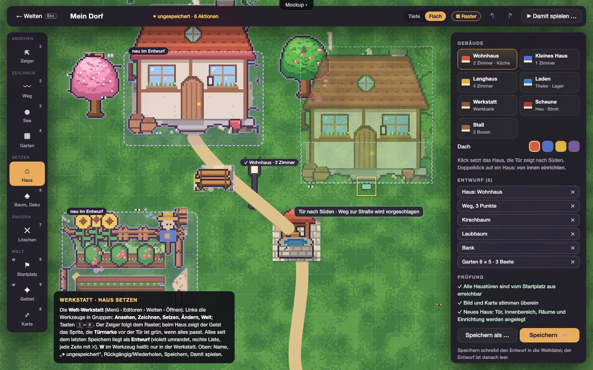 | 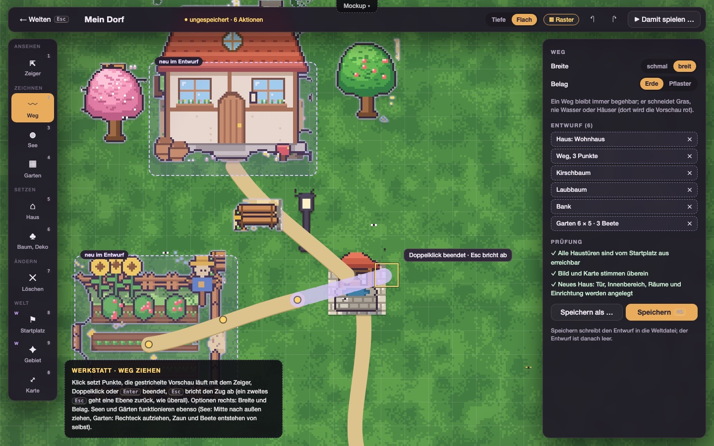 |
| **3 Fehler am Cursor** (See, Baum im Weg) | **4 Prüfung nach dem Löschen** (✗, Speichern geht, Damit spielen gesperrt) |
| 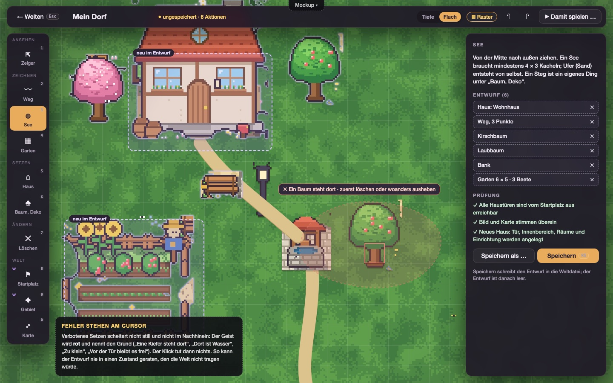 | 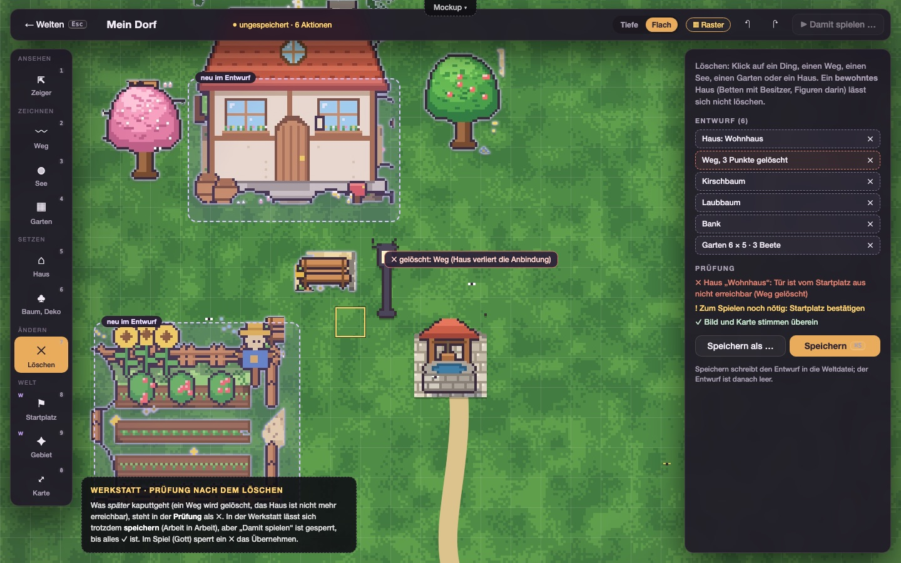 |
| **5 Gott: Entwurf, Zeit steht still** (Belegung rot schraffiert, ohne Startplatz und Gebiet) | **6 Übernehmen** (Sicherung, Bewohner merken nichts) |
| 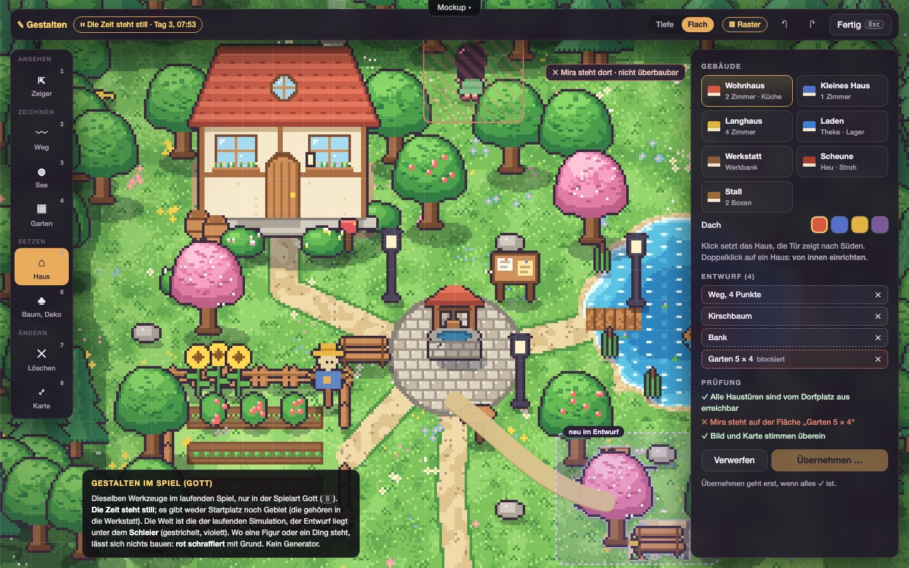 | 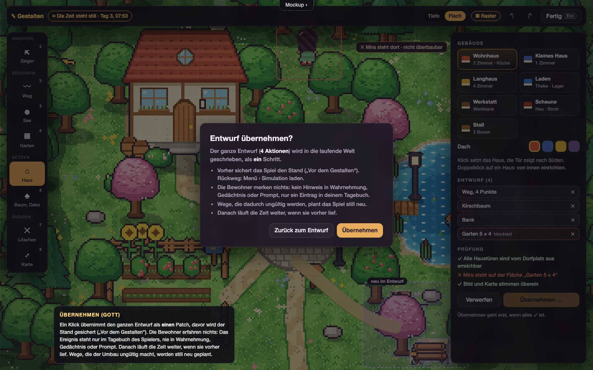 |
| **7 Haus von innen einrichten** | **8 Innen: Fehler am Cursor** (Vor der Tür bleibt es frei) |
| 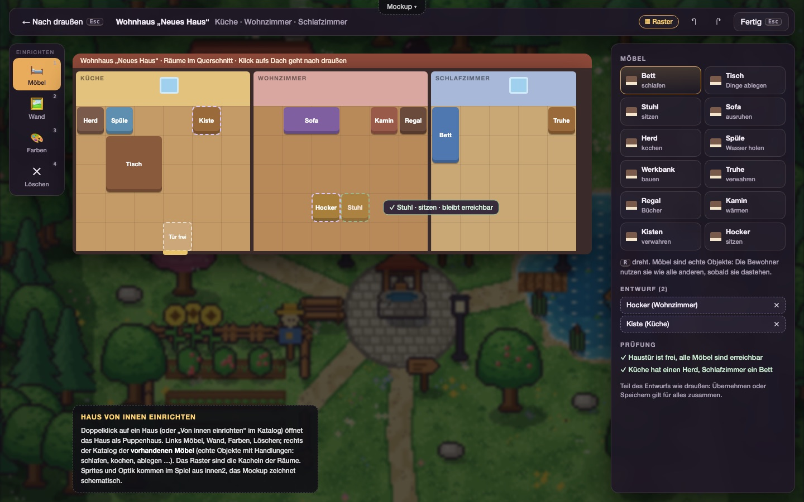 | 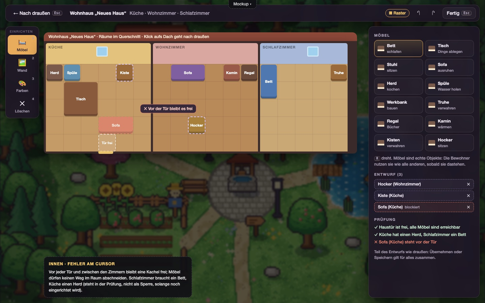 |
| **9 Innen: Wand und Farben** | **10 Karte erweitern** (ersetzt „Dorf anfügen“) |
| 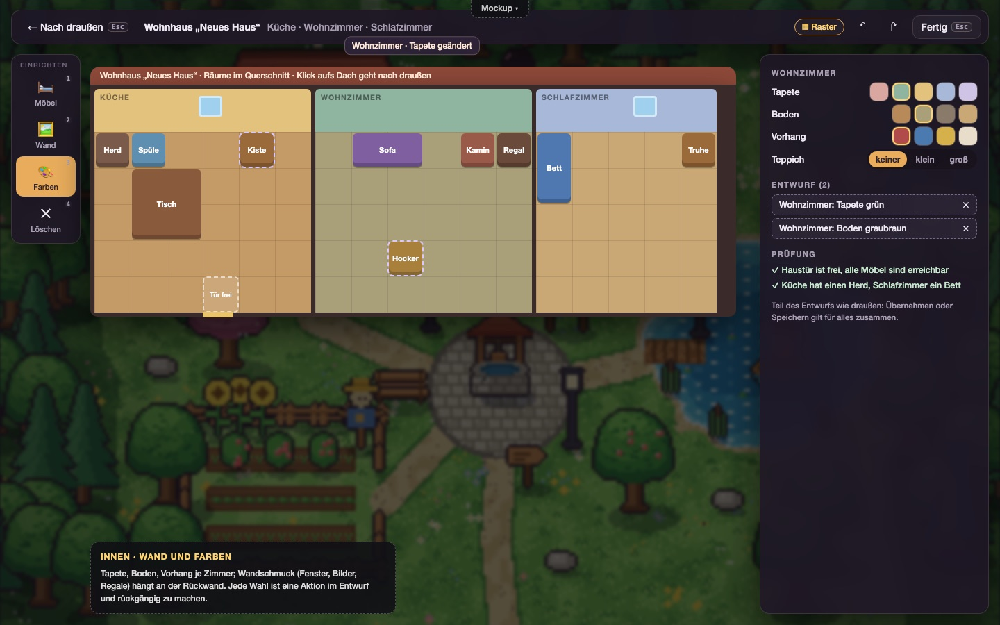 | 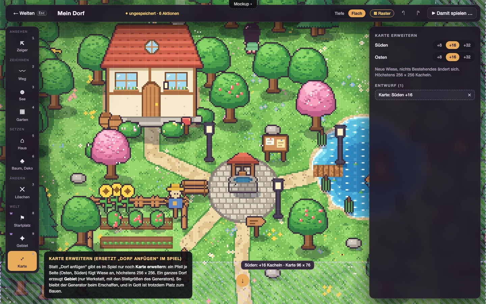 |

**11 „Ein Werkzeugkasten, zwei Orte“** zeigt die Tabelle von oben als Bild: [ap16-mockup-11-orte.jpg](img/ap16-mockup-11-orte.jpg).

**Gegenüber dem alten Mockup neu:** Leiste in **Gruppen** (Ansehen, Zeichnen, Setzen, Ändern, Welt) mit dem Zeichen **W** für „nur in der Werkstatt“; Kopfzeile je Ort (Name, „● ungespeichert · 6 Aktionen“, Speichern, Damit spielen **oder** „⏸ Die Zeit steht still“, Fertig); **Prüfung mit drei Stufen** (✓, ! Hinweis, ✗ Fehler); Belegung durch Figuren; **Karte erweitern**; alles in der Formensprache aus AP18b. **Unverändert:** die Bedienung der Werkzeuge selbst (Weg mit Punkten, See von der Mitte, Garten als Rechteck, Haus mit Türmarke, Fehler am Cursor, Möbelkatalog, Farben) aus dem abgenommenen Mockup.

**Schematisch:** Ansicht „Flach“ (die Werkzeuge arbeiten in Tiefe und Flach), Möbel als Kästen, „Übernehmen“ und „Speichern“ sind nicht verdrahtet.

## 4. Zerlegung in Teilschritte

Reihenfolge wie im Rework-Plan nach AP18e und vor AP18f/g. Jeder Teil hat seinen Branch, nie `git add -A`, Dateien höchstens 400 Zeilen, Abnahme durch dich vor dem nächsten.

### AP16a – Aktionen, Ableiten, Prüfen, API (Backend, L)
1. **Spike zuerst (klein):** Kacheln aus gespeicherten Formen ableiten. `tiles.py` bekommt eine Eingabe aus `look.regions[*].shapes` statt aus `Layout`; Abgleichstest: die Formen der Seeds 7, 12, 31, 58 (Fixtures) ergeben dieselben Kacheln wie der Generator. Ohne das fällt der Rest. Ergebnis des Spikes entscheidet Frage 80 (Legacy-Maske).
2. **Aktionen** (`generator/edit/`): `weg`, `see`, `garten`, `haus` (mit Tasche, Orten, Möbeln, Übergang, Bildstelle, Wegvorschlag), `deko` (Baum, Busch, Bank, Laterne, Brunnen, Stein … aus `kits.py` und den Bausteinen), `loeschen` (Form, Ding, Haus), `karte` (Erweitern), `startplatz` (nur Datei). Jede Aktion nennt Gebiet und Kacheln, die sie berührt; die Ableitung rastert nur dieses Rechteck neu.
3. **Look ändern und entfernen** (aufbauend auf `world/build_look.py`): feste Kennungen für neu gesetzte Formen, Löschen per Kennung, Maske für Legacy-Bestand; Ereignisse mit Reducern im Browser (`world.look_changed`/`look_added` bleiben, neues `world.look_removed`). Die Startwelt-Datei bleibt byte-gleich.
4. **Prüfung** (`generator/edit/pruefung.py`): drei Stufen; Erreichbarkeit aller Türen, Quellen und Dinge vom Startplatz/Dorfplatz (vorhandene `validate`-Regeln), Überlappung, Kartengrenze, Belegung (Figuren und Dinge nur im Spiel), Tür frei, Schlafzimmer braucht Bett, Küche Herd; Grund und Ort je Meldung.
5. **API:** `POST /api/world/draft/preview` und `…/apply` (Gott, `nur_gott`, Prüfsumme, Idempotenz, Sicherung, Ereignis `world.edited` nur im Protokoll); `POST /api/worlds/draft` (zustandslos für die Werkstatt, Temp-Simulation wie `add-area`). Messen: Vorschau einer Werkstatt-Datei mit 20 Aktionen unter einer Sekunde (sonst Temp-Simulation zwischenspeichern und nur die letzte Aktion anwenden).
6. **Tests:** Eigenschaftstest (zufällige Aktionsfolgen → Bild und Kacheln stimmen, alles erreichbar, Ergebnis in der Werkstatt = Ergebnis im Spiel), Bildvergleich Dorf A unverändert, alte Spielstände, 403 in Leben je Endpunkt, `max_objects` (Standard 150, Patch hebt auf höchstens 500).

### AP16b – Außenwerkzeuge an beiden Orten (Frontend, L)
1. **Zeiger-Brücke und Cursor-Schicht** in der Weltansicht: Kachel unter dem Zeiger, Raster, Geist (Sprite, Fläche, Linie), Türmarke, Fehler am Cursor; Tiefe und Flach; nur aktiv, wenn ein Werkzeugkasten offen ist. Die Weltfläche bleibt für alle anderen Zustände unverändert (Goldbilder).
2. **Werkzeugkasten** `frontend/src/gestalten/`: Leiste in Gruppen (Tasten 1–0), Katalog je Werkzeug, Entwurfsliste mit ✕, Prüfung, Rückgängig/Wiederholen (Strg+Z), Esc je Ebene (`ui/zurueck`).
3. **Werkstatt:** Zeiger, Startplatz und Gebiet erzeugen wandern in den Kasten; Gebiet mit Rahmen (Frage 81); Speichern schreibt die Entwurfsliste in die Datei (Frage 77); Hinweistext „Weitere Werkzeuge kommen …“ fällt weg.
4. **Spiel (Gott):** Taste B öffnet den Kasten statt „Dorf anfügen“ (Frage 78); **die Zeit hält an**, Fortsetzen nur, wenn sie lief; Übernehmen-Dialog mit Sicherung; Rückfrage bei Esc mit Entwurf.
5. **Tests:** Vitest für Entwurfsliste, Rückgängig und die Zeigerbrücke; Playwright: je Werkzeug setzen, rückgängig, Fehler am Cursor, Speichern/Übernehmen, Zeit steht still, in Leben keine Taste, Esc führt je eine Ebene zurück; Bildvergleich der Leiste.

### AP16c – Innenausbau (L)
Innenansicht als Bearbeitungsfläche (Mockup Bild 7–9) auf dem Puppenhaus aus innen2: Möbelkatalog aus den vorhandenen Objektarten mit Handlungen (AP15), Raster der Raumkacheln, Drehen, Wandschmuck, Teppiche, Farben von Tapete, Boden und Vorhang; `furnish_room` wird zum Patch-Baustein; Prüfung (Tür frei, alles erreichbar, Schlafzimmer Bett, Küche Herd; in Gott keine Betten mit Besitzer löschen, Frage 82). Zugang: Doppelklick aufs Haus oder „Von innen einrichten“. Tests: Möbel setzen und von einem Bewohner nutzen lassen (Fake-Modell), Eigenschaftstest für Einrichtungen, Bild und Kacheln stimmen.

### AP16d – Abnahme und Härtung (M)
Probelauf mit Fake-Modell auf einer selbst gebauten Welt (Figuren nutzen neue Häuser, Möbel, Wege), Leistungsmessung mit vielen Formen, **Prompt-Test** (kein Hinweis auf Editor, Leitstelle, Spieler, Gott nach einem Umbau), Doku (`welt-erweitern.md`, `generator.md`, `frontend.md`, `schnittstellen.md`), Statusbericht mit Bildern, Beispielwelten für die Bibliothek.

## 5. Fragen an dich
Siehe [offene-fragen.md](../offene-fragen.md), Nr. 77–82 (alle mit Vorschlag), und neu bewertet 27–30:
- **77** Werkstatt: Entwurf mit Speichern (Vorschlag) oder jede Aktion sofort?
- **78** „Dorf anfügen“ entfällt, Ersatz Karte erweitern (Vorschlag), oder Gebiet auch in Gott?
- **79** ✗ in der Prüfung: im Spiel sperrt es Übernehmen, in der Werkstatt nur „Damit spielen“ (Vorschlag).
- **80** Dorf A ändern: Legacy-Bestand per Maske, Neues überall (Vorschlag).
- **81** Gebiet erzeugen: Ecke anklicken mit Rahmen (Vorschlag) oder Rechteck aufziehen?
- **82** Innen einrichten auch in bewohnten Häusern (Vorschlag: ja, ohne Betten mit Besitzer und Türen).

## 6. Risiken

| Risiko | Gegenmaßnahme |
|---|---|
| Kacheln aus gespeicherten Formen weichen vom Generator ab (der größte Posten) | Spike als erster Schritt von AP16a, Abgleichstest über vier Fixtures und zufällige Aktionsfolgen |
| Löschen im Legacy-Block verschiebt den Boden von Dorf A | Maske statt Streichen, Bildvergleich, Rückfall: dort nur Neues löschbar (Frage 80) |
| Vorschau der Werkstatt ist langsam, weil jede Aktion eine Temp-Simulation baut (die Erzeugung eines Dorfs braucht rund 0,6 s, siehe AP18-Bericht; für kleine Aktionen ist es weniger, gemessen ist es nicht) | Messen in AP16a; Verzögerung beim Ziehen, Zwischenspeicher der Temp-Simulation, nur letzte Aktion anwenden |
| Entwurf der Werkstatt geht bei Absturz verloren (liegt im Browser) | Entwurf im `sessionStorage` sichern, Rückfrage beim Verlassen (wie heute bei „ungespeichert“) |
| `enterEditor` hält die Zeit heute nicht erkennbar an | in AP16b bauen und per e2e beweisen |
| Zeigerereignisse in der Weltansicht stören Kamera und Auswahl | Cursor-Schicht nur bei offenem Werkzeugkasten; Kamera mit gedrückter mittlerer Taste/Leertaste |
| Katalog fest verdrahtet, obwohl AP21/AP23 Gegenstände zu Daten machen | Katalog als Datenliste aus `kits.py`/Bausteinen, damit AP21 ihn ersetzen kann; AP23 hängt den Reiter „Eigene“ an |
| Objektgrenze (`max_objects`, Standard 150, Patch bis 500) | Prüfung meldet das Limit am Cursor („Die Welt kann höchstens N Objekte aufnehmen“) |

## 7. Nichts davon ist gebaut
Dieser Schritt hat **keinen Produktivcode** geändert. Neu sind nur das Mockup (`docs/mockups/gestalten-neu.html`, `docs/mockups/gestalten-neu/`), dieser Bericht, die Bilder `docs/status/img/ap16-mockup-*.jpg`, die Fragen 77–82 und die Aktualisierung in `AP16-plan.md` und `ARBEITSPAKETE.md`.

---

## Anhang: der Bericht vom 15.10.2026 (altes Mockup, abgenommen)

Plan: [AP16-plan.md](../arbeitspakete/AP16-plan.md). Entscheidungen zu Frage 27 bis 30: **Entwurf** statt Sofortbau, Umfang wie vorgeschlagen, **Mockup zuerst** (Empfehlungen angenommen); zu Frage 28 hat Henry am 15.10.2026 anders entschieden: **Gestalten nur vor Beginn einer Runde**, die Agenten dürfen nicht merken, dass es eine höhere Instanz gibt ([AP17-plan.md](../arbeitspakete/AP17-plan.md)). Das Mockup zeigt das Werkzeug deshalb als Schritt „Neue Simulation › Welt gestalten“. Dieses Dokument zeigt das Mockup; im Spiel ist noch nichts davon gebaut.

**Ansehen:** `docs/mockups/welt-optik/gestalten.html` im Browser öffnen (Doppelklick genügt, kein Server nötig). Mit `?demo=1` ist ein Entwurf vorbefüllt, mit `?view=in&room=kueche` startet die Innenansicht.

## Was das Mockup zeigt
Boden, Häuser und Dinge sind die **echten Bausteine** aus Bild A und den Bausteinen (`world.js`, `dorf.js`, `bausteine.js`, Dorf aus Seed 7). Jede Werkzeugaktion ist eine **Aktion**; die Welt wird daraus neu berechnet (der Boden Texel für Texel, wie im Spiel), so wie im Spiel jede Aktion ein Patch ist. Aktionen liegen im **Entwurf** und erscheinen unter dem **Schleier** (gestrichelt, violett, wie die Vorschau in AP12c).

| Zeiger: etwas anfahren zeigt seinen Namen | Haus gewählt: „Von innen einrichten“ |
|---|---|
| 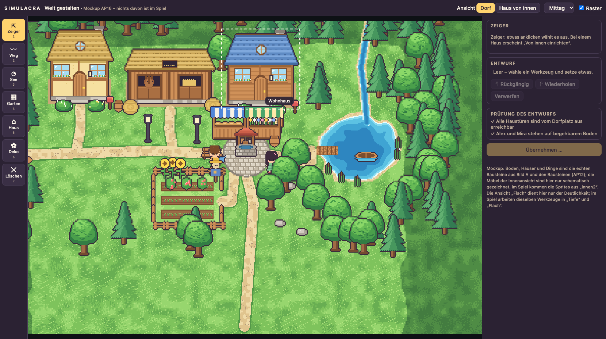 | 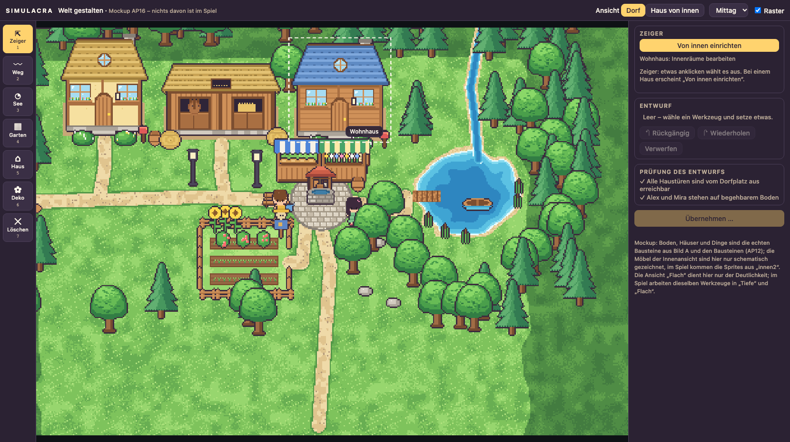 |
| **Weg ziehen:** Punkte setzen, die Vorschau läuft mit dem Zeiger | **See ausheben:** Fehler am Cursor, hier steht ein Baum im Weg |
| 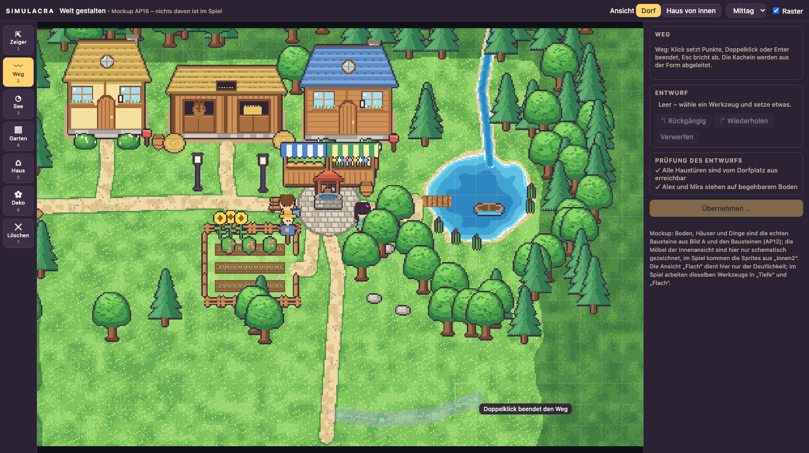 | 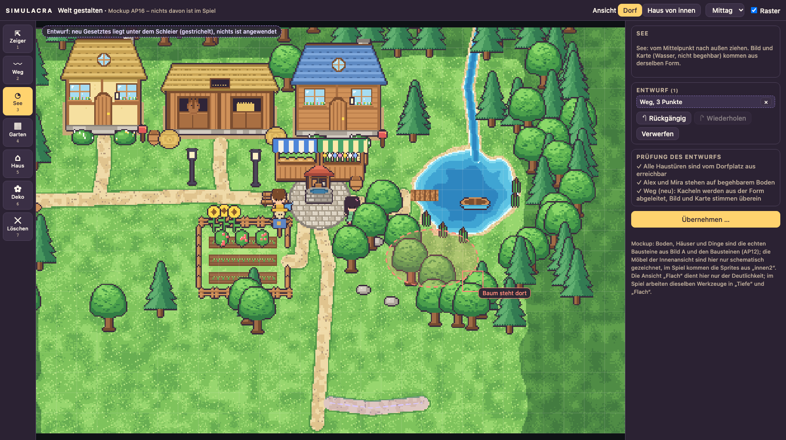 |
| **Haus setzen:** Vorschau des Sprites, Türmarke vor der Tür (grün = gültig) | **Haus setzen, ungültig:** Grund am Cursor, Türmarke rot |
| 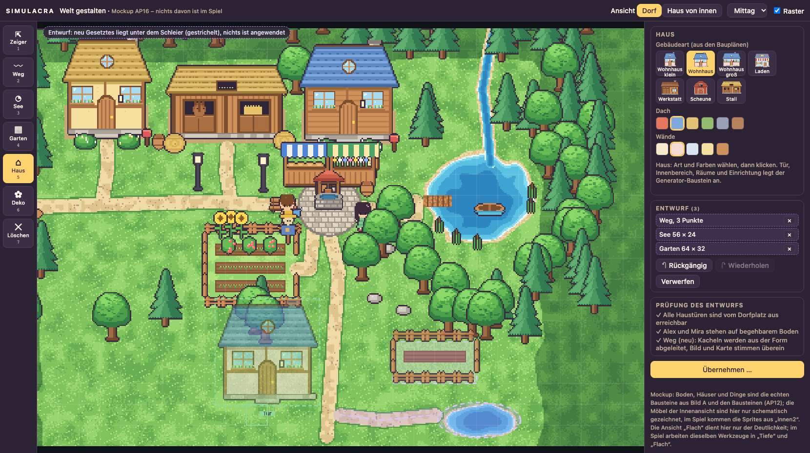 | 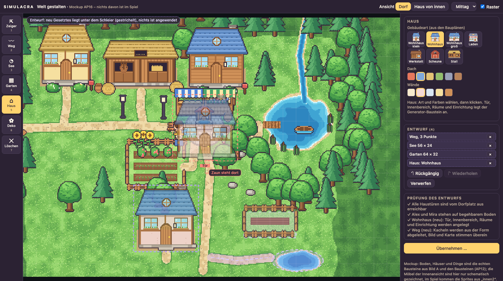 |
| **Löschen:** ein bewohntes Haus lässt sich nicht löschen | **Der Entwurf:** Weg, See, Garten, Haus, drei Bäume, ein Busch gelöscht, Liste mit Rückgängig und Prüfung |
| 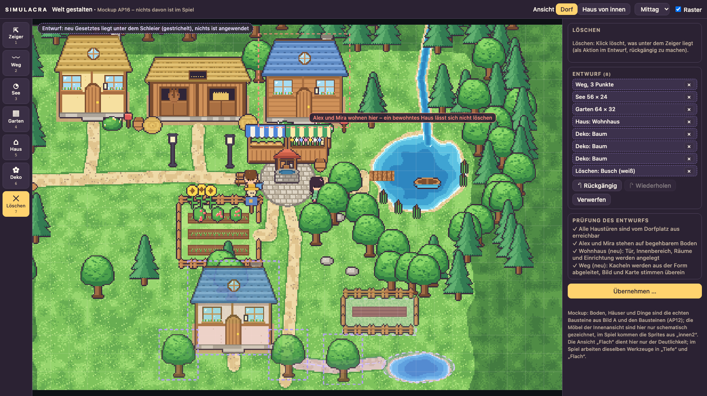 | 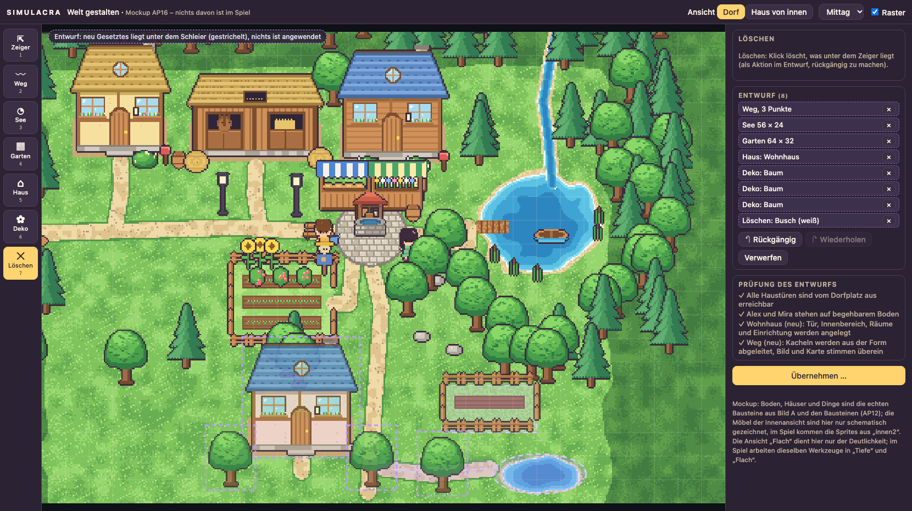 |
| **Abend:** Laternen leuchten, der Entwurf bleibt erkennbar | **Übernehmen:** Bestätigung (die Runde hat noch nicht begonnen) |
| 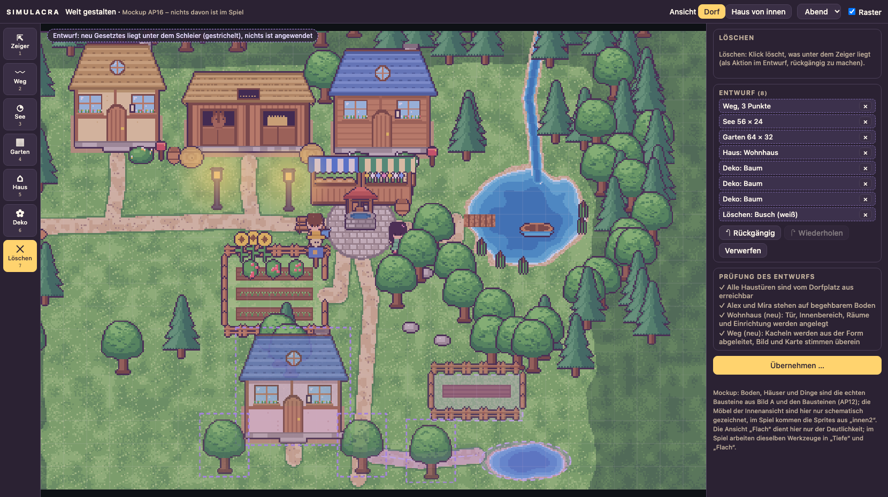 | 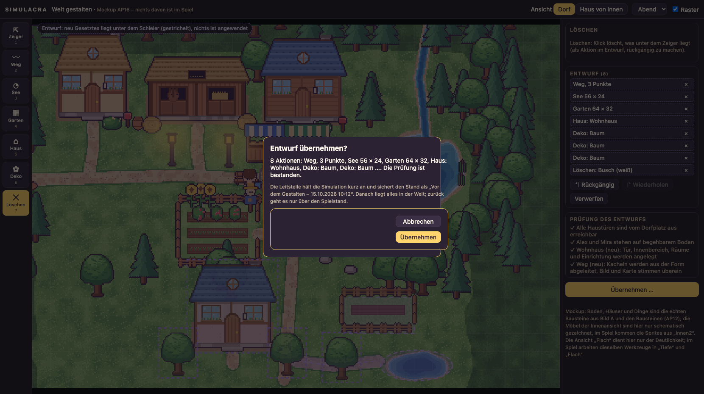 |

### Haus von innen einrichten
| Möbel setzen: Katalog rechts, Vorschau mit Raster | Ungültig: vor der Tür bleibt es frei |
|---|---|
| 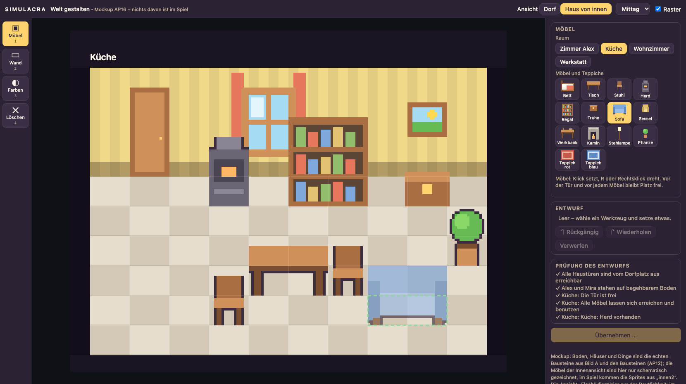 | 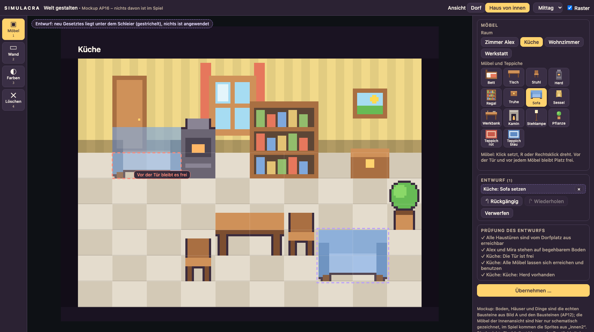 |
| **Wandschmuck:** Fenster und Bilder hängen an der Rückwand | **Farben:** Tapete, Boden, Vorhänge, jede Wahl eine Aktion |
| 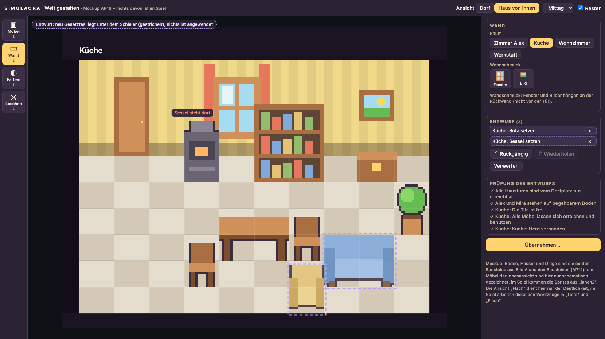 | 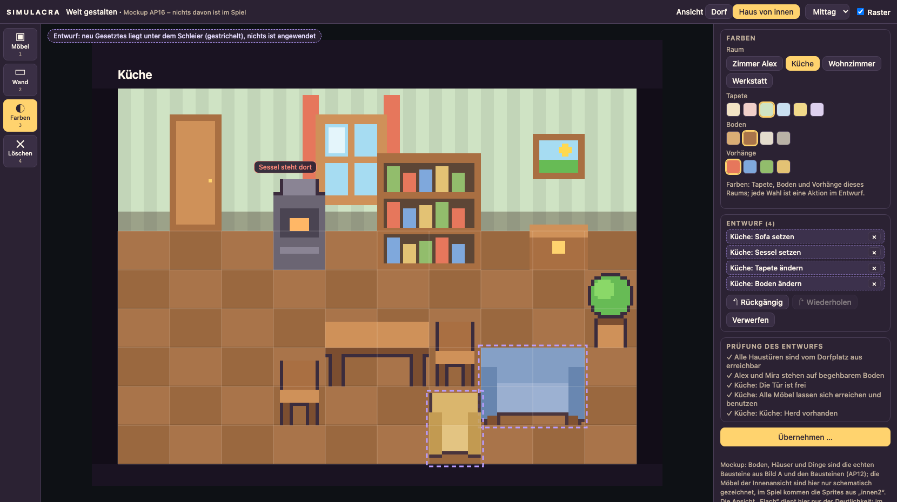 |

## Bedienung
- **Werkzeugleiste links** (Tasten 1 bis 7): Zeiger, Weg, See, Garten, Haus, Deko, Löschen. In der Innenansicht: Möbel, Wand, Farben, Löschen. Rechts oben die Optionen des Werkzeugs (Gebäudeart und Farben, Dekokatalog, Möbelkatalog), darunter der **Entwurf** und die **Prüfung**.
- **Weg:** Klick setzt Punkte, Doppelklick oder Enter beendet, Esc bricht ab. **See:** vom Mittelpunkt nach außen ziehen. **Garten:** Rechteck aufziehen, Zaun, Pfähle und drei Beete entstehen von selbst. **Haus:** Art, Dach- und Wandfarbe wählen, klicken; der Cursor rastet auf die Kachel ein. **Deko:** Klick setzt. **Löschen:** Klick löscht, was unter dem Zeiger liegt (als Aktion, die man zurücknehmen kann).
- **Entwurf:** jede Aktion ist eine Zeile mit ×; Rückgängig und Wiederholen (Strg+Z, Umschalt+Strg+Z), Verwerfen. Was übernommen ist, bleibt; bis zum Beginn der Runde lässt sich weiter gestalten.
- **Prüfung** läuft bei jeder Änderung mit den Regeln des Generators: alle Haustüren vom Dorfplatz erreichbar, Figuren auf begehbarem Boden, für jedes neue Haus „Tür, Innenbereich, Räume und Einrichtung werden angelegt“, innen: Tür frei, alle Möbel erreichbar, Raumart-Regel (Schlafzimmer braucht ein Bett, Küche einen Herd). **Ein Entwurf mit einem ✗ lässt sich nicht übernehmen.**
- **Fehler stehen am Cursor** (rot, mit Grund: „Kiefer steht dort“, „Dort ist Wasser“, „Ein Weg führt hindurch“, „Zu klein“, „Vor der Tür bleibt es frei“), statt dass eine Aktion scheitert.
- Raster (Kacheln zu 16 Weltpixeln) ein- und ausschaltbar, Mittag und Abend.

## Was schematisch ist
- **Ansicht:** Das Mockup zeigt „Flach“ (Draufsicht), weil dort Raster und Cursor am deutlichsten sind. Im Spiel arbeiten dieselben Werkzeuge in „Tiefe“ und „Flach“ (Frage 37).
- **Möbel:** Die Innenansicht hat schematische Möbel, damit Katalog, Raster, Prüfung und Farben zu sehen sind. Im Spiel kommen die Sprites und die Optik aus „innen2“, die Möbel sind echte Objektarten mit ihren Handlungen (AP15).
- **„Übernehmen“** rechnet das Mockup sofort selbst; im Spiel läuft es über Trockenlauf und Patch wie in AP12c, aber ohne laufende Simulation (kein Anhalten, kein Ereignis für die Agenten).

## Fragen an dich
Frage 37 in [offene-fragen.md](../offene-fragen.md): Passt die Bedienung (Werkzeuge, Entwurf, Prüfung, Fehler am Cursor)? Soll ich vor dem Bau auch die Ansicht „Tiefe“ als Mockup zeigen? Was soll geändert werden?
