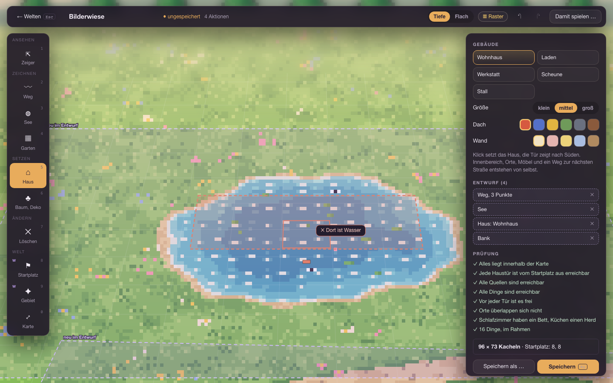
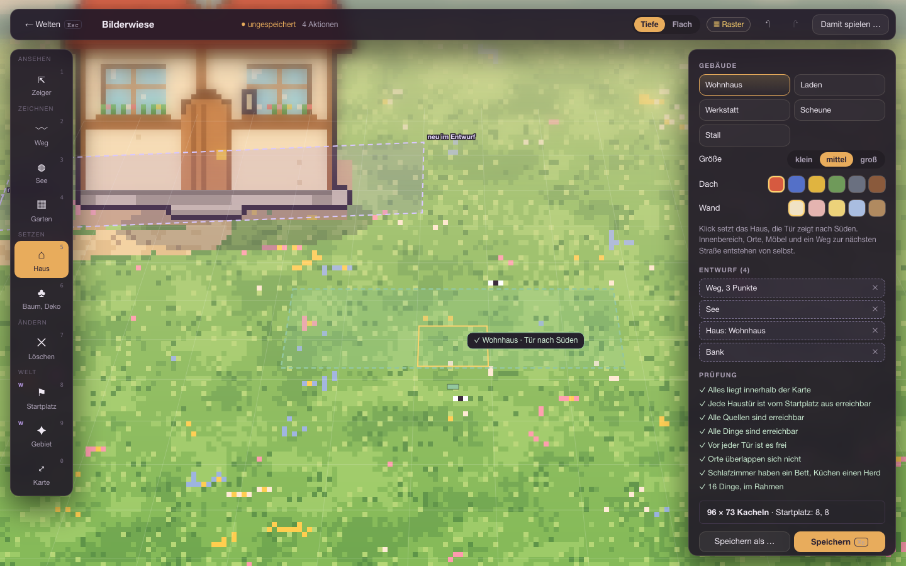
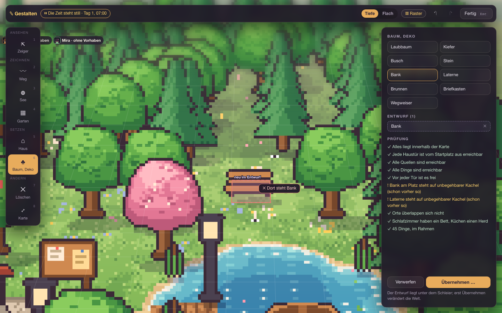
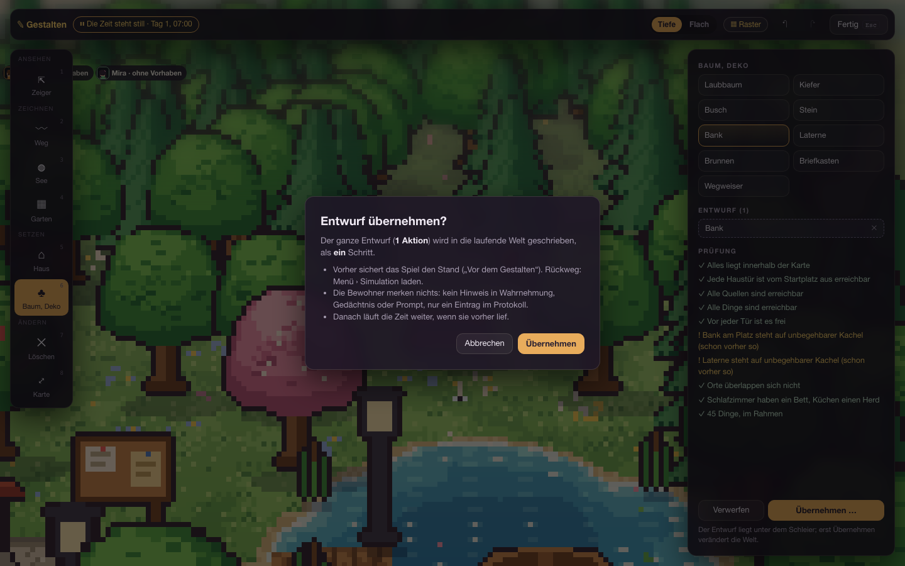

# AP16b – Gestalten, Außenwerkzeuge im Browser (Bericht, 22.10.2026)

**Plan:** [AP16-plan.md](../arbeitspakete/AP16-plan.md), [AP16-schritt0.md](AP16-schritt0.md); Backend: [AP16a.md](AP16a.md). **Branch:** `claude/ap16b-aussenwerkzeuge-1ac889`, nicht gemergt, nicht ausgerollt, wartet auf Abnahme. Nur Außenbereich, kein Innenausbau (AP16c).

## Was fertig ist
- **Ein Werkzeugkasten, zwei Orte** (`frontend/src/gestalten/`), als schwebendes Glas über der Welt wie im Mockup: obere Leiste, Werkzeugleiste links (Gruppen Ansehen, Zeichnen, Setzen, Ändern, Welt; Tasten 1–9, 0; W-Zeichen für „nur Werkstatt“), rechts Katalog, Entwurfsliste mit ✕ und Prüfung (✓ ! ✗). Rückgängig/Wiederholen (Strg+Z, Strg+Umschalt+Z), Raster-Schalter, Tiefe/Flach.
- **Werkzeuge:** Zeiger, Weg (Punkte, Doppelklick oder Enter beendet), See (Mitte, dann Rand), Garten (zwei Ecken), Haus (Gebäudeart, Größe, Dach, Wand; Türmarke), Baum/Deko, Löschen, Karte erweitern (Ost/Süd +8/16/32, Pfeile und Knöpfe), nur Werkstatt: Startplatz (jetzt eine Aktion im Entwurf) und Gebiet erzeugen (gestrichelter Rahmen an der Eckkachel, danach der bekannte Generator).
- **Fehler am Cursor:** der Geist wird rot und nennt den Grund (Prüfung per Probelauf des Backends, 140 ms Ruhe, zwischengespeichert); der Klick tut dann nichts, eine angefangene Form bleibt.
- **Cursor-Schicht** (SVG, folgt der Kamera): Raster um den Zeiger, Geist, Schleier „neu im Entwurf“, blockierte Stellen, Vorschau der neuen Kartenfläche. Dafür zwei kleine Anschlüsse in `DorfView` (`bridge.zeiger`, `commands.punktCss`), die Datei blieb bei 400 Zeilen.
- **Werkstatt:** Entwurf = Aktionen auf der Weltdatei; „Speichern“ schreibt sie in die Datei, ✗ sperrt nur „Damit spielen“. **Spiel (Gott):** Taste B, die Zeit hält an und läuft nur weiter, wenn sie vorher lief; Übernehmen-Dialog mit Sicherung; ✗ oder abgelehnte Aktion sperrt Übernehmen. In Leben weiterhin weder Taste noch Leiste noch Endpunkt (403).
- **Esc** je Ebene: angefangene Form → Werkzeug → Ort (Rückfrage bei Entwurf). Neue Ebene `EBENE.Werkzeug`.
- **Entfallen:** „Dorf anfügen“ (`WorldEditor.tsx` gelöscht, zwei alte e2e-Dateien ersetzt). `editorStore` bleibt (Vorschau-Schleier, Backend `generate`).

## Tests
Vitest 36 neue Tests (Werkzeuglogik, Entwurf, Szene, Store mit Zeit anhalten/fortsetzen/Übernehmen), `tsc` sauber, Dateigrößentest grün. Playwright `e2e/gestalten.spec.ts` (13 Tests: Leiste/Tasten/Esc, Weg mit Rückgängig und Speichern, See/Garten/Haus/Baum/Löschen, Fehler am Cursor, Prüfung ✗, Karte, Startplatz und Gebiet, Rückfrage; Spiel: Zeit steht still/läuft weiter/bleibt stehen, Übernehmen mit Sicherung und Ereignis, Verwerfen, Leben). Angepasst: `welten`, `zurueck`, `helpers`, `playwright.config.ts` (`SIM_E2E_DATA` für parallele Läufe).

## Hinweise und Abweichungen
- Das Mockup zeigt für Wege „Breite/Belag“; die Backend-Aktion kennt das nicht, darum nur Hilfetext.
- Ein ✗ eines gespeicherten Entwurfs erscheint beim Wiederöffnen als „!“ (schon vorher so, Regel aus AP16a).
- Der Rahmen für „Gebiet“ hat feste Größe 68 × 46 (echte Größe je Seed 58–77 × 40–51).
- Nicht gebaut: Entwurf der Werkstatt im `sessionStorage` sichern; Bilder für den Bericht (AP16d); „Von innen einrichten“ (AP16c).
- `backend/.venv` und `frontend/node_modules` sind Symlinke im Worktree (nicht eingecheckt).

## Bilder
 
 
