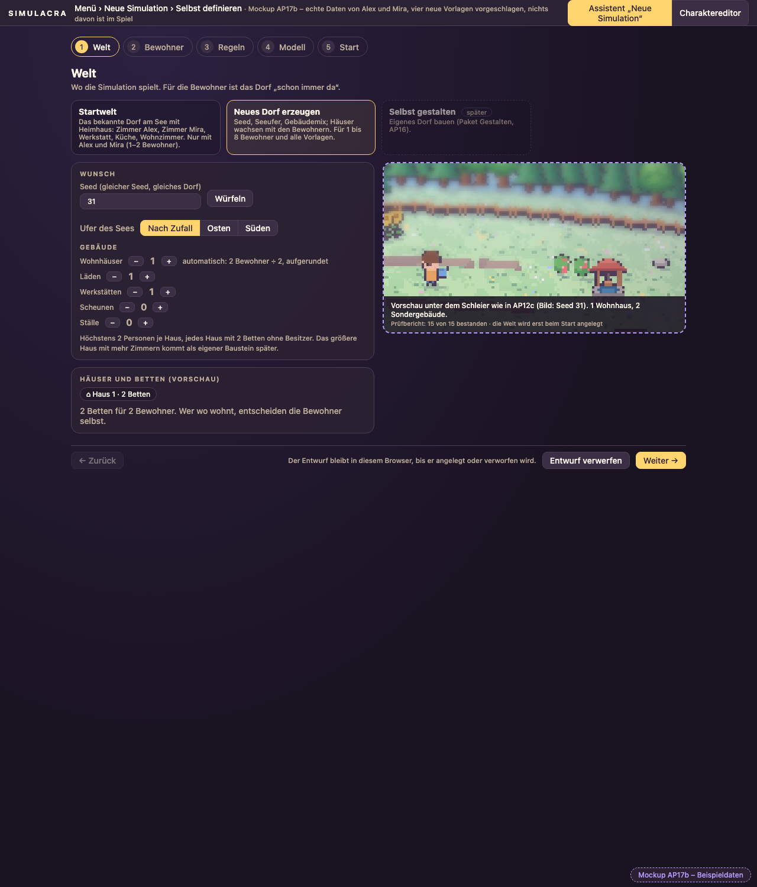
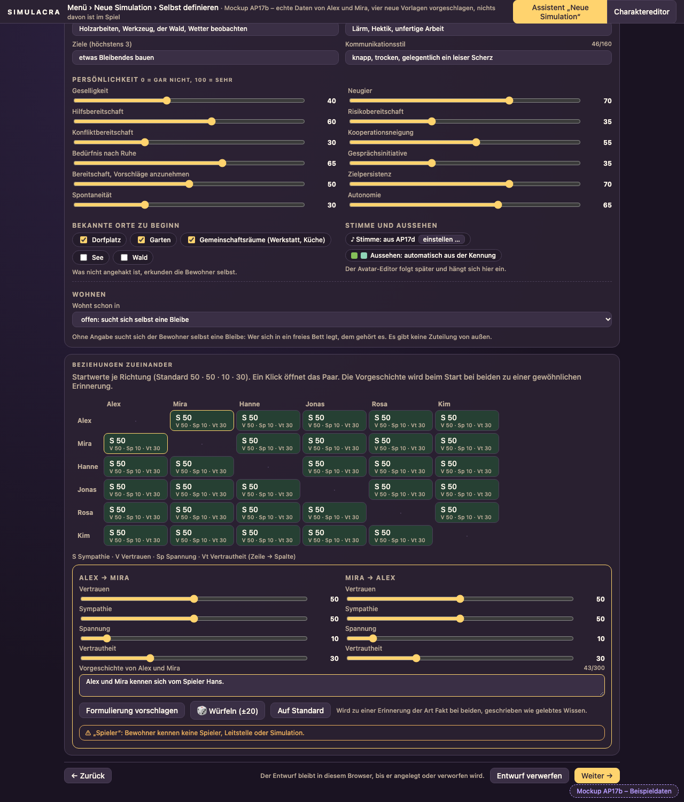
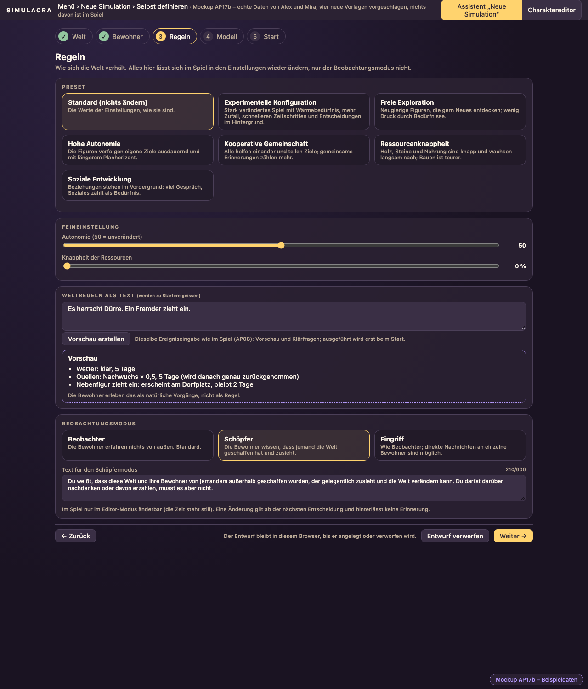
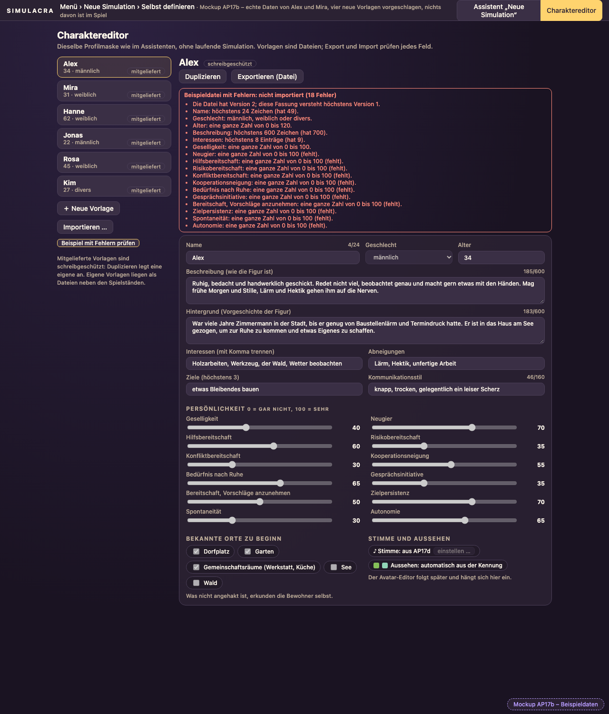

# AP17b Schritt 0 – Plan, Entscheidungen, Mockup (19.10.2026)

Plan: AP17b-plan.md (im Git-Verlauf). Mockup: [assistent.html](../mockups/assistent.html) (mit `assistent.js` und `assistent-daten.js` daneben, im Browser öffnen; Datei-Aufruf genügt, kein Server). **Es ist noch kein Code der Anwendung geändert.** Gebaut wird nach deiner Abnahme.

## Was ich gefunden habe
1. **Betten:** Jedes Schlafzimmer der Haustypen `haus`, `haus_klein`, `langhaus` hat genau **ein** Bett. „Zwei Betten je Haus“ gibt es noch nicht. Lösung: Der Generator bekommt die Bewohnerzahl als neue Eingabe; ohne sie bleibt jede Ausgabe wie bisher (alte Seeds, Fixtures und Goldbilder ändern sich nicht).
2. **Bleibe suchen:** Betten ohne Besitzer darf schon heute jeder benutzen. Aber „Zum Schlafen gehen“ bietet nur **ein** Bett an (`beds[0]` in `agents/options.py`), und schlafen setzt nie einen Besitzer. Nötig (17b-a): freie Betten mehrerer Häuser anbieten; wer in einem freien Bett schläft, dem gehört es (gewöhnliches Weltereignis „Bett gehört X“); danach ist es für andere gesperrt (die Regel dafür gibt es schon).
3. **Alex und Mira im Code:** festverdrahtet in `generator/generate.py`, `generator/kits.py` (zwei Startplätze), `generator/interiors.py` (Heimhaus), `events_user/lexicon.py` (Orts-Aliase), `frontend/.../things.ts` (Besitzer nur über `["alex","mira"]`) und in Texten (Startmenü, Presets „Beide …“). `people.ts` gibt unbekannten Kennungen schon ein Aussehen aus der Kennung.
4. **Profile ohne Datei:** `AgentStore.ensure` legt Profile nur aus `agents/defaults/<id>.json` an; für beliebige Bewohner braucht es den Weg über die Vorlage.
5. **Schöpfermodus:** `mode` und `mode.creator_text` gibt es als Parameter, jederzeit änderbar. Neu: beim Anlegen wählbar und im Spiel nur im Editor-Modus.

## Entscheidungen von dir (heute)
- Größeres Haus: **eigener Baustein nach dem Assistenten.**
- Karte wächst mit der Bewohnerzahl: **ja** (Vorschau zeigt Betten statt Namen).
- Vorlagen: **4 weitere**, sehr verschieden.
- Vorgeschichte: **Startwerte plus gewöhnliche Erinnerung** bei beiden.
- Schon vorher entschieden: höchstens 2 Personen je Haus, jeder Agent wählt seine Bleibe selbst, Startwelt bleibt bei Alex und Mira.

## Das Mockup
| Welt | Bewohner (6, mit Beziehungsmatrix und Paar) |
|---|---|
|  |  |
| **Regeln (Weltregeln mit Vorschau, Schöpfermodus)** | **Charaktereditor mit Fehlermeldungen beim Import** |
|  |  |

Ausprobieren: Welt „Neues Dorf erzeugen“, Wohnhäuser ± (Betten rechnen mit), bei Bewohner die Anzahl hochzählen (Tempohinweis wächst, ab 5 wird er gelb), Vorlage wechseln, Würfeln, in der Matrix ein Paar öffnen und „Spieler“ in die Vorgeschichte tippen (Warnung), bei Regeln „Dürre“ eingeben und Vorschau erstellen, im Editor „Exportieren“ (echte JSON-Datei) und „Importieren“ (echte Prüfung; „Beispiel mit Fehlern prüfen“ zeigt die Meldungen).

Echte Daten: Alex und Mira wörtlich aus `agents/defaults/*.json`, die zwölf Bezeichnungen aus `PERSONALITY_LABELS`, die sechs Presets mit ihren Beschreibungen, das Dorfbild aus `frontend/public/menue/`, die Standardwerte der Beziehungen aus `relations.py`, der Text des Schöpfermodus aus `agents/modes.py`. **Nur Beispiel:** Hanne, Jonas, Rosa und Kim (vier vorgeschlagene Vorlagen, bitte lesen und ändern), die Vorschau des Dorfs (festes Bild von Seed 31) und die Vorschau der Weltregeln (einfache Stichwörter statt Ereigniseingabe).

## Was du entscheiden oder prüfen sollst
1. Gefällt dir der Ablauf (Welt · Bewohner · Regeln · Modell · Start)? Der Schöpfermodus steht im Schritt Regeln.
2. Passen die vier neuen Vorlagen (Texte, Alter, Werte)?
3. Beziehungsmatrix: Zeile → Spalte, Klick öffnet das Paar mit beiden Richtungen und einer Vorgeschichte. Reicht das?
4. Annahmen aus dem Plan, die ich ohne Rückfrage übernommen habe: **Nebenfiguren** nicht in AP17b; **Würfeln** je Feld mit sichtbarem Seed; **Vorlagen als Dateien** neben den Spielständen; **Wortprüfung** (Spieler, Leitstelle, Simulation …) nur als Warnung, nicht als Sperre.
5. Offen geblieben: Bewohner mit eigener Vorlage in der **Startwelt** (nur Alex und Mira passen zu den festen Zimmern). Ich lasse es dabei und weise im Assistenten darauf hin.

## Nächster Schritt
Nach deiner Abnahme: Branch `ap/17b-simulation-definieren` ist angelegt; Teilpaket **a** (Backend) beginnt mit Profilschema und Wortprüfung, dann Generator für N Bewohner und Bleibe suchen.
