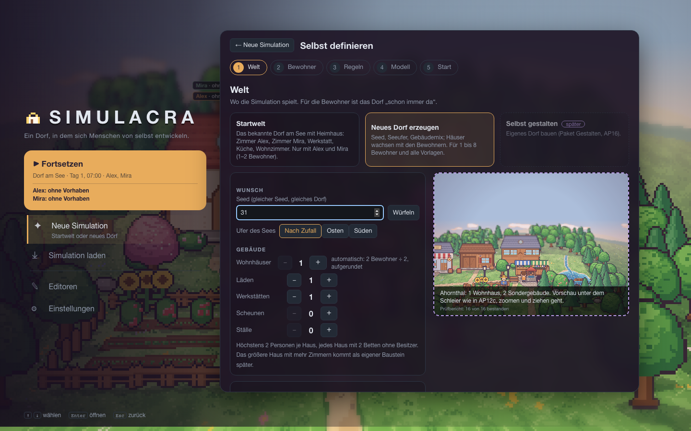
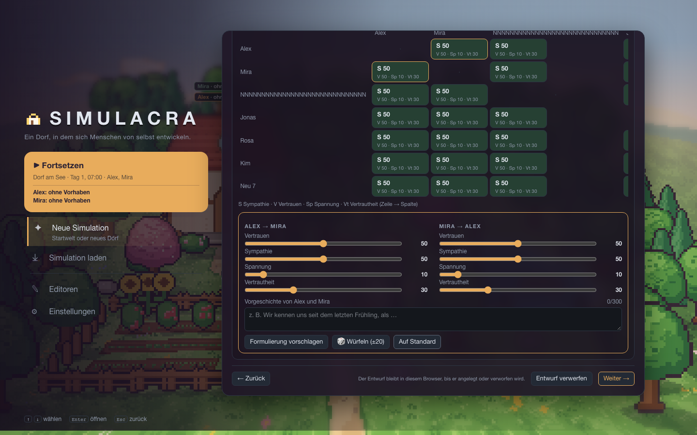
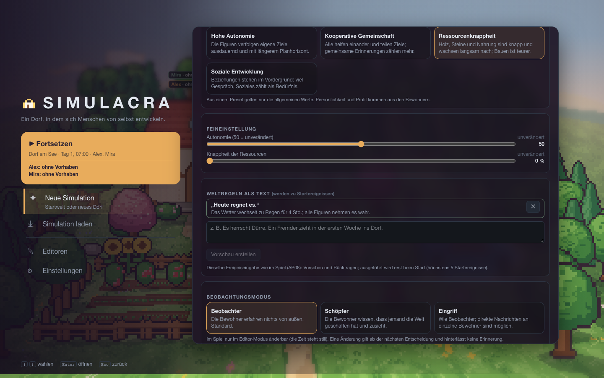
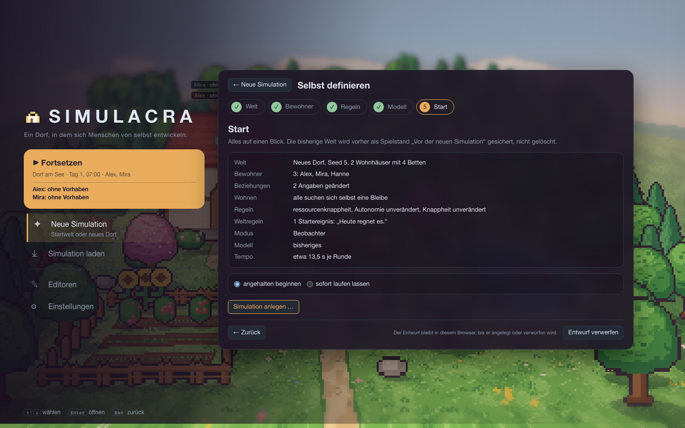
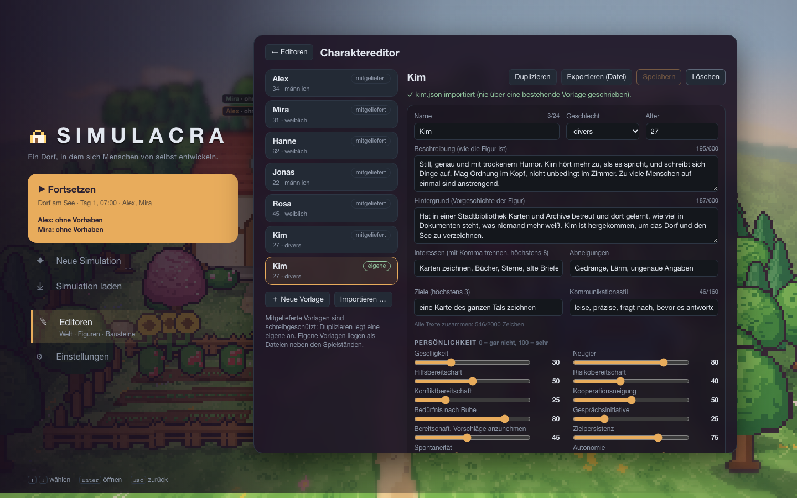

# AP17b – Simulation selbst definieren (Stand 19.10.2026)

Plan: [AP17b-plan.md](../arbeitspakete/AP17b-plan.md), Mockup: [assistent.html](../mockups/assistent.html) (abgenommen, „ok leg los“), Schritt-0-Bericht: [AP17b-schritt0.md](AP17b-schritt0.md). Branch `ap/17b-simulation-definieren` (von `ap/12c-leitstelle`), nicht ausgerollt.

## Bilder
Alles sind Bildschirmfotos der echten Oberfläche gegen das Backend mit Fake-Modell (Playwright, `frontend/e2e/assistent.spec.ts`).

| Welt: das Dorf unter dem Schleier | Bewohner (Maske, Stimme, Beziehungen) |
|---|---|
|  |  |
| **Regeln mit Weltregel als Startereignis** | **Start (Übersicht, Hinweise der Wortprüfung)** |
|  |  |
| **Charaktereditor nach dem Import** | |
|  | |

## Gebaut
**Backend**
- **Profilmaske** (`agents/schema.py`): Grenzen mit deutschen Meldungen (Name 24, Beschreibung und Hintergrund je 600, Stil 160, Interessen und Abneigungen je 8 × 40, Ziele 3 × 120, alle Texte zusammen 2 000 Zeichen, Vorgeschichte 300), **Wortprüfung** (Spieler, Nutzer, Leitstelle, Simulation, Editor, Schöpfer, KI, Prompt … nur als Warnung), Kennungen aus dem Namen.
- **Vorlagen** (`agents/templates.py`, `api/routes_newsim.py`): sechs mitgelieferte (Alex, Mira, Hanne, Jonas, Rosa, Kim; schreibgeschützt) und eigene als Dateien in `data/vorlagen/`; Duplizieren, Speichern, Löschen; **Export und Import** als Datei (`simulacra-vorlage`, Version 1): der Import meldet alle Fehler auf einmal und legt nie über Bestehendes.
- **Dorf nach Maß** (`generator/generate.py`: `new_world(seed, residents=…)`): 1 bis 8 Bewohner, aufgerundet N/2 Wohnhäuser mit je **zwei Betten ohne Besitzer**, Werkstatt und Laden, ab 5 ein Stall, ab 7 eine Scheune, Startplätze auf dem Platz; ohne `residents` ist jede Ausgabe unverändert (Goldbilder, Seeds).
- **Bleibe selbst suchen:** „Zum Schlafen gehen“ bietet das eigene Bett, sonst die nächsten freien Betten **verschiedener Räume**; wer in einem freien Bett schläft, dem gehört es (Bett trägt seinen Namen, Ereignis `world.object_changed` mit `change: "claimed"`), wer eines hat, nimmt kein zweites. Nur das Vorwort „wohnt schon in Haus N“ setzt vorab einen Besitzer. Es gibt keinen Hinweis auf eine Zuteilung von außen.
- **Neue Simulation per API** (`simulation/newsim.py`): `POST /api/sim/new/preview` (Prüfung, Warnungen, Welt als Trockenlauf) und `POST /api/sim/new` (Bestätigung, Idempotency-Key, Prüfsumme, Sicherung „Vor der neuen Simulation“). Angelegt werden Profile mit bekannten Orten, **Beziehungsstartwerte** (ohne Protokoll und Ereignis), **Vorgeschichten** (gewöhnliche Erinnerung Art Fakt bei beiden), Stimmen, Preset (nur allgemeine Werte), Autonomie, Knappheit, Beobachtungsmodus und Modell.
- **Weltregeln als Startereignisse:** `POST /api/sim/new/rules/preview` schickt einen Satz durch die Ereigniseingabe (AP08) auf der Welt des Entwurfs (Vorschau, Rückfragen, Ablehnung); die bestätigten Operationen laufen gleich nach dem Anlegen und werden **vorher in einer Wegwerf-Simulation probiert** (scheitert eines, bleibt die alte Welt unverändert).
- **Beobachtungsmodus** ändert sich im Spiel nur noch, **solange die Zeit steht** (Parameter `mode` und `mode.creator_text` mit Vorprüfung); gilt ab der nächsten Entscheidung, keine Spur für die Bewohner.
- Presets sprechen von „alle“ statt „beide“.

**Oberfläche** (`frontend/src/assistent/`)
- **Assistent** (Menü → Neue Simulation → „Selbst definieren“) mit den fünf Schritten wie im Mockup; Entwurf je Gerät gemerkt; **Vorschaufenster** mit der echten Weltansicht unter einem Schleier; Tempohinweis; Maske mit Zählern, Warnungen und **Stimme** (Vorschlag oder eigene, derselbe Regler wie in Einstellungen → Ton); Beziehungsmatrix mit Paar und Vorgeschichte; Würfeln mit Seed; Weltregeln mit Vorschau, Rückfragen und ausdrücklicher Übernahme; Start mit Übersicht, Fehlern, Hinweisen und Bestätigungswort „neu starten“.
- **Charaktereditor** (Menü → Editoren → „Figuren“): Liste, dieselbe Maske, Duplizieren, Speichern, Löschen, Export (Datei), Import mit Fehlerliste.

## Bewusst nicht gebaut oder anders als im Mockup
- **Nebenfiguren** (Figuren ohne KI) nicht in AP17b, wie im Plan vorgemerkt; sie bleiben bei der Ereigniseingabe im Spiel.
- **Größeres Haus:** eigener Baustein danach (Entscheidung 19.10.).
- **Avatar-Editor, Gestalten (AP16), Szenen, Modellverwaltung (AP17c-3/-4):** nicht Teil dieses Pakets. Der Schritt Modell zeigt die Modellliste des Servers wie der Dialog „Zurücksetzen“.
- **Beobachtungsmodus „nur im Editor-Modus“:** den Editor-Modus mit stehender Zeit gibt es erst mit AP16. Bis dahin gilt die Regel „nur bei stehender Zeit“ (angehalten oder gestoppt).
- **Presets:** aus einem Preset gelten nur die allgemeinen Werte; die Werte je Bewohner (Persönlichkeit von alex und mira) bleiben beim Anlegen unberührt, damit die Maske gilt.
- **Eigene Vorlagen** (`data/vorlagen/`) sind noch nicht im Backup-Archiv; sie lassen sich einzeln exportieren.
- **Vorschau im Mockup** war ein festes Bild; jetzt ist es die echte Welt (zoom- und ziehbar). Weltregeln im Mockup waren Stichwörter; jetzt die echte Ereigniseingabe. Die Stimme steht im Assistenten als Feld mit Vorschlag und „einstellen …“.
- **Probelauf mit echtem Modell:** maintux ist von hier nicht erreichbar, nicht getestet. Mit Fake-Modell laufen 4 und 8 Bewohner je 300 Schritte durch (Test `test_dorf_nach_mass_laeuft_mit_dem_fake_modell`).
- Das alte „Neues Dorf erzeugen“ (AP12c, Heimhaus für Alex und Mira) bleibt neben dem Assistenten.

## Tests
- **pytest 1249 bestanden** (Stand davor 1177): neu `test_schema.py`, `test_templates.py`, `test_bleibe.py` (Besitz, Bettoptionen, eine Nacht mit 4 Bewohnern, Probelauf 4 und 8), `test_bewohner.py` (Generator: Betten, Startplätze, Wachsen, gleicher Seed, alte Ausgabe unverändert), `test_newsim.py` (20: Vorlagen, Vorschau, Fehler, Warnungen, Anlegen, Startereignisse, keine höhere Instanz in Prompts, Erinnerungen und Ereignissen), Beobachtungsmodus bei laufender Zeit.
- **Vitest 160 bestanden** (davor 140): `begrenzung.test.ts`, `entwurf.test.ts`, `assistentStore.test.ts`.
- **Playwright:** 10 neue Tests (`e2e/assistent.spec.ts`: Welt mit Vorschau, Bewohner und Beziehungen, Wohnen, Fehler beim Start, alles durchklicken mit Anlegen, Entwurf nach Neuladen, Startwelt, 8 Bewohner, Charaktereditor, Export und Import mit Fehlern). Letzter vollständiger Lauf: 93 bestanden, ein Test (`menue.spec.ts`, Pfeiltasten) flackerte einmal und wurde abgesichert (10 × grün); Goldbilder (Startwelt, Dörfer, Flach) unverändert.
- Typen aktuell (`scripts/gen_types.sh --check`), Dateigrößenregel eingehalten.

## So siehst du es an
```bash
backend/.venv/bin/python scripts/e2e_server.py --port 8195 --data-dir /tmp/simdorf
cd frontend && SIM_BACKEND=http://127.0.0.1:8195 npm run dev
```
Im Browser: Menü → Neue Simulation → „Selbst definieren“. Welt „Neues Dorf erzeugen“, Seed würfeln (die Vorschau folgt), Bewohner hochzählen (Tempohinweis, ab 5 gelb), Vorlage wechseln, Würfeln, ein Paar öffnen, in den Regeln „Heute regnet es.“ vorschauen und übernehmen, im Start „Simulation anlegen …“ mit „neu starten“. Danach unter „Simulation laden“ den Stand „Vor der neuen Simulation“. Charaktereditor: Menü → Editoren → Figuren.

## Was du entscheiden oder prüfen solltest
1. Die vier neuen Vorlagen (Texte und Werte in `backend/simulacra/agents/defaults/hanne.json` und Co.): passen sie?
2. Frage 49 in [offene-fragen.md](../offene-fragen.md): die Annahmen (Wortprüfung als Warnung, Preset nur allgemein, Modus nur bei stehender Zeit, Vorlagen nicht im Backup).
3. Probelauf mit dem echten Modell auf maintux/thirdtux, sobald erreichbar (4 und 8 Bewohner über mehrere Tage).
4. Ausrollen nur auf Freigabe.
