# AP18 Schritt 0 – Befund, Mockup, Fragen (19.10.2026)

**Auftrag:** Henry, 19.10.2026 (Wortlaut im [Plan](../arbeitspakete/AP18-plan.md)). **Gebaut:** Plan `docs/arbeitspakete/AP18-plan.md`, Startprompts `docs/arbeitspakete/AP18-start-prompts.md`, Mockup `docs/mockups/rework.html` mit `docs/mockups/rework/`, Fragen 52–62 in `docs/offene-fragen.md`. **Kein Anwendungscode** wurde geändert.

## So siehst du es an
`docs/mockups/rework.html` im Browser öffnen (Doppelklick genügt, alles liegt lokal). Oben in der Mitte öffnet der Reiter **„Mockup ▾“** (oder die Taste `M`) die **Mockup-Leiste** mit zehn Bildschirmen, den Blasen-Varianten **A · B · C** und der Taste **Erklärung** (der Kasten links, je Bild ein kurzer Text). Bedienbar sind:
- im Spiel `?` (Hilfe), `T` (Tagebuch), Klick auf ein Bildnis (Karte), im Gott-Modus `E` und `B`, und `Esc` schließt jeweils das Oberste;
- im Menü Weiter, Zurück, Brotkrumen und `Esc`, das genau eine Ebene zurückgeht;
- bei „Welt erzeugen“ jede Stellgröße und Würfeln. Der Plan wird jedes Mal neu erzeugt, und die vier kleinen Pläne zeigen andere Seeds;
- in der Werkstatt Werkzeuge mit `1`–`9`, ein Klick in die Wiese setzt das Gewählte.

## Befund: der alte Stand
| Bild | Was auffällt |
|---|---|
| 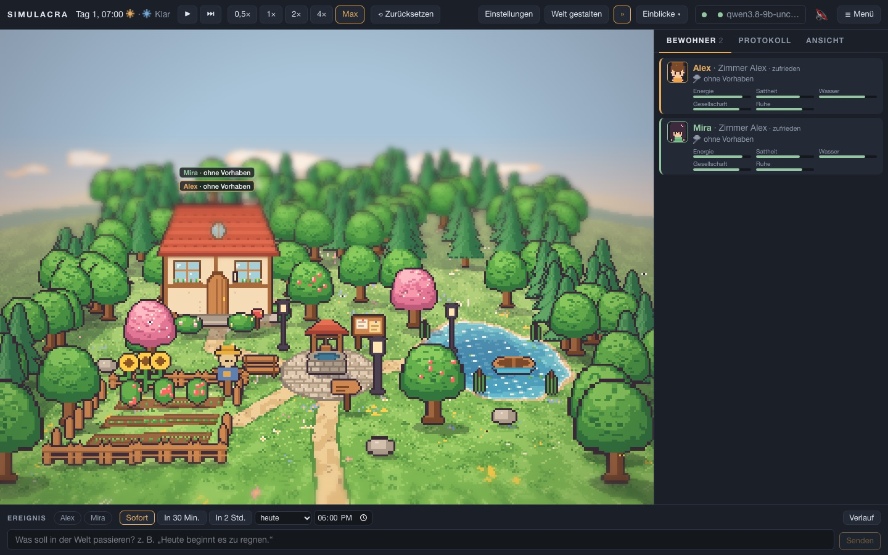 | **Kopfzeile mit 17 Bedienelementen** (Uhr, Wetter, Start, Schritt, fünf Tempi, Zurücksetzen, Einstellungen, Welt gestalten, », Einblicke, Status, Ton, Menü), **Infoleiste** 380 px, **Ereigniszeile** 80 px. Die Welt bekommt 1060 × 770 von 1440 × 900 px. Der Stil (grau, kleine Knöpfe) passt nicht zum Menü. |
| 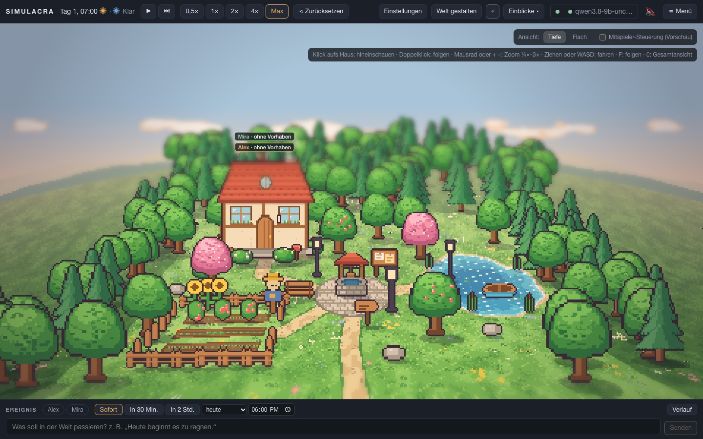 | Bei eingeklappter Leiste schweben Ansichtswahl und die **Hinweisschrift** über der Welt. |
| 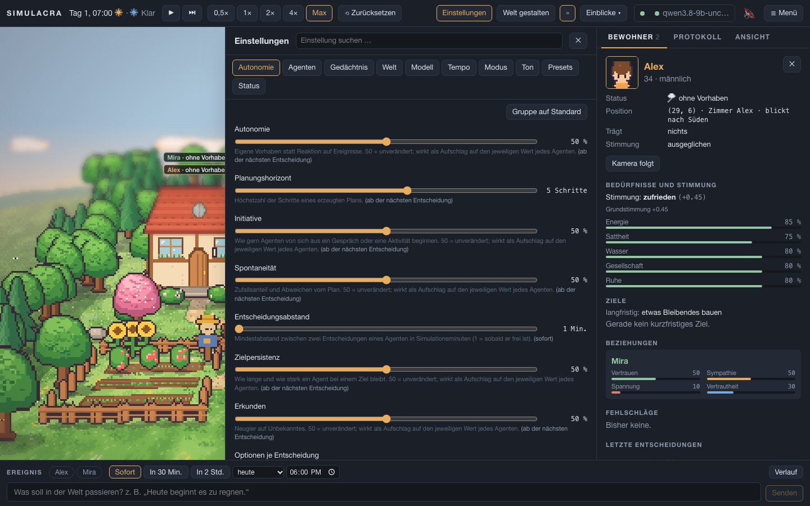 | Die Einstellungen sind eine Schublade **zwischen** Welt und Infoleiste, zehn Reiter mit Reglern. Dieselben Einstellungen gibt es ein zweites Mal im Menü. |
| 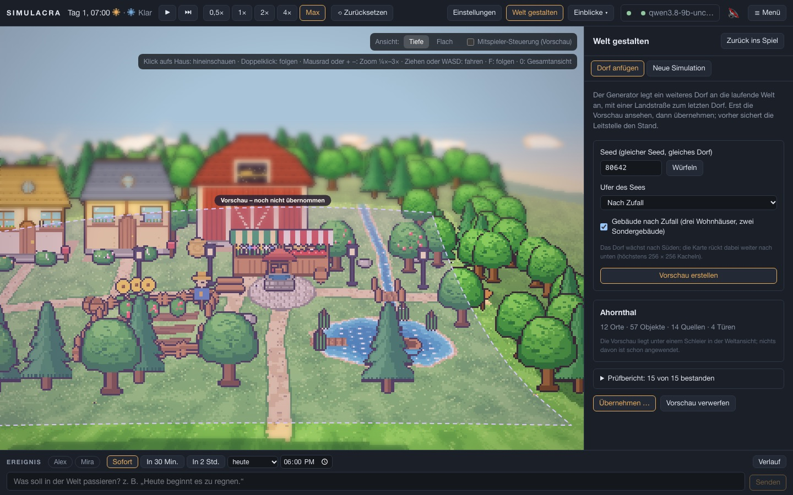 | „Welt gestalten“ heißt nur: Seed, Seeufer, Gebäudemix, Vorschau. Es gibt keine Werkzeuge, keine leere Welt und kein Speichern als Welt. |
| 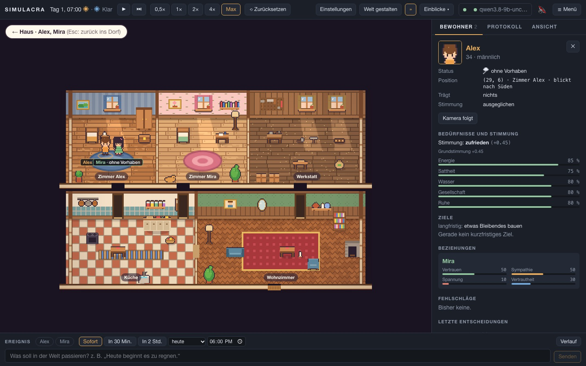 | In der Innenansicht überdecken sich die Schilder („Alex Mira · ohne Vorhaben“). |
| 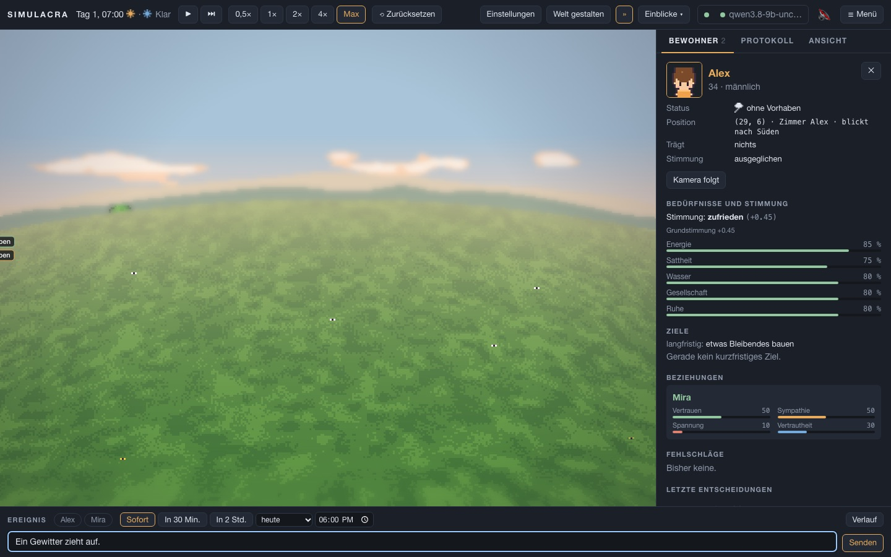 | **Fehler:** „Kamera folgt“ auf Alex, der im Haus ist, zeigt eine leere Wiese, nämlich die Lage des Innenraums auf der Karte. Am linken Rand hängen abgeschnittene Schilder („…ben“). |
| 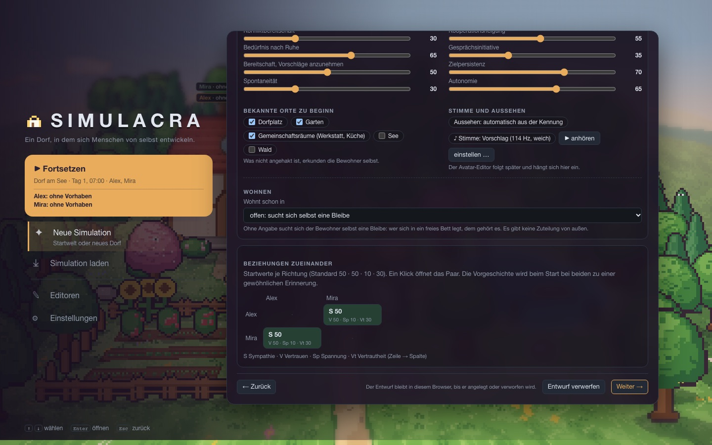 | Der Assistent ist eine lange Rollseite im Menübereich. Esc führt hier zurück, aus dem Editor aber nicht. |
| 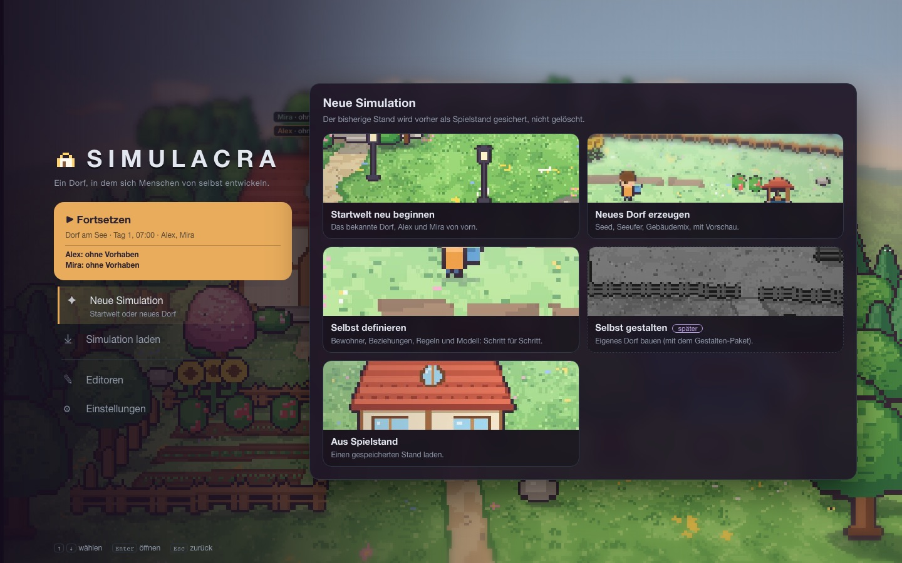 | Unter Neue Simulation stehen fünf Kacheln mit sich überschneidenden Wegen: Startwelt, Dorf erzeugen, Selbst definieren, Selbst gestalten („später“), Aus Spielstand. |

Weitere Befunde aus dem Code:
- **Schilder:** `world/Overlays.tsx` setzt Name, Tätigkeit und `＋ merkt sich: …` in ein Element mit `whitespace-nowrap`. Daher laufen die „Denkboxen“ in die Breite. Die Sprechblase hat schon `max-w-52`, ist aber nicht von einem Gedanken zu unterscheiden.
- **Esc:** Es gibt sieben eigene Esc-Behandler (Menü, Innenansicht, Einblicke, Schublade, Dialoge, Assistent, Editor) ohne gemeinsame Reihenfolge. Das Menü öffnet Esc nur bei `appMode === "game"`, also kommt man aus dem Editor mit Esc nicht zurück, auch wenn man aus dem Menü kam.
- **Generator** (`generator/layout.py`): Es gibt ein Muster, nämlich Platz, Hauptstraße, Südstraße, Häuserzeile entlang der Straße, einen See (Osten oder Süden), einen Garten und einen Wald. Die Stellgrößen sind nur Seed, Seeufer und Gebäudemix (Frage 26).
- **Bauvorlagen der Bewohner** (`data/blueprints.json`): Es sind sechs (Bank, Vogelhaus, Feuerstelle, Gartenzaun, Steg-Verlängerung, Korb). Damit kann eine Spielart „nur die Bewohner verändern die Welt“ wenig bewirken. Rohstoffe sind Holz, Stein, Schilf, Saatgut, Nahrung und Wasser.
- **Modus** (`agents/modes.py`): Beobachter, Schöpfer und Eingriff regeln, **was die Bewohner wissen**, nicht, wer die Welt verändern darf. Die neuen Spielarten sind etwas anderes (Frage 57).

## Das Mockup
| Bild | Inhalt |
|---|---|
| 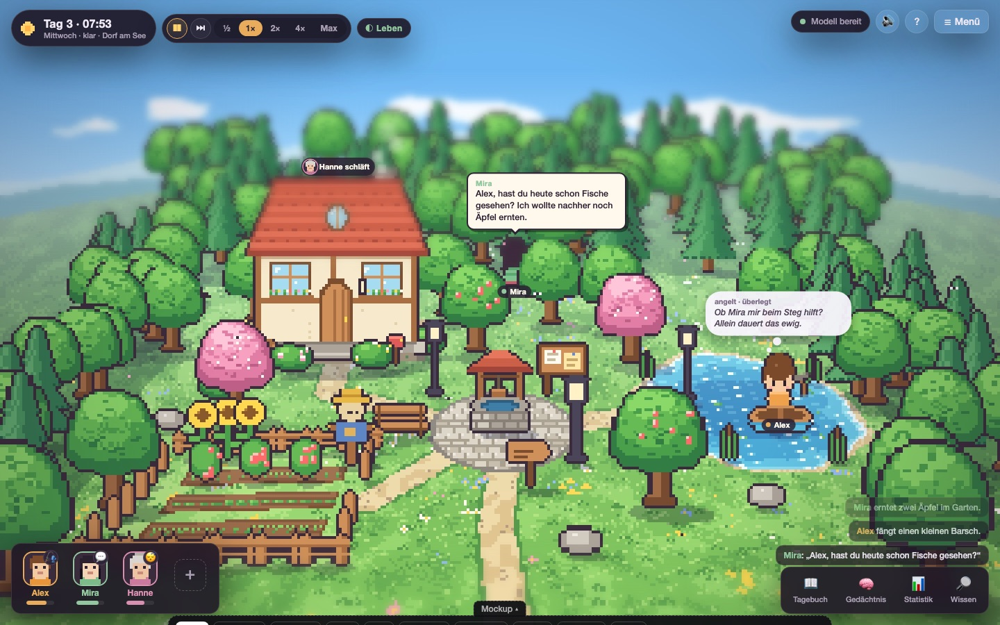 | **Spiel, Spielart Leben.** HUD in den Ecken, Bewohnerleiste unten links, Einblicke und Ticker unten rechts, keine Hinweisschrift. Blasen Variante A. |
| 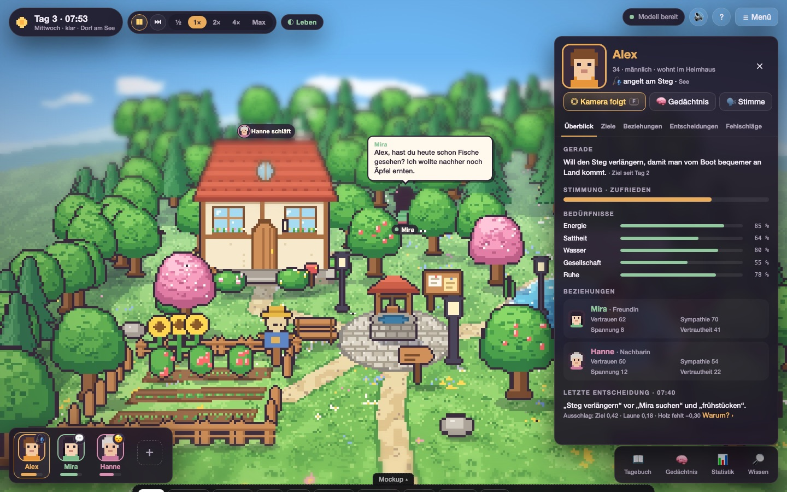 | **Bewohner-Karte** statt Infoleiste: was die Figur tut und will, Bedürfnisse, Beziehungen, letzte Entscheidung mit „Warum?“. |
| 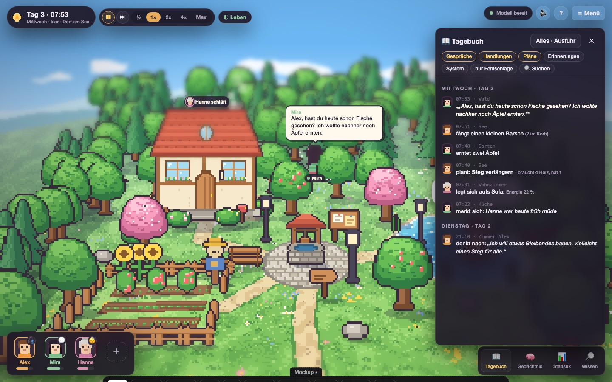 | **Tagebuch** = Protokoll und Verlauf in einem, mit Filterchips. |
| 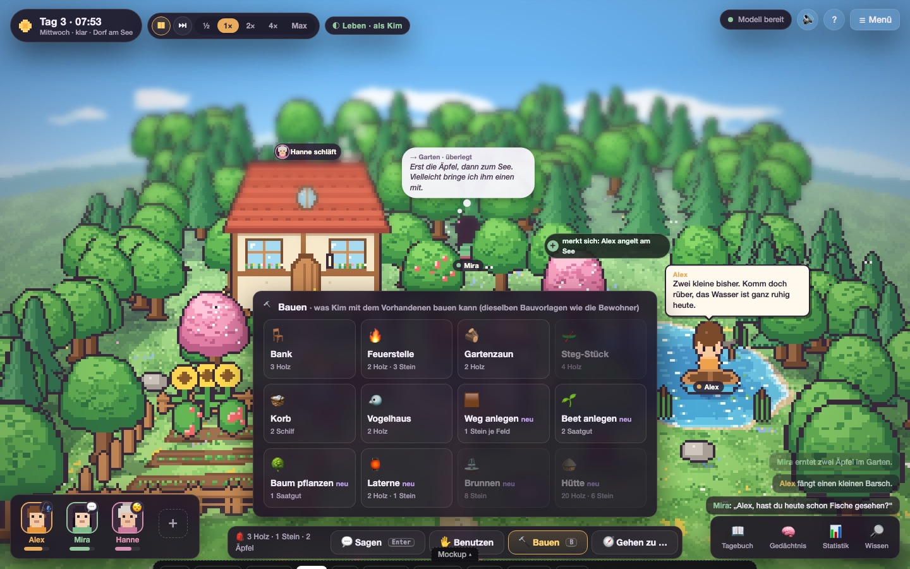 | **Leben mit eigener Figur:** Handlungsleiste und Bauen-Katalog (heutige sechs Vorlagen und sechs neue). |
| 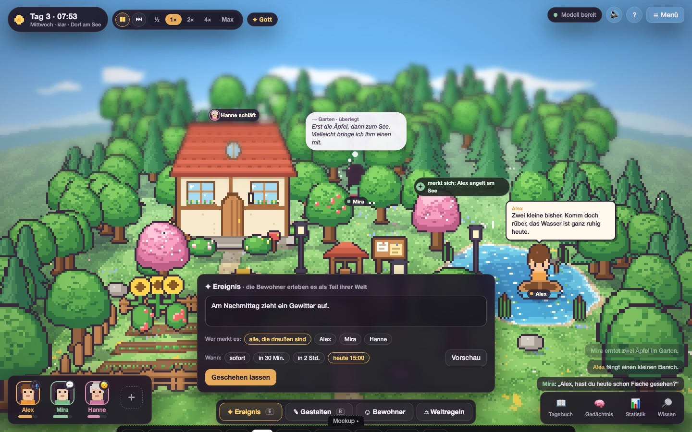 | **Spielart Gott:** Werkzeugleiste unten Mitte, die Ereigniseingabe als Popover. |
| 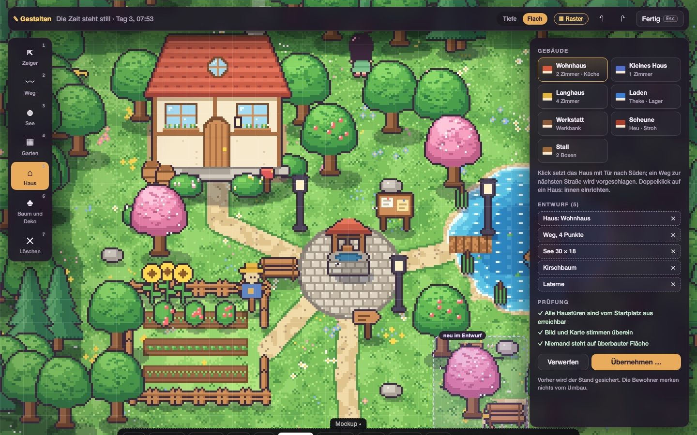 | **Gestalten im Spiel** (Gott): Die Zeit steht still, Werkzeuge wie in AP16, Übernehmen, kein Generator. |
| 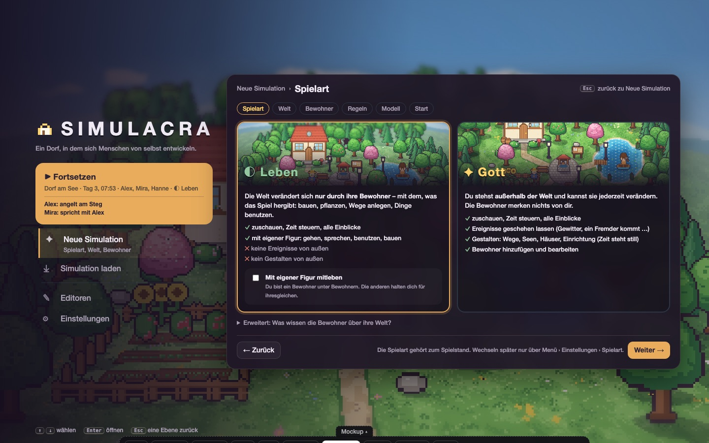 | **Neue Simulation › Spielart** im unveränderten Menü, mit Brotkrumen und „Esc zurück zu …“. |
| 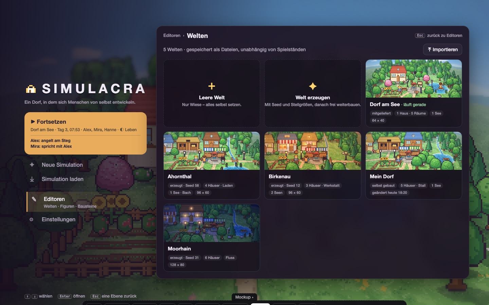 | **Editoren › Welten:** die Weltenbibliothek. |
| 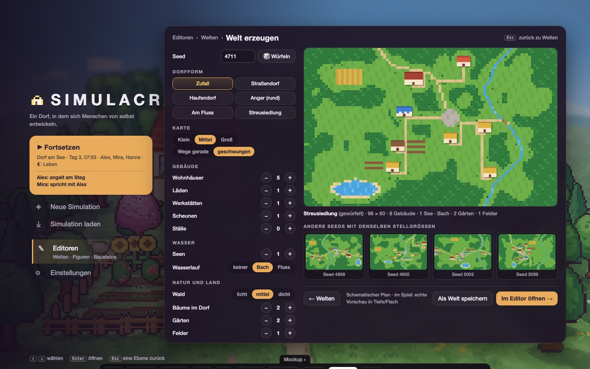 | **Welt erzeugen** mit allen Stellgrößen und einem echten Verfahren (Dorfform zufällig, hier eine Streusiedlung). |
| 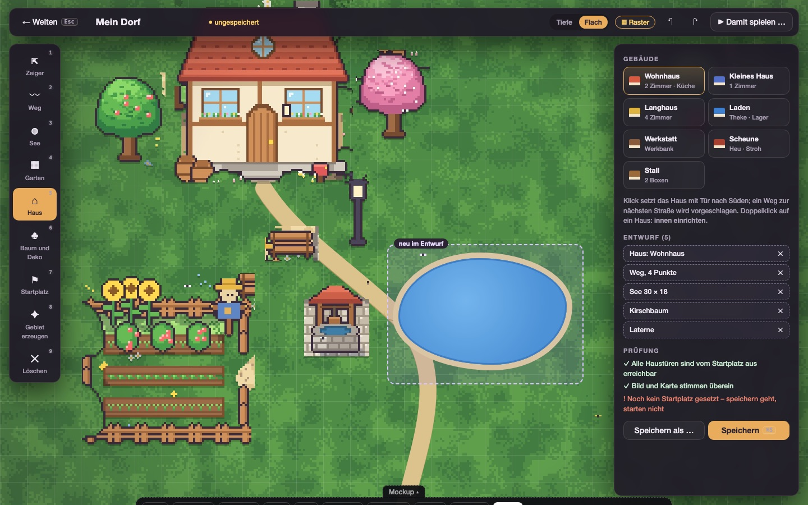 | **Welt-Werkstatt** auf einer leeren Welt: Name, ungespeichert, Speichern, Damit spielen. |
| 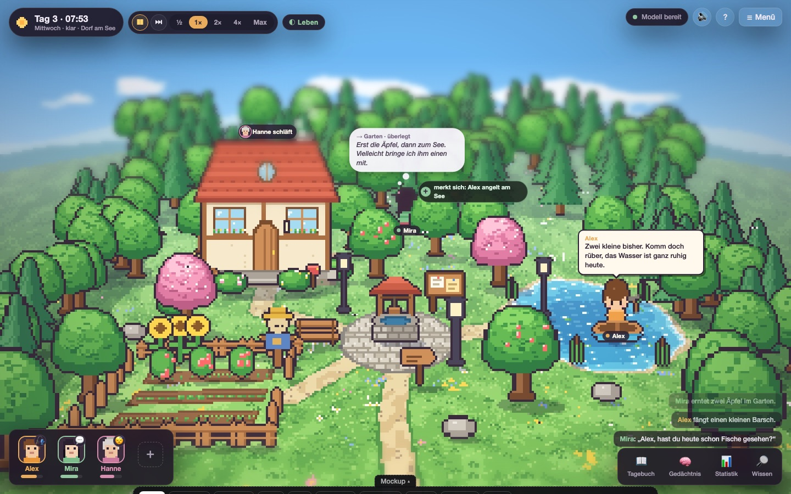  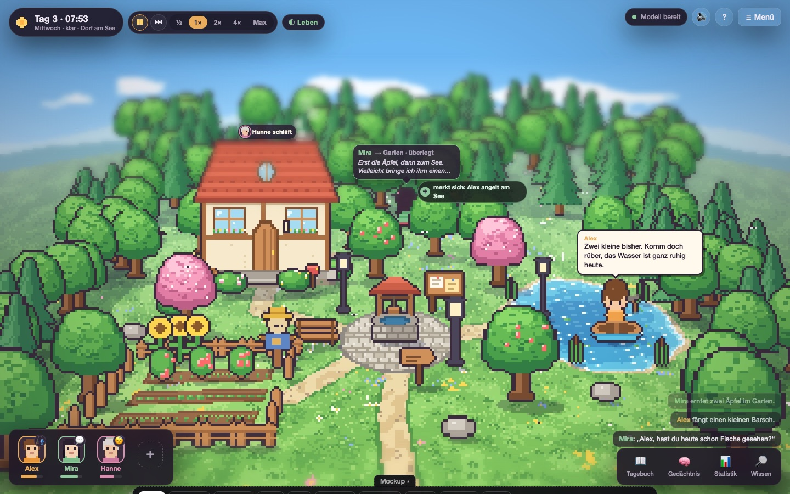 | **Blasen A · B · C** (Frage 53): A Wolke mit Bläschen und kleinem Namen am Fuß, B leise (nur „•••“, Text beim Zeigen), C kleine Karte (Name, Handlung, Gedanke). Alle brechen um, Gemerktes erscheint als verblassendes Zeichen, und wer im Haus ist, steht als Bildnis auf dem Dach. |
| 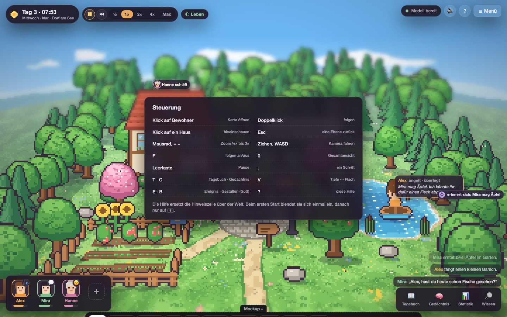 | **Hilfe** auf `?` statt Hinweiszeile. |

**Was das Mockup nicht ist:**
- Die Weltbilder sind Aufnahmen des echten Spiels (Fake-Modell). Figuren, Blasen und HUD liegen als HTML darüber, die Bewegung fehlt.
- Die Bildnisse sind genähert gezeichnet; im Spiel kommen sie aus `lib/Portrait.tsx`.
- Die Sprites in der Werkstatt sind aus dem flachen Dorfbild freigestellt, die Kanten sind daher nicht ganz sauber. Im Spiel zeichnet DorfView die echten Bausteine.
- Der Plan bei „Welt erzeugen“ ist schematisch (eine Kachel ein Punkt). Im Spiel steht dort die echte Vorschau in Tiefe und Flach, nur die vier kleinen Pläne bleiben schematisch.
- Die Hanne-Figur ist eine der Vorlagen aus AP17b und dient nur dem Beispiel „jemand ist im Haus“.

## Arbeitsweise
- Jedes Teilpaket bekommt eine eigene Sitzung mit dem Startprompt aus `AP18-start-prompts.md`, einen eigenen Branch und, wenn nötig, einen Worktree. Es wird nie `git add -A` verwendet, denn Henry arbeitet oft parallel im selben Ordner. Bei Schritt 0 lagen fremde, nicht eingecheckte Änderungen im Ordner (`ParameterPanel.tsx`, `uiStore.ts`, `people.ts`, `menue.spec.ts`, ein Goldbild).
- **AP18a** (Esc) hängt nicht vom Mockup ab und kann sofort beginnen. Alles andere wartet auf Henrys Abnahme (Frage 52).
- Für die Aufnahmen lief ein eigenes Backend mit Fake-Modell auf Port 8391 und Vite auf 5391, mit eigenem Datenordner im Sitzungsverzeichnis. Die Skripte liegen nicht im Repo.
