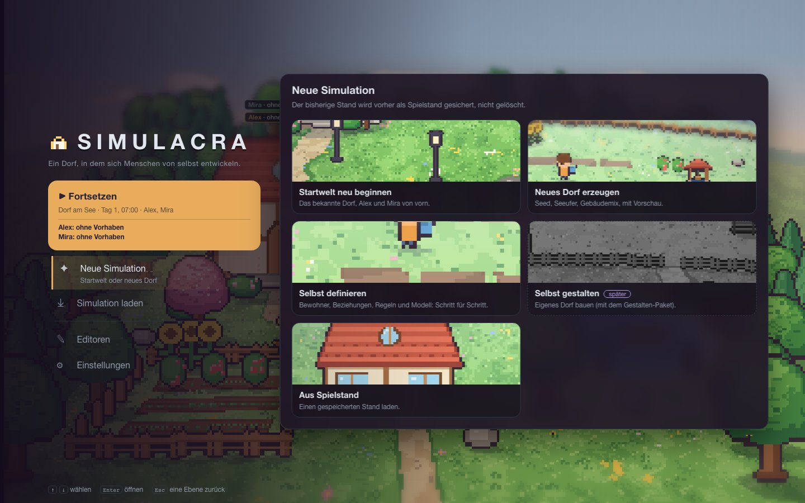
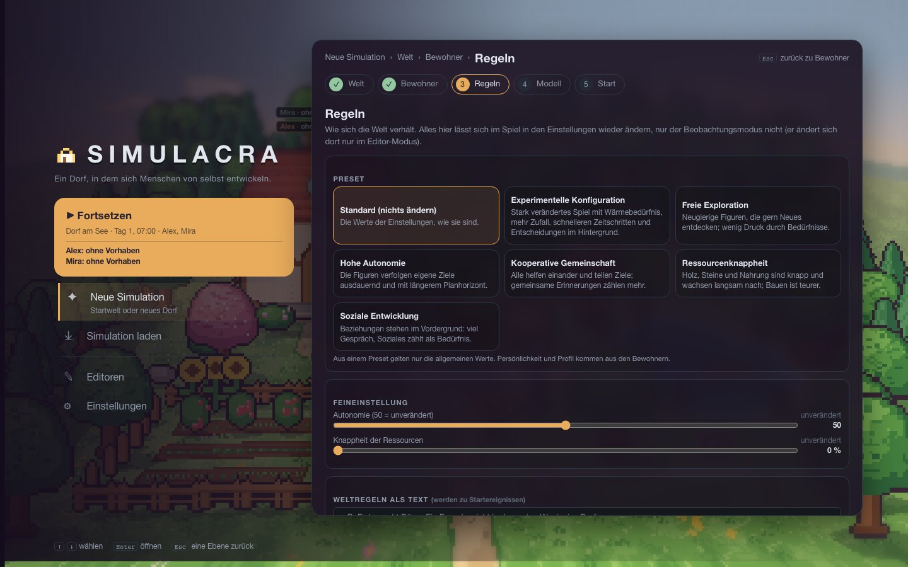
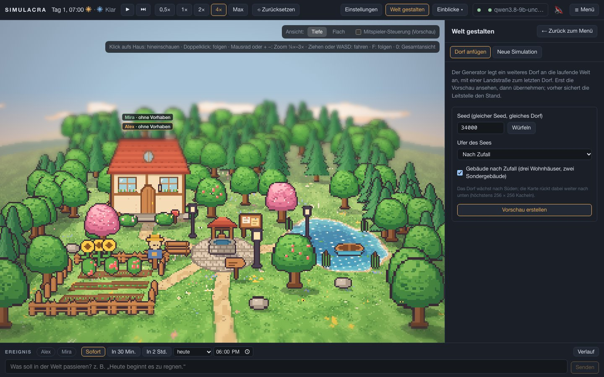
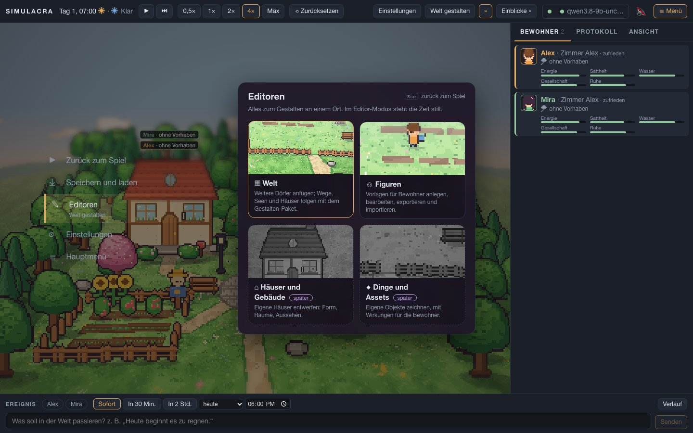
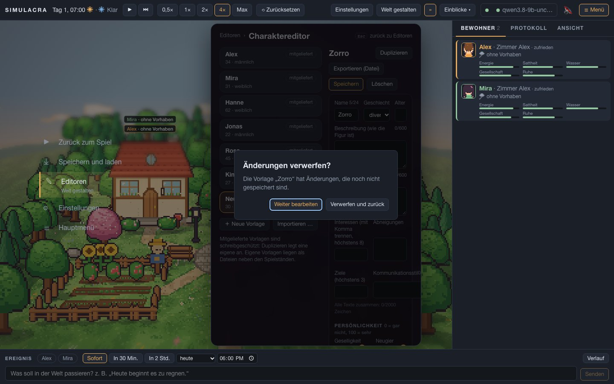

# AP18a – Rückweg mit Esc und Brotkrumen (20.10.2026)

**Auftrag:** Henry: „Wenn man ein neues Spiel gestalten will und Escape drückt, soll man zum vorherigen Menü kommen können, das sollte grundsätzlich gehen.“ **Plan:** [AP18-plan.md](../arbeitspakete/AP18-plan.md), Abschnitt AP18a. **Branch:** `ap/18a-esc` (Worktree `.claude/worktrees/ap18a`, von `main` aus). Nicht ausgerollt.

## Was jetzt gilt
**Esc nimmt immer genau eine Ebene zurück.** Alle bisherigen Esc-Behandler hängen an einem zentralen Stapel (`frontend/src/ui/zurueck.ts`). Von oben nach unten: Dialog → Popover → Unterebene im Menü (Assistentenschritt, Charaktereditor) → Menü → Editor → Einblick → Einstellungs-Schublade → Innenansicht → Detail → Spiel (öffnet das Pausenmenü).

| Von | Esc führt zu |
|---|---|
| Assistent, Schritt n | Schritt n−1; vom ersten Schritt zu „Neue Simulation“ |
| Neue Simulation, Editoren, Einstellungen, Laden (Pausenmenü) | zurück ins Spiel |
| dasselbe im Titelbild | bleibt im Titelbild (nie aus Versehen ins Spiel) |
| Neues Dorf erzeugen / Editoren › Welt (aus dem Menü) | **an dieselbe Menüstelle** (Neue Simulation bzw. Editoren) |
| „Welt gestalten“ in der Kopfzeile | ins Spiel |
| Charaktereditor | Editoren; bei ungesicherten Änderungen erst Rückfrage (Esc darin = „weiter bearbeiten“) |
| Zurücksetzen-Dialog, Spielstände-Dialog | schließt den Dialog |
| Einblick (Gedächtnis, Verlauf, Statistik) | Welt; ein offenes Einblicke-Untermenü schließt zuerst |
| Detail (Bewohner, Ort, Ereignis) | schließt es (bisher tat Esc dort nichts) |
| Raum / Haus von innen | wie bisher Raum → Haus → Dorf |

**Brotkrumen** (Mockup Bild 7) stehen oben in jedem Menübereich: „Neue Simulation › Welt › Bewohner“, die letzte ist die Überschrift, die davor sind anklickbar, rechts steht „Esc zurück zu …“.

## Bilder
| | |
|---|---|
|  |  |
|  |  |
|  | |

## Abweichungen vom Plan (bitte ansehen)
1. **Eingabefeld:** Statt „erstes Esc immer Fokus nehmen“ gilt: Nur ein Feld **mit Text** hält das erste Esc fest. Ein leeres Feld, eine Auswahl oder ein Kästchen lässt Esc gleich durch (sonst bräuchte der Zurücksetzen-Dialog mit seinem Fokusfeld zwei Esc zum Abbrechen). Folge: In der Einstellungs-Suche mit Text schließt erst das zweite Esc die Schublade; ein Test wurde angepasst.
2. **Rückfrage nur dort, wo etwas verloren ginge:** im Charaktereditor. Der **Assistent fragt nicht**, weil sein Entwurf im Browser erhalten bleibt (Verwerfen ist ein eigener Knopf). Der **Welteditor fragt nicht**, weil seine Vorschau mit demselben Seed neu entsteht. Für den Gestalten-Entwurf aus AP16 kommt die Rückfrage mit.
3. **Innenansicht vor Detail:** Esc verlässt zuerst das Haus, dann schließt es das Detail (wie bisher; ein Klick aufs Haus wählt oft zugleich einen Ort).
4. Neu: Im ersten Assistentenschritt führt „← Neue Simulation“ unten zurück (der Knopf war dort ausgegraut). Im Editor heißt der Knopf „← Zurück zum Menü“, wenn man aus dem Menü kam.

## Tests
- Vitest: 182 + 7 neue (`ui/zurueck.test.ts`: Reihenfolge, „nicht zuständig“, Ebene für Ebene, Abmelden, Feld mit Text) – alle grün, `tsc -b` ohne Fehler.
- Playwright `e2e/zurueck.spec.ts` (11 Tests): Titelbild › Assistent Schritt für Schritt zurück, Krumen und „← Zurück“, Neues Dorf erzeugen und Rückkehr zur Menüstelle, Zurücksetzen-Dialog; Pausenmenü; Editoren › Welt; „Welt gestalten“ aus der Kopfzeile; Charaktereditor mit Rückfrage; Detail → Einblick → Menü; Innenansicht; Einstellungen. Erster voller Lauf: 3 rot (Reihenfolge Innenansicht/Detail in `world` und `klang`, Esc im Suchfeld in `settings`); nach der Korrektur **voller Lauf grün: 115 bestanden, 13 übersprungen** (wie vorher). Goldbilder blieben unberührt.

## So siehst du es an
Branch `ap/18a-esc` im Worktree `.claude/worktrees/ap18a`: dort `cd frontend && npm run dev` (Backend wie gewohnt). Esc-Wege zum Ausprobieren: Menü › Neue Simulation › Selbst definieren › Schritt 3, dann dreimal Esc; Neue Simulation › Neues Dorf erzeugen, Esc; Editoren › Figuren › Neue Vorlage, Namen ändern, Esc.
