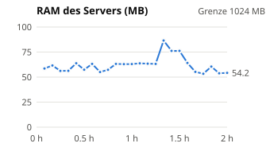
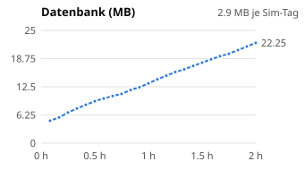
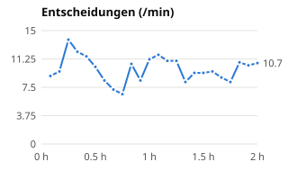
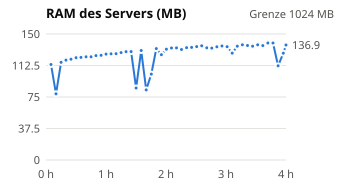
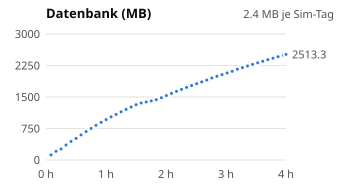
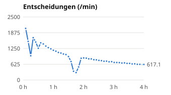

# Langlauf (AP11)

Erzeugt mit `scripts/langlauf_report.py` aus den Messreihen von `scripts/langlauf.py` (Messung alle 5 min, Server als eigener Prozess, ein WebSocket-Leser wie ein Browser). Grenzwerte aus AP11: RAM < 1 GB, DB-Wachstum < 50 MB je Sim-Tag, keine Fehlerserie > 5, keine überwachte Aktion ≥ 5× hintereinander, Gesprächslänge ≤ Höchstwert.

**Gesamtergebnis: alle Grenzwerte eingehalten.**

## Lauf `real` (echtes Modell)

- Start 2026-10-12 22:13:33, Dauer 2.00 h Echtzeit, Tempo `max`, Standard-Preset
- Modell `qwen3.8-9b` über `http://192.168.178.160:8080/v1`
- Simulierte Zeit: 7.4 Sim-Tage (Minute 420 bis 11057)
- Entscheidungen 1190 (gültig 1183, Rückfall 7), LLM-Aufrufe 1472, LLM-Fehler 6
- Ereignisse 14994, Objekte 39, Schutz-Eingriffe 41, Gespräche 96, fehlgeschlagene Aktionen 21
- Aktive Erinnerungen am Ende: alex 731, mira 706 (archiviert 938)

| Prüfung | Ergebnis |
|---|---|
| kein Absturz (25 Messungen, Server lief bis zum Ende) | ✅ |
| RAM höchstens 93.4 MB (Grenze 1024 MB) | ✅ |
| DB-Wachstum 2.89 MB je Sim-Tag (Grenze 50 MB) | ✅ |
| Fehlerserie höchstens alex 1, mira 2 (Grenze 5) | ✅ |
| gleiche überwachte Aktion in Folge höchstens alex 3, mira 2 (Grenze < 5) | ✅ |
| Gesprächslänge höchstens 8 Beiträge (Höchstwert 8) | ✅ |
| Lücken in den Ereignisnummern beim Mitlesen: 0 | ✅ |

Zur Information (nicht vom Wiederholungsschutz überwacht): längste Folge gleicher Aktionen einschließlich Warten und Gesprächszügen: alex 3× `speak:to=mira`, mira 2× `give:amount=1,resource=water,to=alex`.

| Uhrzeit | Sim-Zeit | Entsch./min | Rückfall | Ø Antwort s | RAM MB | DB MB | Ereign./min | Objekte | Erinnerungen | Eingriffe |
|---|---|---|---|---|---|---|---|---|---|---|
| 22:13 | T1 07:00 | 0 | 0 | 0.00 | 93.4 | 0.88 | 0 | 32 |  | 0 |
| 22:18 | T1 14:30 | 9 | 0 | 5.29 | 58.6 | 4.98 | 112 | 34 | 38/50 | 0 |
| 22:23 | T1 20:09 | 9.6 | 0 | 5.03 | 61.6 | 5.7 | 117.8 | 34 | 84/93 | 0 |
| 22:28 | T2 04:48 | 13.8 | 0 | 3.62 | 56.2 | 6.78 | 161.7 | 34 | 156/152 | 1 |
| 22:33 | T2 11:15 | 12.2 | 0 | 4.26 | 56.3 | 7.67 | 153.6 | 34 | 218/212 | 2 |
| 22:38 | T2 18:27 | 11.6 | 0 | 4.21 | 63.8 | 8.52 | 142.6 | 34 | 273/273 | 3 |
| 22:43 | T3 06:45 | 10.2 | 0 | 4.45 | 57.4 | 9.3 | 135 | 34 | 294/266 | 5 |
| 22:48 | T3 12:07 | 8.4 | 1 | 4.28 | 63.2 | 9.91 | 102.4 | 34 | 325/304 | 6 |
| 22:53 | T3 16:42 | 7.2 | 4 | 4.45 | 55.1 | 10.46 | 90.6 | 34 | 351/347 | 9 |
| 22:58 | T3 22:39 | 6.6 | 4 | 7.46 | 57.3 | 10.94 | 85.6 | 34 | 363/401 | 10 |
| 23:03 | T4 08:22 | 10.6 | 4 | 4.33 | 63.2 | 11.78 | 140 | 34 | 336/344 | 12 |
| 23:08 | T4 14:01 | 8.4 | 4 | 4.96 | 62.9 | 12.41 | 104.2 | 34 | 371/391 | 13 |
| 23:13 | T4 23:54 | 11.2 | 4 | 4.33 | 63 | 13.26 | 145.2 | 34 | 415/468 | 14 |
| 23:18 | T5 09:15 | 11.8 | 4 | 4.06 | 63.7 | 14.17 | 151.4 | 34 | 430/433 | 15 |
| 23:23 | T5 14:10 | 11 | 4 | 4.71 | 63.4 | 14.96 | 134 | 34 | 484/483 | 17 |
| 23:28 | T5 23:34 | 11 | 4 | 4.63 | 63.2 | 15.78 | 135.8 | 34 | 521/540 | 19 |
| 23:33 | T6 05:19 | 8.2 | 4 | 5.67 | 86.5 | 16.37 | 103.2 | 34 | 499/482 | 21 |
| 23:38 | T6 11:39 | 9.4 | 4 | 5.06 | 76.2 | 17.12 | 117.2 | 35 | 545/529 | 25 |
| 23:43 | T6 19:44 | 9.4 | 6 | 4.55 | 76.2 | 17.85 | 123.8 | 36 | 587/582 | 28 |
| 23:48 | T7 03:50 | 9.6 | 6 | 4.94 | 64.1 | 18.6 | 127.6 | 36 | 568/553 | 29 |
| 23:53 | T7 10:08 | 8.8 | 6 | 5.13 | 55.2 | 19.28 | 113 | 36 | 618/592 | 32 |
| 23:58 | T7 16:03 | 8.2 | 6 | 6.03 | 53.3 | 19.82 | 102.8 | 36 | 672/619 | 38 |
| 00:03 | T7 22:52 | 10.8 | 6 | 4.02 | 60.5 | 20.64 | 136.2 | 36 | 730/680 | 38 |
| 00:08 | T8 10:26 | 10.4 | 6 | 4.00 | 53.8 | 21.43 | 137.2 | 39 | 679/654 | 41 |
| 00:13 | T8 16:17 | 10.7 | 7 | 4.19 | 54.2 | 22.25 | 125 | 39 | 728/706 | 41 |

  

## Lauf `fake` (Fake-LLM)

- Start 2026-10-12 22:22:25, Dauer 4.00 h Echtzeit, Tempo `max`, Standard-Preset
- deterministisches Fake-LLM der Browser-Tests (kein Netz)
- Simulierte Zeit: 1027.0 Sim-Tage (Minute 420 bis 1479368)
- Entscheidungen 220146 (gültig 220146, Rückfall 0), LLM-Aufrufe 250692, LLM-Fehler 0
- Ereignisse 2251055, Objekte 41, Schutz-Eingriffe 16063, Gespräche 7, fehlgeschlagene Aktionen 0
- Aktive Erinnerungen am Ende: alex 2079, mira 2031 (archiviert 238120)

| Prüfung | Ergebnis |
|---|---|
| kein Absturz (49 Messungen, Server lief bis zum Ende) | ✅ |
| RAM höchstens 139.3 MB (Grenze 1024 MB) | ✅ |
| DB-Wachstum 2.45 MB je Sim-Tag (Grenze 50 MB) | ✅ |
| Fehlerserie höchstens alex 0, mira 0 (Grenze 5) | ✅ |
| gleiche überwachte Aktion in Folge höchstens alex 3, mira 3 (Grenze < 5) | ✅ |
| Gesprächslänge höchstens 2 Beiträge (Höchstwert 8) | ✅ |
| Lücken in den Ereignisnummern beim Mitlesen: 0 | ✅ |

Zur Information (nicht vom Wiederholungsschutz überwacht): längste Folge gleicher Aktionen einschließlich Warten und Gesprächszügen: alex 7× `wait:minutes=10`, mira 3× `use:mode=sit,object_id=bench_garden`.

| Uhrzeit | Sim-Zeit | Entsch./min | Rückfall | Ø Antwort s | RAM MB | DB MB | Ereign./min | Objekte | Erinnerungen | Eingriffe |
|---|---|---|---|---|---|---|---|---|---|---|
| 22:22 | T1 07:00 | 0 | 0 | 0.00 | 94.3 | 1.23 | 0 | 32 | 1 | 0 |
| 22:27 | T49 11:06 | 2048.2 | 0 | 0.00 | 113.7 | 121.18 | 21031.4 | 38 | 2080/2026 | 686 |
| 22:32 | T85 08:41 | 1531.2 | 0 | 0.00 | 78.8 | 207.88 | 15668.5 | 39 | 2061/2030 | 1250 |
| 22:37 | T107 18:34 | 963.2 | 0 | 0.00 | 116.3 | 262.61 | 9871 | 40 | 2126/2056 | 1575 |
| 22:42 | T147 06:10 | 1677.7 | 0 | 0.00 | 118.9 | 356.56 | 17204.9 | 41 | 2044/2022 | 2190 |
| 22:47 | T182 05:53 | 1505.3 | 0 | 0.00 | 120 | 441.75 | 15428.7 | 41 | 2036/2014 | 2710 |
| 22:52 | T211 04:22 | 1259.6 | 0 | 0.00 | 121.8 | 513.26 | 12892 | 41 | 2033/2012 | 3175 |
| 22:57 | T245 13:02 | 1474.5 | 0 | 0.00 | 122.1 | 596.7 | 15082 | 41 | 2094/2040 | 3705 |
| 23:02 | T278 10:37 | 1430 | 0 | 0.00 | 122.8 | 676.79 | 14618.1 | 41 | 2070/2030 | 4223 |
| 23:07 | T310 05:05 | 1347.5 | 0 | 0.00 | 122.9 | 752.8 | 13834.4 | 41 | 2033/2018 | 4732 |
| 23:12 | T340 07:08 | 1283.5 | 0 | 0.00 | 124.3 | 825.3 | 13143.3 | 41 | 2053/2017 | 5199 |
| 23:17 | T369 06:10 | 1235.2 | 0 | 0.00 | 124.7 | 894.79 | 12646.8 | 41 | 2046/2014 | 5679 |
| 23:22 | T396 20:37 | 1181 | 0 | 0.00 | 126.1 | 961.17 | 12051.1 | 41 | 2146/2059 | 6087 |
| 23:27 | T423 10:29 | 1141.9 | 0 | 0.00 | 126.4 | 1025.06 | 11645.5 | 41 | 2075/2036 | 6507 |
| 23:32 | T449 07:53 | 1092.7 | 0 | 0.00 | 126.5 | 1086.58 | 11176.1 | 41 | 2046/2020 | 6895 |
| 23:37 | T474 06:29 | 1069.5 | 0 | 0.00 | 127.8 | 1147.61 | 10901.1 | 41 | 2045/2012 | 7266 |
| 23:42 | T498 14:42 | 1031 | 0 | 0.00 | 128.9 | 1205.9 | 10564.7 | 41 | 2107/2043 | 7655 |
| 23:47 | T521 20:37 | 1009.3 | 0 | 0.00 | 129.1 | 1262.4 | 10306.3 | 41 | 2129/2079 | 8039 |
| 23:52 | T543 07:54 | 931.1 | 0 | 0.00 | 85.7 | 1316.17 | 9475.4 | 41 | 2057/2018 | 8384 |
| 23:57 | T560 09:30 | 733.6 | 0 | 0.00 | 130.4 | 1357.28 | 7505.3 | 41 | 2073/2020 | 8670 |
| 00:02 | T568 13:25 | 347.9 | 0 | 0.00 | 83.5 | 1381.66 | 3577.4 | 41 | 2097/2029 | 8795 |
| 00:07 | T575 12:04 | 296.6 | 0 | 0.00 | 102.3 | 1406.38 | 2994.1 | 41 | 2082/2036 | 8908 |
| 00:12 | T587 14:26 | 517.3 | 0 | 0.00 | 132.6 | 1435.82 | 5273.6 | 41 | 2093/2047 | 9100 |
| 00:17 | T607 16:08 | 862.7 | 0 | 0.00 | 125.3 | 1484.22 | 8853 | 41 | 2104/2054 | 9424 |
| 00:22 | T628 08:17 | 875.1 | 0 | 0.00 | 131.9 | 1533.44 | 8949.7 | 41 | 2053/2026 | 9766 |
| 00:27 | T649 01:19 | 866.3 | 0 | 0.00 | 133.3 | 1586.83 | 8784 | 41 | 2010/2004 | 10085 |
| 00:32 | T668 16:36 | 839.2 | 0 | 0.00 | 133.5 | 1634.38 | 8587.9 | 41 | 2119/2044 | 10402 |
| 00:37 | T688 06:50 | 837 | 0 | 0.00 | 131.5 | 1681.6 | 8594.4 | 41 | 2050/2021 | 10737 |
| 00:43 | T707 10:45 | 806.3 | 0 | 0.00 | 133.7 | 1727.43 | 8224.1 | 41 | 2075/2025 | 11036 |
| 00:48 | T726 12:36 | 800.3 | 0 | 0.00 | 134 | 1773.01 | 8181.6 | 41 | 2077/2048 | 11307 |
| 00:53 | T744 22:28 | 777.8 | 0 | 0.00 | 135 | 1817.07 | 7963.7 | 41 | 2153/2067 | 11607 |
| 00:58 | T763 00:00 | 768.4 | 0 | 0.00 | 135.9 | 1860.61 | 7902.7 | 41 | 2000/2000 | 11901 |
| 01:03 | T780 19:04 | 744.3 | 0 | 0.00 | 133.6 | 1902.86 | 7671.4 | 41 | 2145/2053 | 12178 |
| 01:08 | T798 11:25 | 748.3 | 0 | 0.00 | 133.2 | 1951.41 | 7560.2 | 41 | 2079/2021 | 12453 |
| 01:13 | T815 14:10 | 722.2 | 0 | 0.00 | 134.8 | 1993.03 | 7424.8 | 41 | 2084/2039 | 12725 |
| 01:18 | T832 21:55 | 728.7 | 0 | 0.00 | 135.7 | 2033.33 | 7363.5 | 41 | 2150/2080 | 12996 |
| 01:23 | T849 14:09 | 695.8 | 0 | 0.00 | 134.9 | 2073.57 | 7139.4 | 41 | 2104/2040 | 13251 |
| 01:28 | T865 23:18 | 693.5 | 0 | 0.00 | 127.3 | 2112.79 | 7157.7 | 41 | 2155/2086 | 13523 |
| 01:33 | T882 11:13 | 690.7 | 0 | 0.00 | 135.5 | 2161.3 | 6982.7 | 41 | 2069/2029 | 13768 |
| 01:38 | T898 08:14 | 673.1 | 0 | 0.00 | 137.2 | 2199.55 | 6883 | 41 | 2054/2030 | 14025 |
| 01:43 | T914 02:37 | 679.1 | 0 | 0.00 | 136.3 | 2238.33 | 6942.4 | 41 | 2020/2009 | 14281 |
| 01:49 | T929 12:40 | 659.3 | 0 | 0.00 | 135.5 | 2276.05 | 6687.7 | 41 | 2079/2042 | 14511 |
| 01:54 | T945 11:14 | 659.4 | 0 | 0.00 | 137.1 | 2313.95 | 6727 | 41 | 2070/2023 | 14777 |
| 01:59 | T960 17:42 | 637.7 | 0 | 0.00 | 136.2 | 2350.29 | 6526.9 | 41 | 2125/2052 | 15016 |
| 02:04 | T976 04:22 | 641.8 | 0 | 0.00 | 139.3 | 2387.4 | 6592.5 | 41 | 2032/2015 | 15257 |
| 02:09 | T990 21:56 | 623.3 | 0 | 0.00 | 139.3 | 2423.19 | 6344.3 | 41 | 2155/2066 | 15493 |
| 02:14 | T1005 17:22 | 621 | 0 | 0.00 | 112.2 | 2459.04 | 6364.2 | 41 | 2105/2055 | 15719 |
| 02:19 | T1020 14:40 | 613.4 | 0 | 0.00 | 127.2 | 2494.57 | 6247.5 | 41 | 2090/2043 | 15950 |
| 02:22 | T1028 08:08 | 617.1 | 0 | 0.00 | 136.9 | 2513.3 | 6221.3 | 41 | 2050/2020 | 16063 |

  

